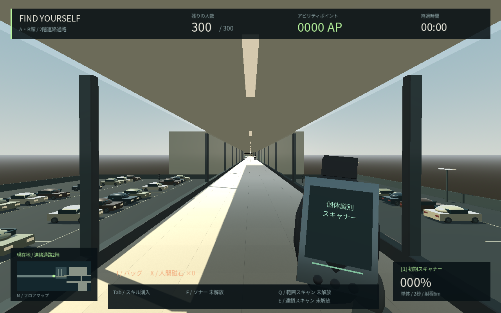
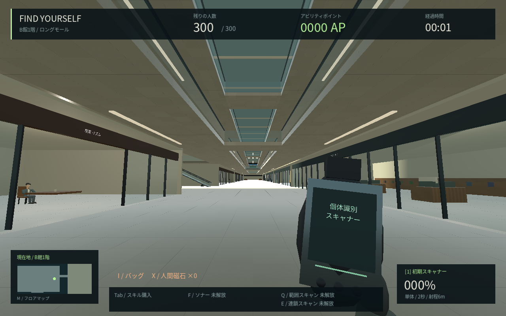
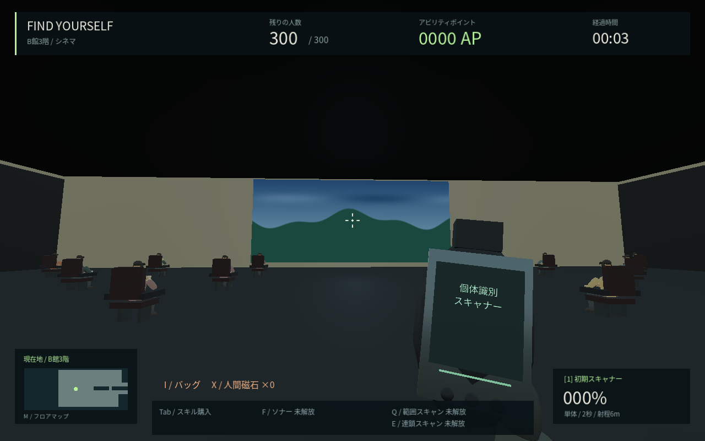

# FIND YOURSELF

**巨大モールにいる、自分と同じ顔の5,000人。その中の「本当の自分」を見つけるPCゲーム。**

Godot 4.6.3 / GDScript。現在は **0.8・軽量化とA・B館の接続を進めた日本語開発版**です。Steam販売版は開発中です。

0.8では移動中の負荷に対応し、モールの描画を区画ごとにまとめ、遠くの人物を簡易表示にしました。建物と経路の事前生成で読み込み時の処理も削減。Escから「軽量・標準・高画質」を切り替え、使用中のGPU名を確認できます。[比較の条件と結果](docs/PERFORMANCE.md)を公開しています。Windows実機でのFPSは未測定です。

B館は1〜3階の長い吹き抜け通路と各階8店舗、家電売場・生活用品売場・映画館を追加。A館とは2階のガラス張り連絡通路と1階の駐車場側歩行路で行き来できます。A館の地下・1〜3階・屋上も維持しています。現在は300人、訪問済み移動地点は15か所です。







人物は既存の独自モデルを維持し、近距離の詳細表示と遠距離の簡易表示を使い分けています。ペルソナ5相当の人物品質や商用の内装品質にはまだ達していません。

過去の変更は [更新内容](docs/CHANGELOG.md)、確定した仕様と仮設定の区別は [開発仕様](docs/DESIGN.md) を参照してください。

## すぐに遊ぶ

Smart App ControlでEXEがブロックされる場合は、[ソース版ZIP](https://github.com/tapiosan666-coder/1/raw/refs/heads/main/downloads/FIND_YOURSELF-Source.zip)と[Godotからの起動手順](docs/GODOT起動手順.md)を使用できます。公式Godot側の起動可否は端末のポリシーによります。

[Windows版ZIPをダウンロード](https://github.com/tapiosan666-coder/1/raw/refs/heads/main/downloads/FIND_YOURSELF-Windows.zip) → ZIPを右クリックして「すべて展開」→ 展開先の `FIND_YOURSELF.exe` を開いてください。


Windows用配布ビルドは `builds/FIND_YOURSELF-Windows.zip`、Linux用は `builds/FIND_YOURSELF-Linux.zip`。ZIPをすべて展開し、Windowsでは `FIND_YOURSELF.exe` をダブルクリックしてください。Linuxでは `./FIND_YOURSELF.x86_64` で起動します。PCKファイルを実行ファイルと同じフォルダーに置いてください。

Windowsバイナリはクロスビルド済みですが、このクラウド環境ではWindowsでの実行確認はできていません。Linuxでは描画・ゲーム動作・配布ビルド起動を検証しています。配布物は開発版です。Steamへの公開はしていません。

ソースから起動する場合：

1. [Godot 4.6.3 Standard版](https://godotengine.org/download/archive/4.6.3-stable/)をインストールします。.NET版は不要です。
2. Godotの「インポート」で、このフォルダーの `project.godot` を選びます。
3. **F6ではなくF5**でプロジェクトを実行します。
4. タイトル画面で肌・髪・顔幅を設定して **「探索をはじめる」** を押します。

ゲームにPython、Node.js、外部APIキーは不要です。UIは日本語です。日本語フォントを同梱しているため、追加インストールは不要です。写真からの顔生成は未実装です。

## 操作

| 操作 | キー |
| --- | --- |
| 移動 / 視点 | WASD / マウス |
| 初期スキャナー / 照準 | 左クリックを同じ1人へ2秒長押し / 右クリック |
| 装備切替 | 1：初期スキャナー / 2：購入済みスキャン銃 |
| リロード / ジャンプ / ダッシュ | R / Space / Shift |
| AP強化パネル | Tab |
| 瞬間ソナー / 範囲スキャン | F / Q（APで解放）|
| 連鎖スキャン / 二段ジャンプ | E / 空中でSpace（APで解放）|
| 案内図 / 訪問済み地点へ移動 | M（移動は100 APで解放後、目的地をクリック）|
| 宝箱を開ける / バッグ / 選択アイテムを使用 | G（近づいて） / I / X |
| 一時停止・再開 | Esc |

初期装備は手持ちの初期スキャナーです。6m以内の同じNPCを2秒間捉えながら左クリックを長押ししてください。対象変更・ボタンを離す・遮蔽・範囲外で途中進捗はリセットされます。偽物は床に落下し10 AP。Tabの「スキャン銃」を1,000 APで購入（300人版の仮設定）すると、2キーで銃を使えます。銃の強化は銃購入後に解放されます。銃・猫・範囲スキャンで本物を見つけてもクリアしません。必ず1キーで最初のスキャナーに戻し、本物を2秒間調べて確定します。

貫通スキャンは150 AP（銃購入が前提）、1発が最大3人に命中し壁で停止。連鎖スキャンは180 AP、照準した相手から5m以内・壁に遮られない近隣へ最大8人、再使用20秒。二段ジャンプは80 AP、着地で空中ジャンプが1回復活します。価格と人数は開発用の仮設定です。

ファストトラベルは100 AP。A館の従来10地点と、A・B連絡通路・B館東入口・B館2階ラウンジ・B館3階シネマ・B館家電売場の案内ポイントから2m以内に近づくと訪問を記録します。Mのマップで訪問済みの地点だけを選択できます。新しいプレイでは訪問記録もリセットされます。

## 現在遊べる範囲

- 架空のA館の開発用区画を地下・1〜3階・屋上へ接続。西側階段で5階層を歩いて往復でき、1階から西駐車場へ通じる。地下に7つの食品カウンターと食品棚、屋上に植栽・ベンチ、西駐車場に40台の静止車両と歩行者通路。
- 既存の1〜3階。約180mの湾曲する主通路と3層の吹き抜け、各階12専門店、橋、2本のエスカレーター。1階には大型食品スーパー、回遊通路、フードコート、お手洗い、読書コーナー、バックヤード。
- B館は1〜3階の長大通路、各階8専門店と西側の大型売場、2本のエスカレーター。3階の映画館には18人の着席客。A館2階から連絡通路へ進むか、西駐車場の歩行路からB館1階へ入る。
- 300人は全員同じ顔。定位置の267人（店員・買い物・読書・着席・会話・お手洗い・休憩）と歩行33人。近くの相手には日本語の吹き出し。表示を簡略化してもID・位置・スキャン判定を保持する。
- FPS移動・ダッシュ・ジャンプ・ADS。初期は単体・2秒・6mのスキャナー。途中で購入する銃は30m・5発・30発弾倉・1秒リロード・無限予備弾。
- 固定・等確率の本物、偽物だけの落下、AP、コンボ、合成サウンド、勝利・再プレイ。
- 4系統14種類の強化。ソナーは15→30→50→80→120m、4秒間の静止スナップショット。壁を透過するが本物は判別しない。
- 猫1匹（20→12→6秒の接近スキャン）、範囲スキャン（8→12→16m）。銃・猫・宝箱アイテムも本物は通知のみで、初期スキャナーだけが確定できる。
- 毎プレイ10宝箱（通常6・レア3・伝説1）、到達可能な経路点からランダム配置。人間磁石・超連鎖弾・時間停止時計・ブラックホール・全域ソナーチップ・スーパーカート・天井レーザー・ディスコフィーバー。数値は仮設定（詳細はDESIGN.md）。
- ポーズ、画質設定、スキル、バッグ、5階層を切り替える案内図、訪問済み15地点のみのファストトラベル。B館地下・屋上、C館と残る連絡通路は今後追加する。

**5,000人の識別ロジックは自動テスト済みですが、5,000人の描画・15フロア・平均3時間のゲームプレイを完成したという意味ではありません。** 全体の確定仕様・実装状況は [DESIGN.md](docs/DESIGN.md) に記録しています。

## 開発・検証

```bash
# リポジトリのルートで実行
godot --headless --editor --import --quit
godot --headless --script res://tests/test_game.gd
godot --headless --script res://tests/test_expansion.gd
godot --headless --script res://tests/test_annex.gd
godot --headless --script res://tests/test_wing_b.gd
godot --path .

# 設計シミュレーションのみPythonが必要
python3 -m venv .venv  # ローカルで任意。クラウドでは以下のsetup_cloud.shを使う
.venv/bin/pip install -r tools/requirements.txt
.venv/bin/python tools/simulate_balance.py --trials 100000 --seed 20261023
```

建物・什器・群衆経路を変更した場合、`godot --headless --path . --script res://tools/build_world.gd -- --rebuild-world` で事前生成データを更新してください。配布ZIP作成時には入力スクリプトのハッシュ一致を検査します。

クラウドでの再セットアップは `bash tools/setup_cloud.sh`。現在のチェックアウトをそのまま使います。公開用にソースをZIP化する際、`.godot/`、`.git/`、`builds/`、仮想環境を含めないでください。

公式の同バージョンのexport templatesをGodotに導入すると、`godot --headless --export-release Windows` / `godot --headless --export-release Linux` でネイティブ実行ファイルを生成できます。クラウド設定ではテンプレートは `/workspace/.local/share/godot/export_templates/4.6.3.stable` に保存し、`XDG_DATA_HOME=/workspace/.local/share` を指定しています。

## 試算と次の段階

[10万回の結果と仮定](docs/BALANCE.md)は、未実装の完成版を想定した集約モデルです。実測のプレイ時間ではありません。0.2時点の集約モデルの仮定では平均210.6分、中央値205.8分です。180分の目標への調整と、長時間化する裾の改善が必要です。旧版の90.8分は現在の仕様の結果ではありません。本物の確率操作や配置変更で時間を引き延ばすことはしません。

次は人物・店舗の素材と動作、店員や客の行動の細部、実プレイ計測を進めます。B館の地下・屋上、C館、完成版の残りの区画、5,000人での描画とAI性能検証は今後の工程です。写真顔生成、セーブ／ロード、キー割り当て・音量設定、その他の言語対応、Steam連携・ストア素材・対象PCでのQAも販売前に必要です。

Godotと配布ランタイムに関する表示は [THIRD_PARTY_NOTICES.md](THIRD_PARTY_NOTICES.md) を参照してください。

人物アセットの再生成は任意です。通常のプレイとソースのインポートにはBlenderは不要です。制作手順と現状の限界は [美術・間取りの制作記録](docs/ART_AND_LAYOUT.md) を参照してください。
