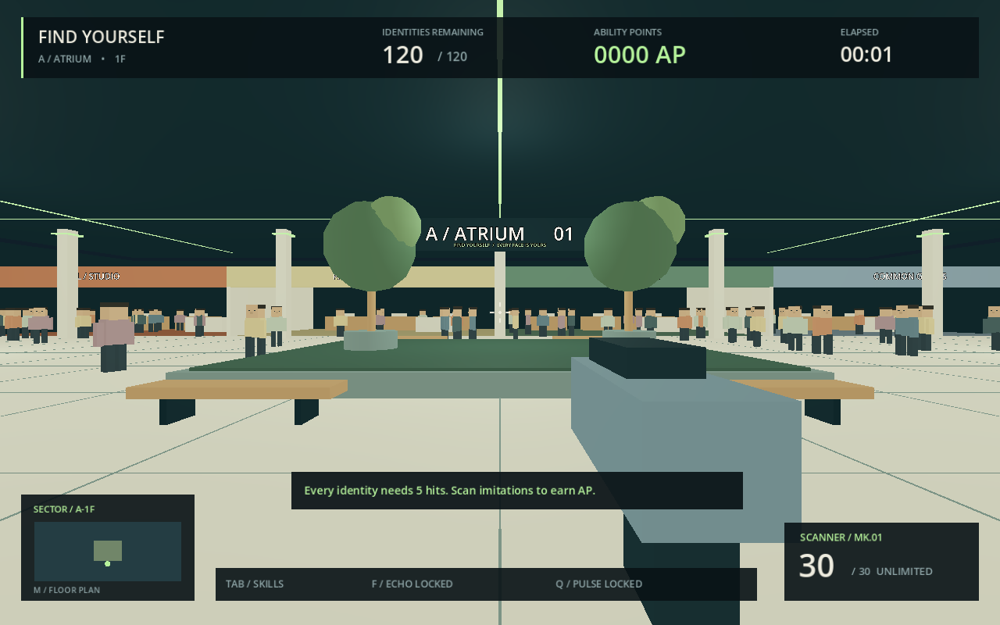

# FIND YOURSELF

**巨大モールにいる、自分と同じ顔の5,000人。その中の「本当の自分」を見つけるPCゲーム。**

Godot 4.6.3 / GDScript。現在のバージョンは **0.1・A館1階のプレイ可能な開発版**です。Steam販売版の完成品ではありません。指定された段階的開発に従い、第1段階の基本ループと、第2段階の一部を実装しています。



## すぐに遊ぶ

[Windows版ZIPをダウンロード](https://github.com/tapiosan666-coder/1/raw/refs/heads/main/downloads/FIND_YOURSELF-Windows.zip) → ZIPを右クリックして「すべて展開」→ 展開先の `FIND_YOURSELF.exe` を開いてください。


Windows用配布ビルドは `builds/FIND_YOURSELF-Windows.zip`、Linux用は `builds/FIND_YOURSELF-Linux.zip`。ZIPをすべて展開し、Windowsでは `FIND_YOURSELF.exe` をダブルクリックしてください。Linuxでは `./FIND_YOURSELF.x86_64` で起動します。PCKファイルを実行ファイルと同じフォルダーに置いてください。

Windowsバイナリはクロスビルド済みですが、このクラウド環境ではWindowsでの実行確認はできていません。Linuxでは描画・ゲーム動作・配布ビルド起動を検証しています。配布物は開発版です。Steamへの公開はしていません。

ソースから起動する場合：

1. [Godot 4.6.3 Standard版](https://godotengine.org/download/archive/4.6.3-stable/)をインストールします。.NET版は不要です。
2. Godotの「インポート」で、このフォルダーの `project.godot` を選びます。
3. **F6ではなくF5**でプロジェクトを実行します。
4. タイトル画面で肌・髪・顔幅を設定して **ENTER THE ATRIUM** を押します。

ゲームにPython、Node.js、外部APIキーは不要です。UIは現在英語です。写真からの顔生成と日本語UIは未実装です。

## 操作

| 操作 | キー |
| --- | --- |
| 移動 / 視点 | WASD / マウス |
| スキャン / 照準 | 左クリック（長押し可）/ 右クリック |
| リロード / ジャンプ / ダッシュ | R / Space / Shift |
| AP強化パネル | Tab |
| 瞬間ソナー / 範囲スキャン | F / Q（APで解放）|
| 現在フロアの案内図 | M |
| 一時停止・再開 | Esc |

まず同じNPCに5発当ててください。偽物は床の穴に落下し、10 APを獲得します。APで必要命中数や弾数、ソナー、猫、範囲スキャンなどを強化できます。猫や範囲スキャンが本物を検出するとビーコンが表示されます。最後はプレイヤー自身が通常銃でスキャンしてクリアしてください。

## 現在遊べる範囲

- 架空のA館1階、8店舗に入れる回遊式アトリウム、120人の検証用NPC。
- FPS移動・ダッシュ・ジャンプ・ADS、30m射程・5発確定・30発弾倉・1秒リロード・無限予備弾。
- 同じ顔と服装差、グリッド経路探索、歩行・買い物先での待機。
- 固定・等確率の本物、偽物だけの落下、AP、コンボ、合成サウンド、勝利・再プレイ。
- 4系統9種類の強化。ソナーは15→30→50→80→120m、4秒間の静止スナップショット。壁を透過するが本物は判別しない。
- 猫1匹（20→12→6秒の接近スキャン）、範囲スキャン（8→12→16m）。両者は本物を自動確定しない。
- ポーズ、スキル画面、案内図。案内図の未訪問場所への移動機能は設けていません。

**5,000人の識別ロジックは自動テスト済みですが、5,000人の描画・15フロア・平均3時間のゲームプレイを完成したという意味ではありません。** 全体の確定仕様・実装状況は [DESIGN.md](docs/DESIGN.md) に記録しています。

## 開発・検証

```bash
# リポジトリのルートで実行
godot --headless --editor --import --quit
godot --headless --script res://tests/test_game.gd
godot --path .

# 設計シミュレーションのみPythonが必要
python3 -m venv .venv  # ローカルで任意。クラウドでは以下のsetup_cloud.shを使う
.venv/bin/pip install -r tools/requirements.txt
.venv/bin/python tools/simulate_balance.py --trials 100000 --seed 20261023
```

クラウドでの再セットアップは `bash tools/setup_cloud.sh`。現在のチェックアウトをそのまま使います。公開用にソースをZIP化する際、`.godot/`、`.git/`、`builds/`、仮想環境を含めないでください。

公式の同バージョンのexport templatesをGodotに導入すると、`godot --headless --export-release Windows` / `godot --headless --export-release Linux` でネイティブ実行ファイルを生成できます。クラウド設定ではテンプレートは `/workspace/.local/share/godot/export_templates/4.6.3.stable` に保存し、`XDG_DATA_HOME=/workspace/.local/share` を指定しています。

## 試算と次の段階

[10万回の結果と仮定](docs/BALANCE.md)は、未実装の完成版を想定した集約モデルです。実測のプレイ時間ではありません。現在の仮定では平均90.8分、中央値80.3分で、目標180分は未達です。本物の確率操作や配置変更で時間を引き延ばすことはしません。

次の開発では第2段階の残りと実プレイ計測を進め、その後A/B/C館・15フロア、探索・宝箱、5,000人のLODとAI最適化に進みます。写真顔生成、セーブ／ロード、設定・キー割り当て、日本語化、Steam連携・ストア素材・対象PCでのQAも販売前に必要です。

Godotと配布ランタイムに関する表示は [THIRD_PARTY_NOTICES.md](THIRD_PARTY_NOTICES.md) を参照してください。
