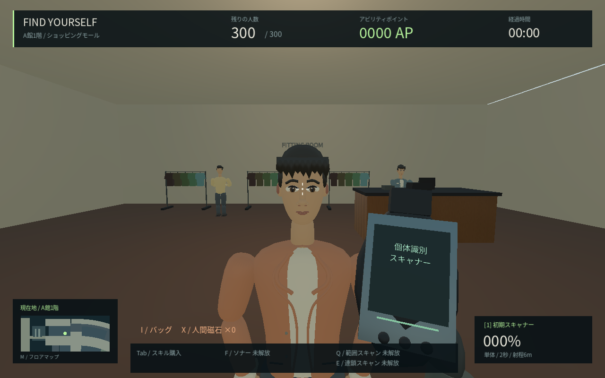
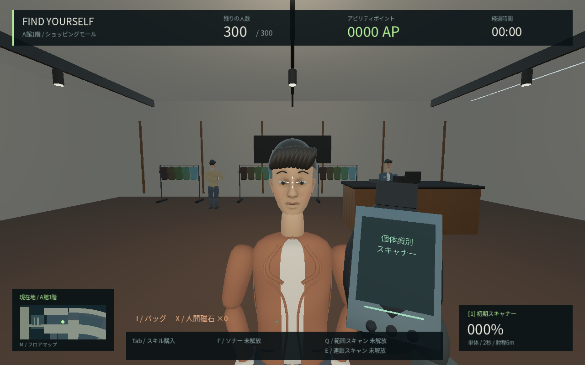
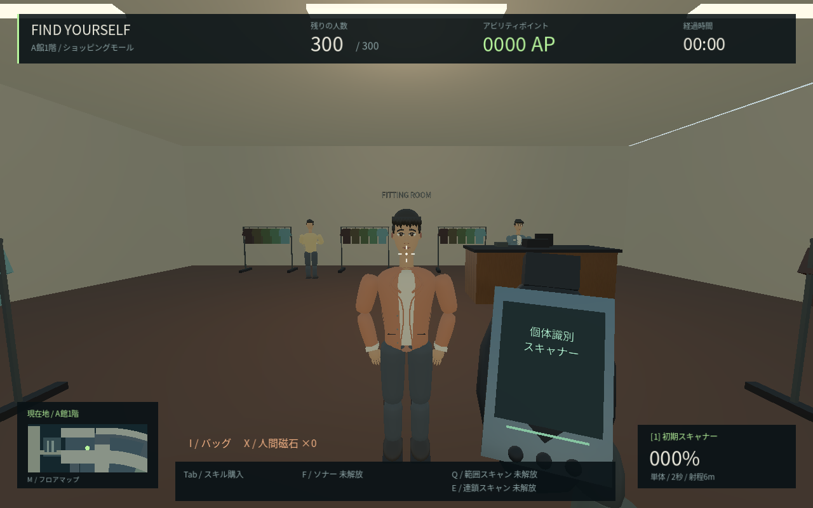
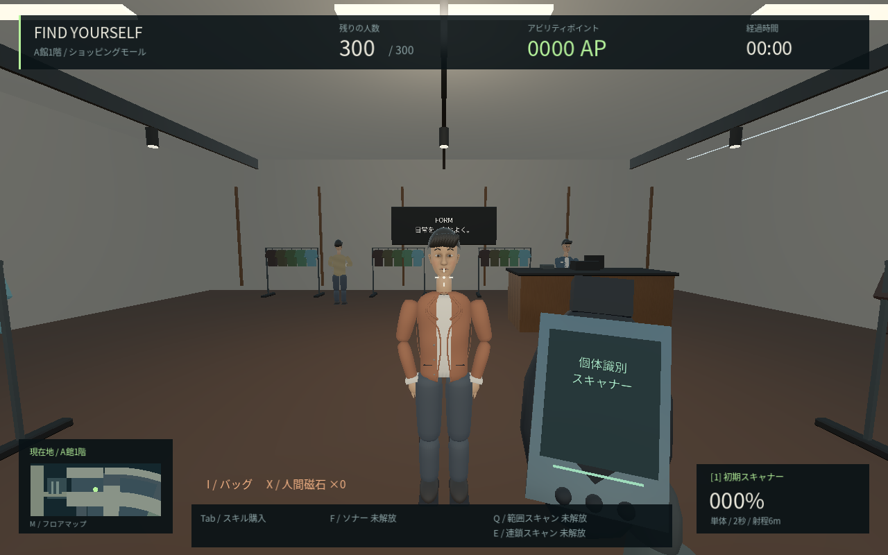
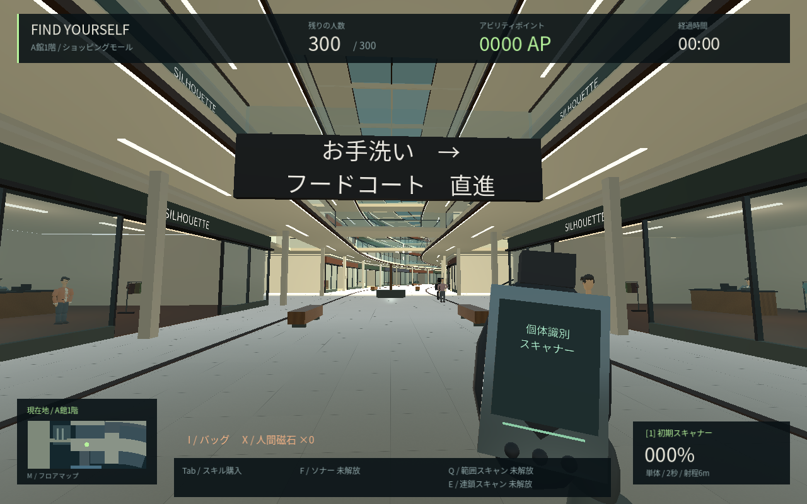
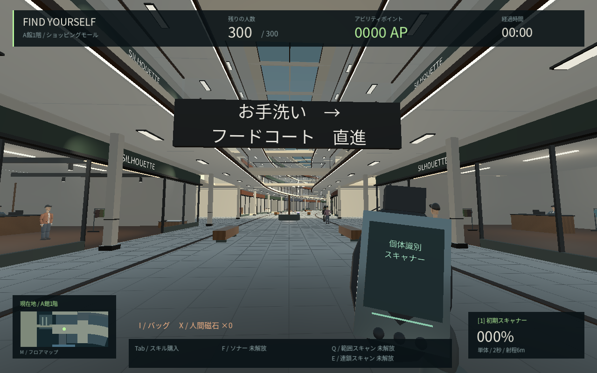
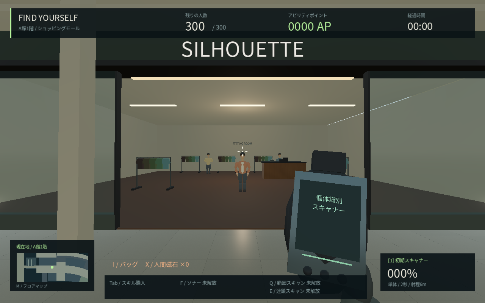
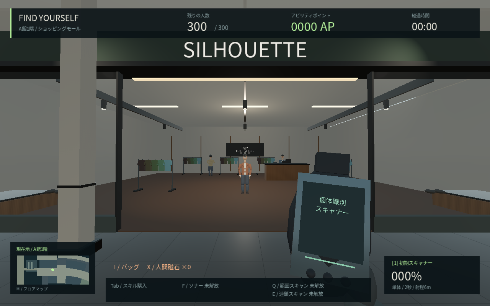
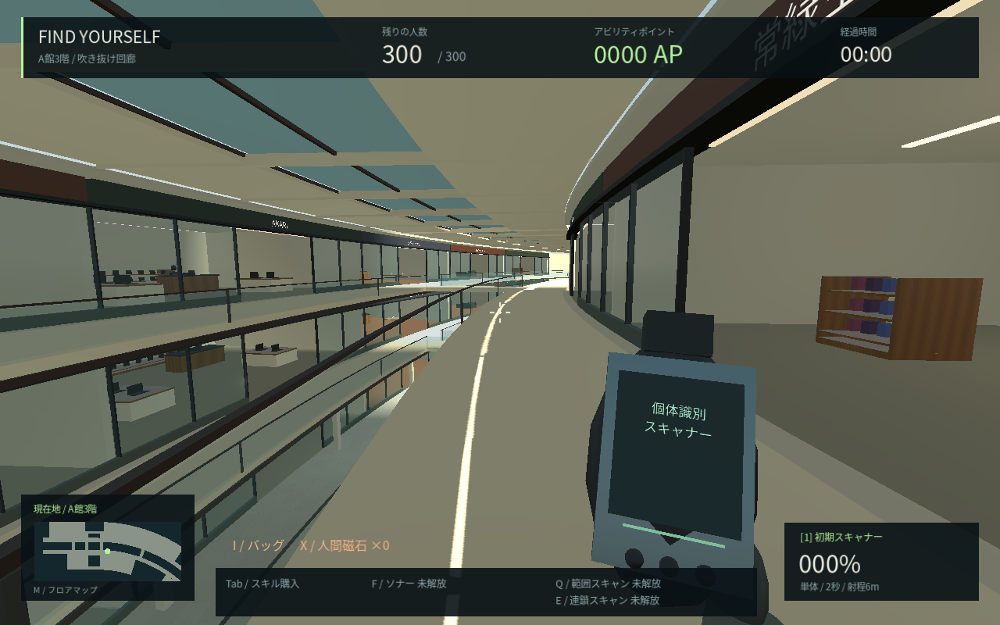
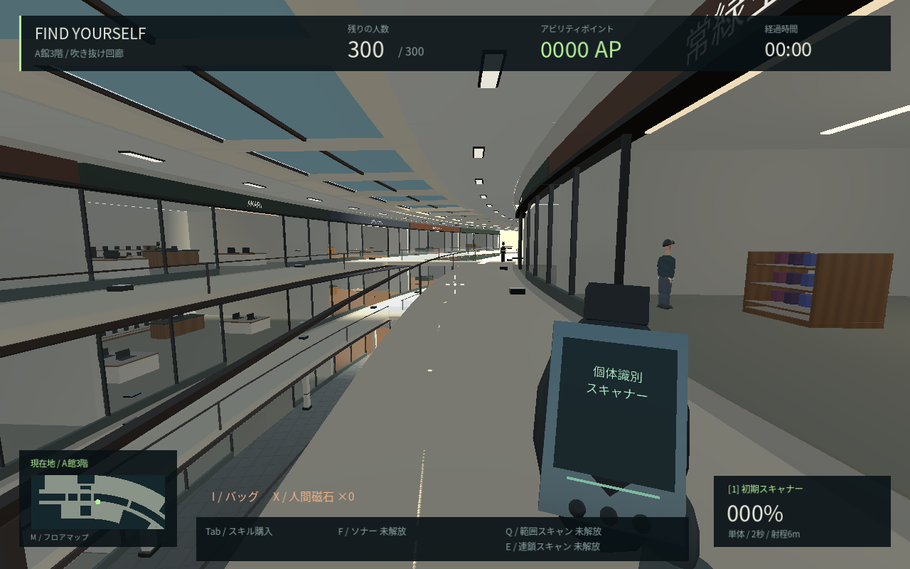

# 0.9 → 0.10の美術比較

人物とA館の見た目を優先した最初の更新。『8番出口』相当の現実感は目標であり、この画像が同等品質に到達したという意味ではない。顔はCC0の人体メッシュを土台に変形し、肌・髪・布の材質、自己遮蔽、体格を調整した。A館の天井・器具・床・壁とファッション店の仕上げを追加している。

| 対象 | 変更前：0.9 | 変更後：0.10 |
| --- | --- | --- |
| 近距離の顔 |  |  |
| 全身 |  |  |
| 回廊 |  |  |
| 店舗 |  |  |
| 上階 |  |  |

Linux、Godot 4.6.3 Compatibility、Mesa llvmpipe、1280×800、300人、標準画質。変更前はコミット7743ba1の保存したソース、変更後は0.10のLinux release export。同じカメラ・主対象の位置と姿勢を使い、照明・造形・材質の変更をそのまま撮影した。後から明るさや色の画像補正はしていない。背景の歩行客の初期位置は同一を保証していない。

撮影では開発用に主対象1人を固定し、通常プレイで本物の位置を変更する機能は追加していない。現版は`-- --capture-art`で撮影できる。旧ソースを比較するための独立した撮影スクリプトは`tools/capture_art.gd`。出力先は`/tmp/fy10-*.png`（クラウド開発用）。

顔の素材の取得元と権利は[制作記録](ART_AND_LAYOUT.md)と[表示](../THIRD_PARTY_NOTICES.md)を参照。次に必要なのは肌・衣服・髪のテクスチャ、関節の自然なつながりと衣服変形、表情、店舗ごとの内装と照明の仕上げ。全館を同じ品質へ仕上げた段階ではない。

美術を加えた分、描画負荷も増えている。[計測条件と数値](PERFORMANCE.md)を公開している。Windows実機でのFPSや5,000人での動作を保証する比較ではない。
