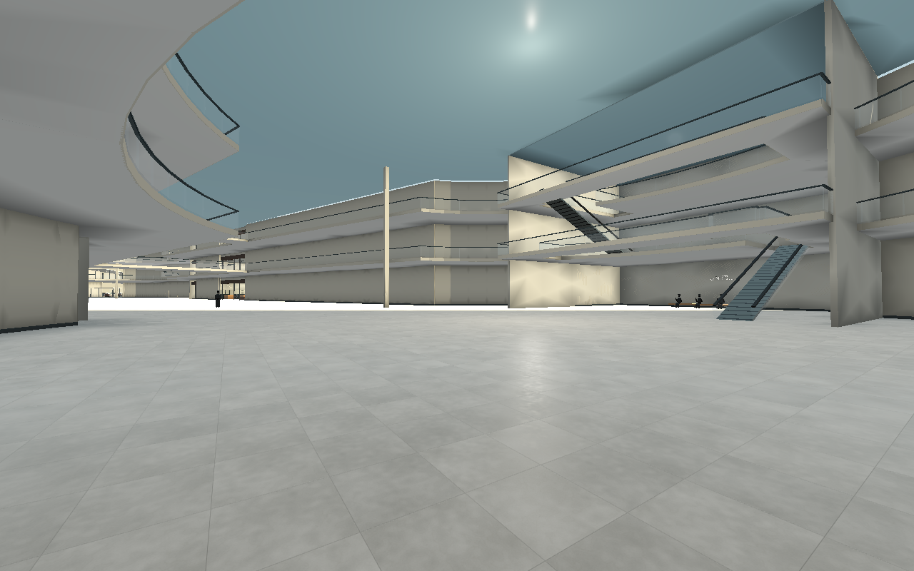
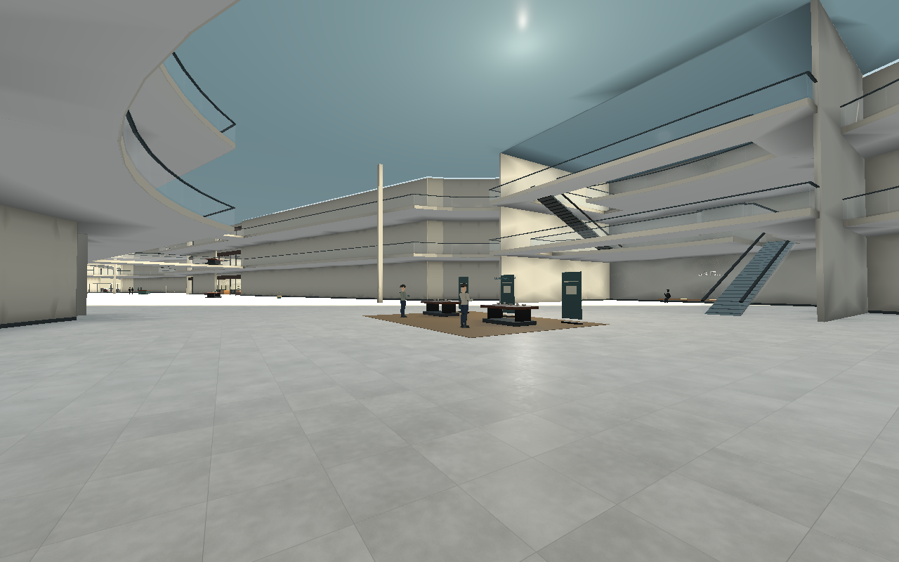
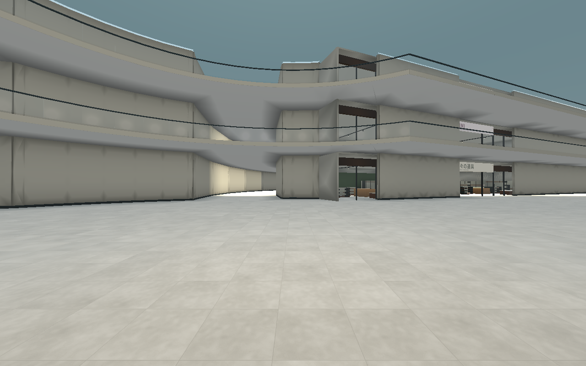
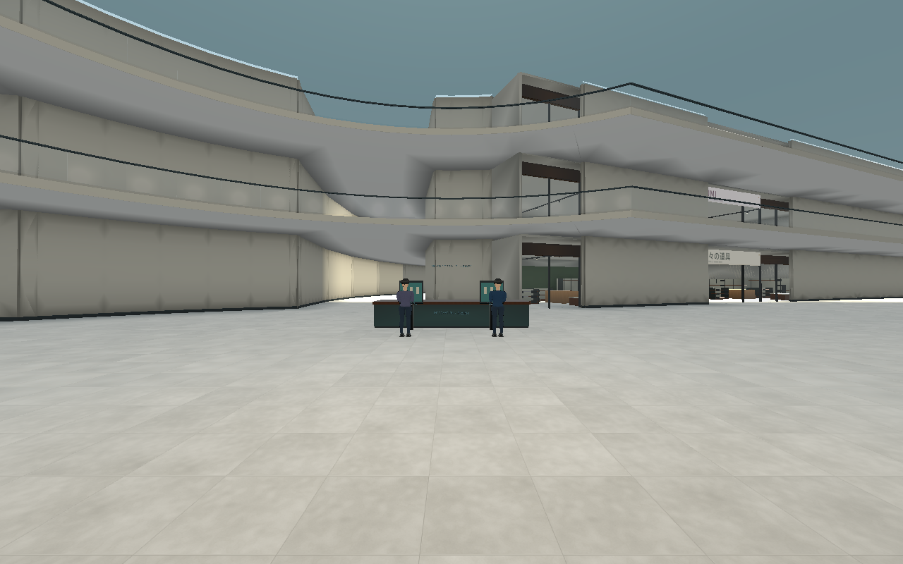
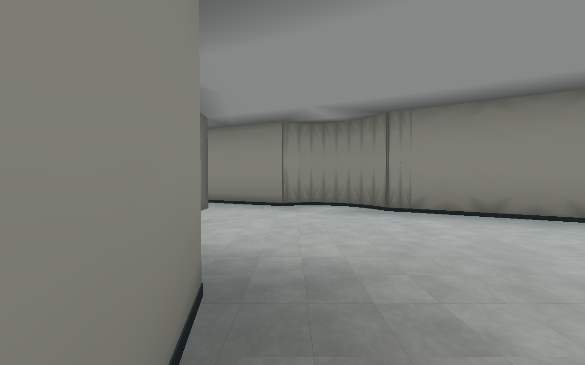
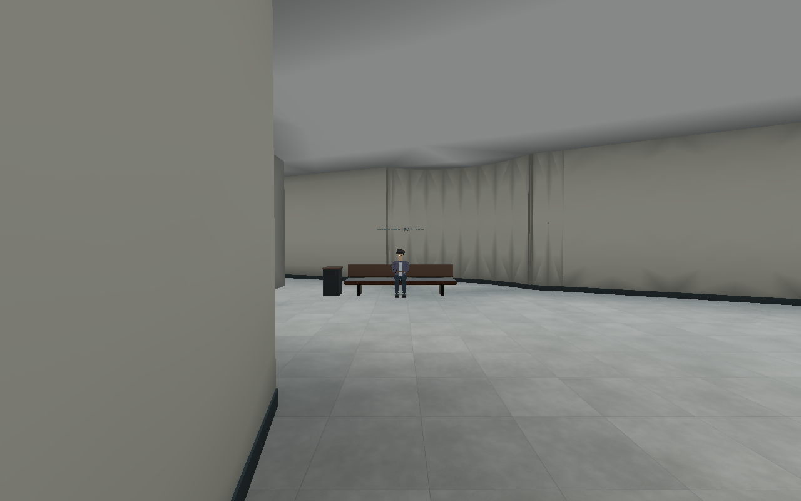
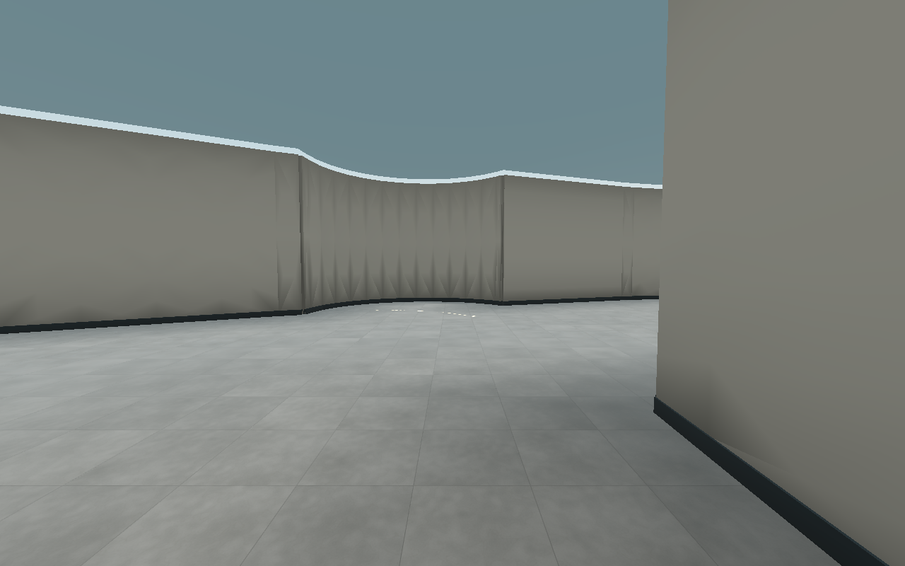
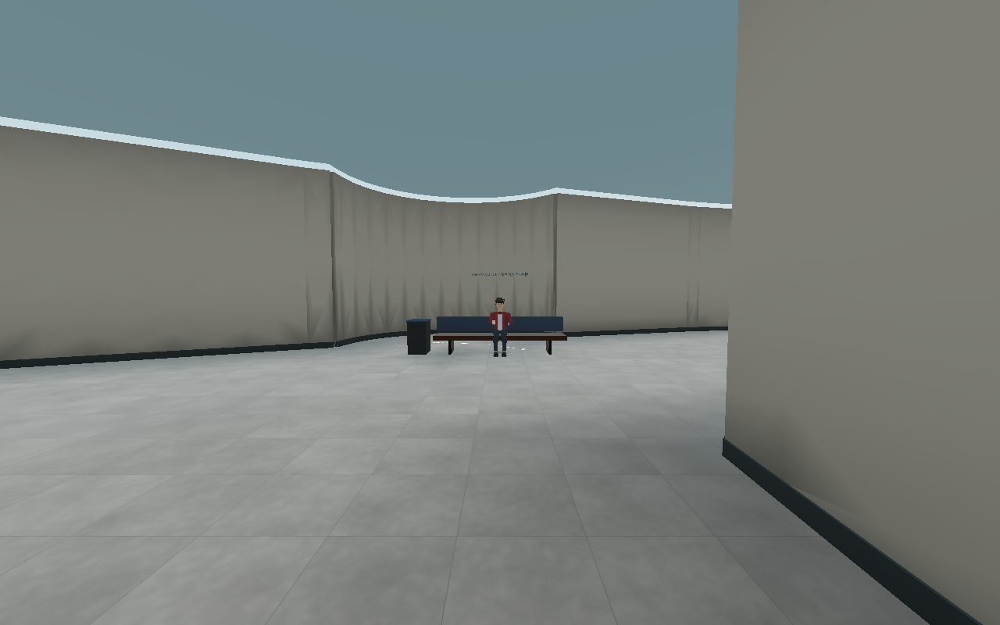

# B館の回廊と立寄場所 — 0.21

## 空疎に見える原因

0.20の実画面とゲームの床・店舗定義を確認したところ、B館は約322m×160mの範囲に、各階8専門店と西側の大型売場だけが配置されていた。床定義の中心線を測ると、主回廊は約281m、湾曲する背面回廊は約357m（階段や寄り道を除く平面の設計値）。床面積は1階約22,779㎡、2階約16,441㎡、3階約16,118㎡。3つの広場や長い背面回廊ができても、店・設備・人の配置が以前の少店舗構成のままだったため、「遠くまで歩いても同じ壁と空床が続く」状態になっていた。

特に、背面の回遊路には店や使う設備が少なく、探索の目的地が乏しい。3広場の1階中央も広さに対して用途がなく、上階から見下ろしても人がいなかった。NPCの多くは店内・映画館・カフェへ固定されていた。

C館1階の30人、今回C館2階の9人を既存枠から配置した後、B館の固定NPCは83人、そのうち立って商品を見る客は17人だった。実際の保存済み配置から数えた開発用300人版の値であり、5,000人を配置した検証結果ではない。

## 今回の変更

A館の間取りや方向性を維持し、B館の既存床・吹き抜け・店舗・橋を変えずに、人が立ち寄る12の拠点を作る。

|階|主広場|背面回廊の目的地|
|---|---|---|
|1階|光：総合案内 / 時：季節の催事 / 翼：家電体験展示|旅の道具の比較展示 / 休憩ラウンジ / 暮らしの道具の比較展示|
|2階|吹き抜けを保ち、行先を示す案内端末を追加|読書ラウンジ / 家具の座り心地の展示 / 季節のスタイル展示|
|3階|吹き抜けを保ち、行先を示す案内端末を追加|ホビーの組立見本 / ゲーム紹介 / ファミリー待合|

展示は各店舗の関連品や見本を使う公共スペースで、新たな独立テナントとして数えない。総店舗数はC館2階の3店舗追加による89店のまま。ゲーム紹介はNPCの展示利用を表す設備で、プレイヤーが遊べるミニゲームの実装ではない。

総合案内の2台、2・3階の案内柱6台は、近づいてFで現在階の館内案内図を開く。訪問済み移動の解放やAP消費、本物の抽選を伴わない。扉を見ているときは既存の扉操作が優先される。

## 人の配置と通路

1階の主広場に各2人、背面の9拠点に各1人の計15人を配置。既存のB閲覧客8人と広場・家具売場のラウンジ客7人を、ラン生成前に再配置する。Bの店内に9人の閲覧客を残し、全店員、映画館の18席、カフェ6席、A館、C館1階30人と2階9人は維持する。

椅子・ベンチへ着席し、読書席では本を読む。会話・吹き出し・姿勢は既存の日本語と役割を使う。この12設備の再配置自体では人数を増やさず、基準となる300人・固定267人/歩行33人の配置を維持する。0.21の既定1000人版では、この配置を土台に追加633人を配置し、B館の滞在人員は450人になる。[1000人の配置と検証](POPULATION_1000.md) を参照。本物のIDを進行中に変更する処理もない。

背面回廊の設備は中央ではなく外側へ寄せる。床の公開範囲、店舗入口、エスカレーター、上階の開口、B/C館2階橋の接続を残し、机・席・案内柱は同じ占有矩形から物理衝突とNPC/猫の経路除外を作る。椅子・ベンチは座面と薄い背板に衝突を分け、座った人の胸まで大きな箱で塞がない。宝箱は生成された公開床候補から選ぶため、設備の中には出さない。

商品の形状と材質は既存の `RetailBatch` / `StockModels` を共有する。1拠点1メッシュを少数の共有材質で構築し、細かな小物ごとの常駐ノードやNPCを追加しない。

## 同じ場所の実画面比較

シード912・300人・標準画質で、Linux/Mesa llvmpipeの通常描画を撮影。人物を静止し、HUDと手持ち道具だけを非表示にした。建築用の代替材質・断面表示は使っていない。

|場所|0.20|0.21|
|---|---|---|
|1階・時の広場の催事|||
|1階・光の広場の総合案内|||
|2階・背面回廊の読書席|||
|3階・背面回廊の待合|||

## 検証方法

新規 `tests/test_b_concourse.gd` で以下を確認する。実施結果は全体の検証記録にまとめる。

- 保存済み配置の12拠点・15人と、従来の300人/固定267人/歩行33人の保持。
- 全施設の占有範囲と実衝突、各拠点の公開アプローチ、7人の椅子の存在。
- 全15人への猫の経路とスキャンの見通し。
- 各階の背面回廊と1階催事を、実際のプレイヤー移動で歩けること。
- 上階の吹き抜け、映画館・カフェ・C館の固定客の保持。
- 案内端末を見てFを押すと現在階の地図を開き、AP・訪問状態・本物・現在位置が変わらないこと。

## 残る課題

今回の対応で「立寄場所がなく、人が店内へ偏っていた」点を改善する。一方、**商業施設としての店舗密度と、背面回廊そのものの長さは未解決**。少数の展示やベンチを置いたことで巨大モールの商業構成が完成したとは扱わない。

次段階では、背面回廊へ小区画のテナントやサービス店舗を増やす案と、回廊の一部を短縮し広場・店へ接続し直す案を比較する必要がある。追加する店の用途、公開床面積、NPC配分、探索時間を一緒に検討する。現300人版の不足を隠すため、本物を移す、発見確率を変える、同じNPCを複製する処理は導入しない。

5,000人の動線・描画、商用品質、Windows/RTX 4060 LaptopでのFPS実測は今回の検証範囲外。
