# B館の店舗と昇降動線 — 開発版0.22

B館の背面回遊路へ、実際に入れる店を各階4店舗、計12店舗追加した。B館の専門店は各階8→12店舗、ゲーム全体は89→101店舗/売場。3つの吹き抜け広場に上下対のエスカレーターを設け、1F↔2Fと2F↔3Fの合計12本に更新した。

既定1000人、比較用300人、10/15フロア、訪問済み20地点を維持。A館とC館のコンパイル済み床・建築定義は0.21と同一。人物モデル、APの価格式、開始時に一度だけ抽選する本物、初期スキャナーだけで最終確認する仕組みも維持している。

## 店舗の構成

|階|背面に加えた4店舗|
|---|---|
|1階|キッチン用品・眼鏡・服飾雑貨・生活家電|
|2階|コスメ・旅行用品・寝具/暮らし・靴|
|3階|文具/画材・模型・楽器・玩具|

入口幅4.8〜7.2mのガラス店舗で、売場の寸法は約18m×16m。レジ、カテゴリ別の陳列、商品、天井灯とデザイン看板を配置する。既存の架空ブランドの看板と共有モデルを使用し、階ごとに商品と什器を変えた。

外周の空白区間を選んで店舗を増築し、旧外壁に出入口を通した。床と入口のアプローチは同じ平面定義から生成し、既存の店や12の公共拠点を塞がない。奥の棚は側壁から約2m離し、斜めの建物でも通路が細い隙間にならないようにした。

1000人版では、既存267人を維持し、追加分のうち12人を新店舗の店員へ割り当てる。各店の買物客は他の店と同じ配置ルールで生成する。900人の滞在/100人の歩行と、滞在のA300/B450/C150の配分は同じ。比較用300人は従来の267固定/33歩行の初期配置を保持する。

## エスカレーターの配置

|広場|配置側|構成|
|---|---|---|
|光の広場|吹き抜けの東側|1↔2階、2↔3階、それぞれ上り/下り|
|時の広場|吹き抜けの東側|同上|
|翼の広場|吹き抜けの西側|同上|

既存店舗を横切らず、吹き抜けを見ながら乗り降りできる側を選んだ。各広場に南北の踊り場と側面の回廊を作り、上りで到着した後は回廊を回って次の階の上りへ進む。3階の使わない開口端には手すりを残す。

エスカレーターは傾斜する踏面・左右のガラスと手すり・下部の金属構造・乗降板を持つ。床の開口と踊り場を作り直し、古い離れた側面広場の2本は撤去した。そこは回廊ラウンジとして案内する。

踏面の流れる向きとプレイヤーを運ぶ向きを上り/下りで反転する。NPCと猫の経路も一方通行にし、上りを下り方向へ歩かせない。156本の有向リンクを保存し、再読込時に双方向へ戻らないことを検証する。既存の階段やA館の移動仕様は維持。

Mの案内図とミニマップには、新店舗の床と、上り/下りを色分けした3か所の昇降口を反映した。新しい宝箱も接続済みの公開床から選び、什器内や開口の上へ置かない。

## 同じ場所での実画面比較

0.21と0.22の通常ゲーム描画。1000人・標準画質・本物抽選シード912で撮影し、人物の動作を静止、HUDと手持ち道具を非表示にした。歩行者の初期点は既存のランダム配置。建築の差し替え・代替材質・断面表示は行っていない。Linux/Mesa llvmpipeの画像で、WindowsのFPS測定ではない。

|場所|0.21|0.22|
|---|---|---|
|翼の広場|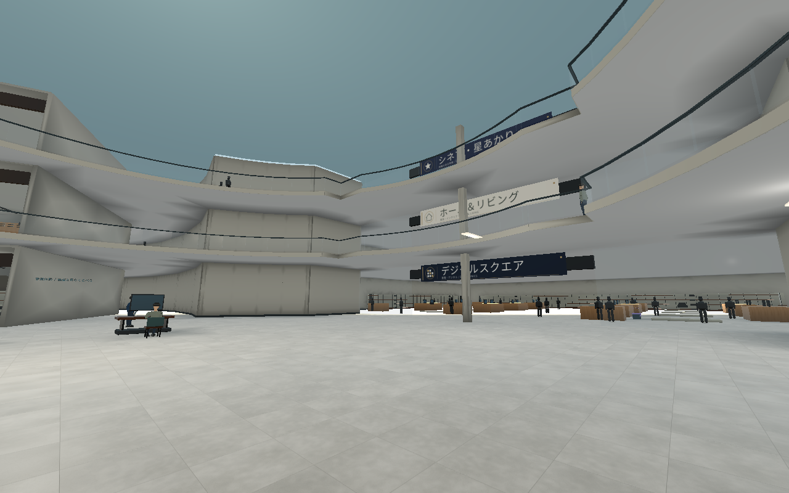|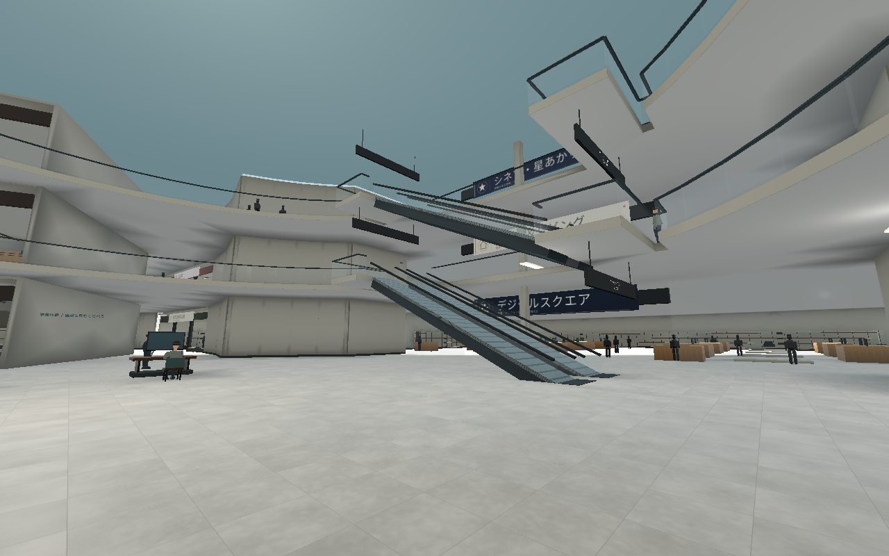|
|時の広場|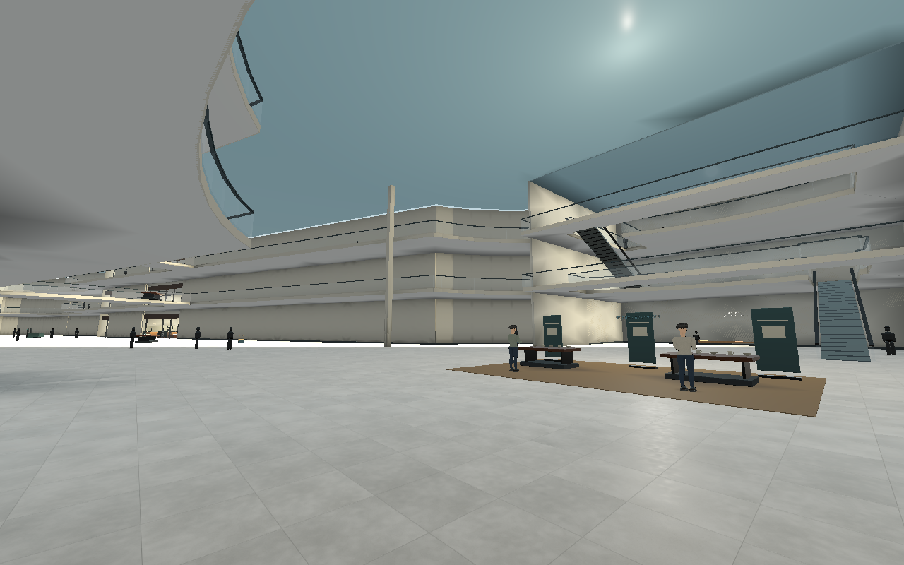|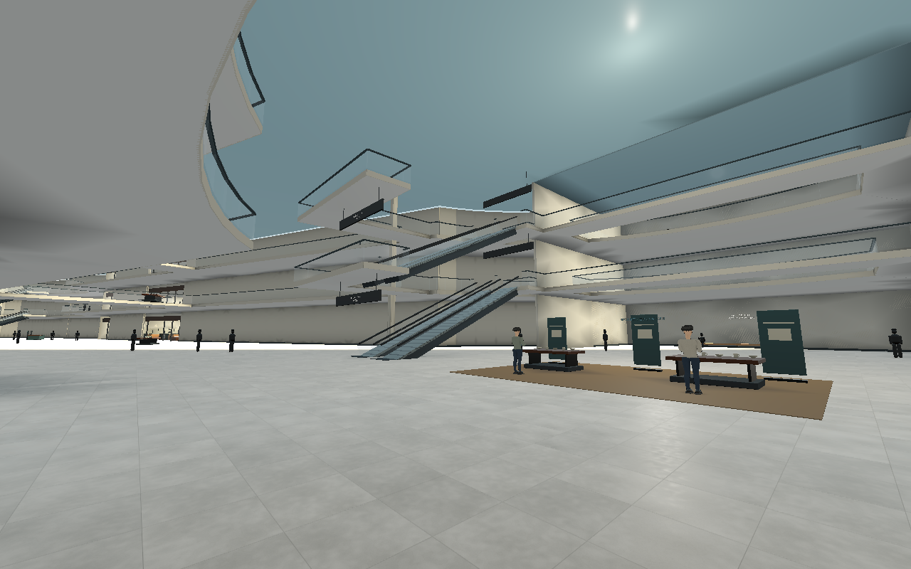|
|光の広場|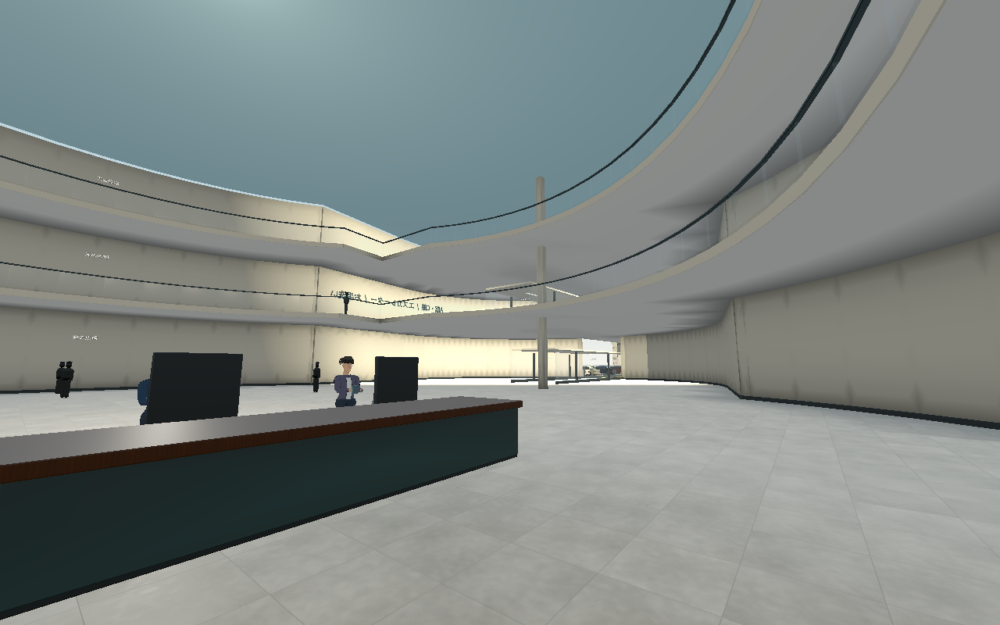|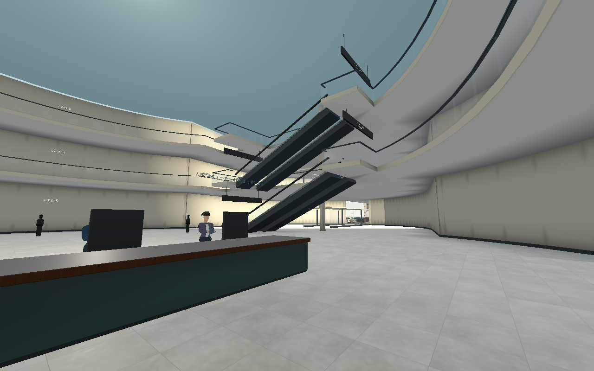|
|1階・キッチン用品店|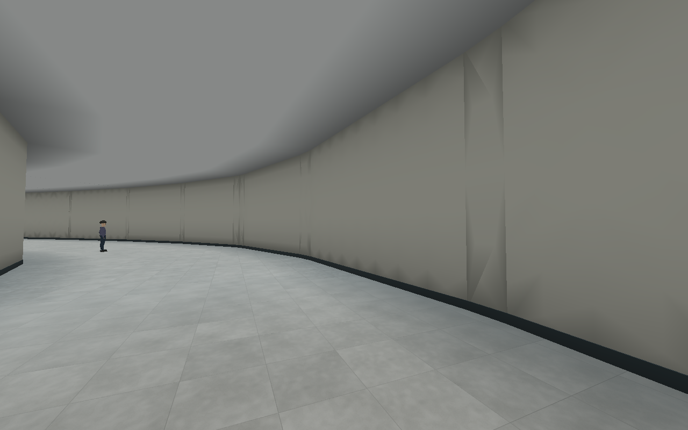|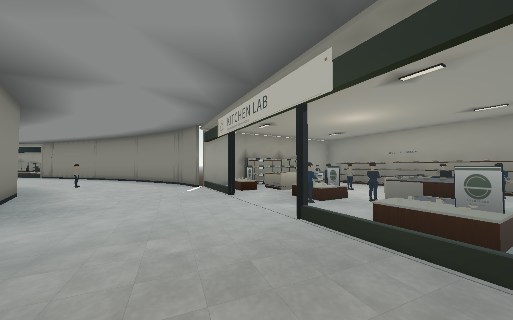|
|2階・旅行用品店|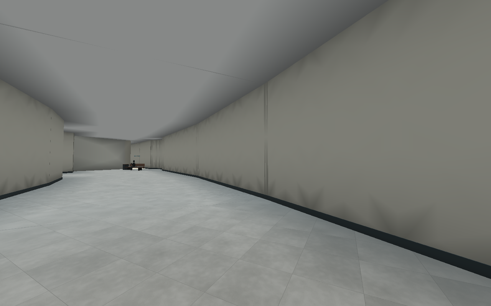|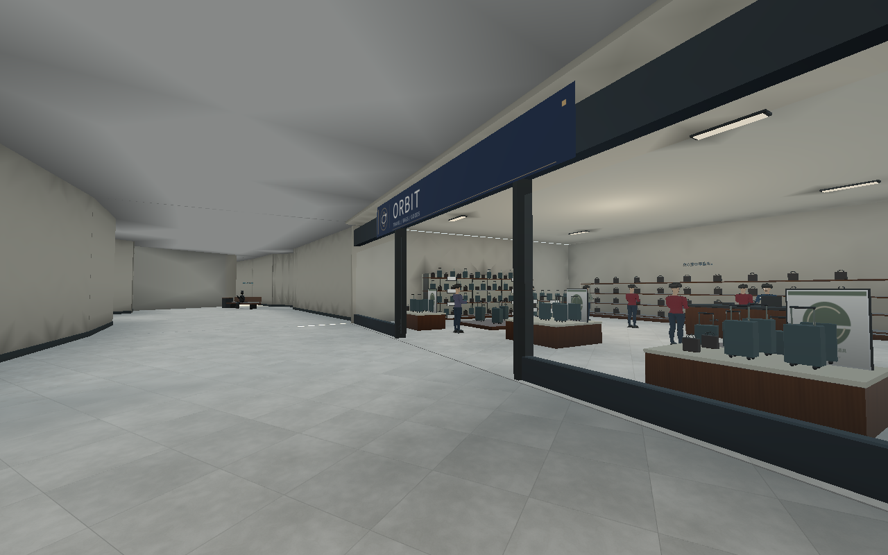|
|3階・楽器店|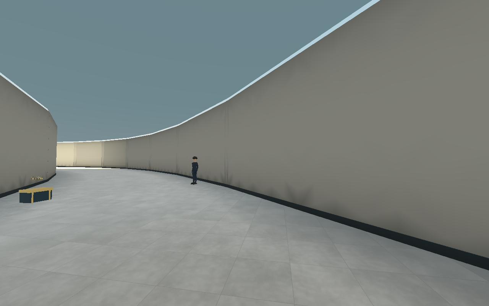|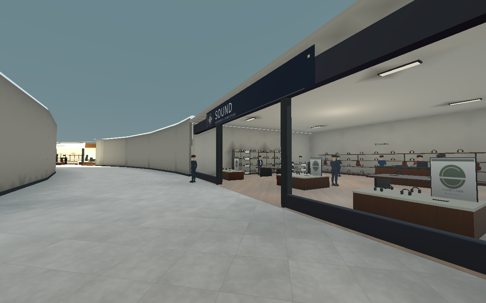|

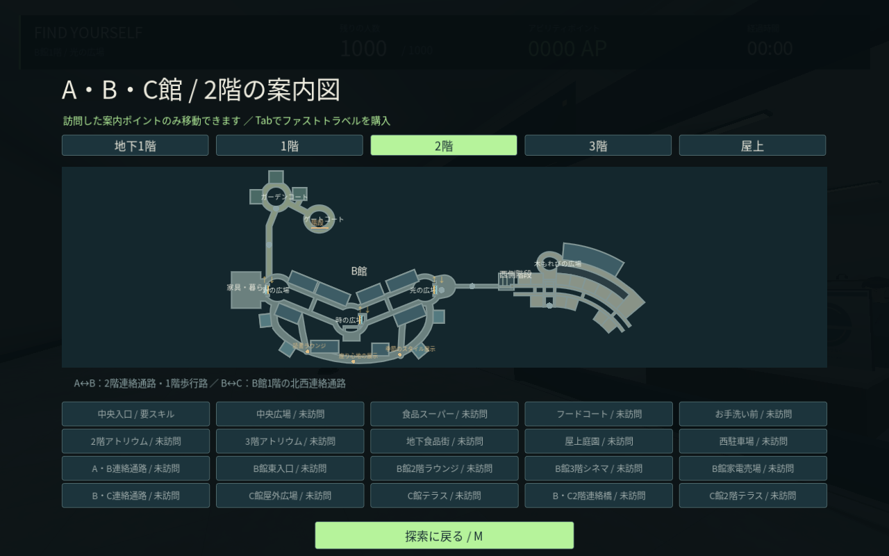

以下はゲームと共通の床・店舗定義から描いた図で、ゲーム画面ではない。

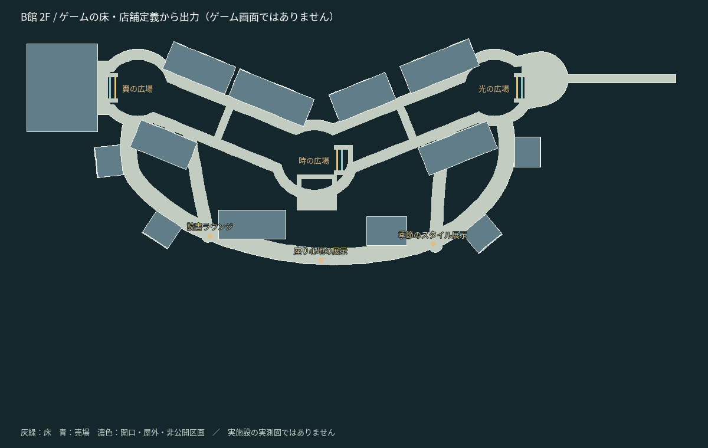

## 検証と残る範囲

`test_b_circulation.gd` は167項目で新店舗の物理床・出入口・店員・陳列/看板・猫の到達、全12本の上下通行、保存した有向リンク、最上階の手すり、宝箱、本物の通常スキャンを確認する。`test_escalator_render.gd` では保存済みの踏面が逆向きのアニメーション設定を保持することを実描画環境で確認する。既存のゲーム、人物、店舗、マップ、1000人を含めた27スイート・1,118項目が成功し、結果を `b-circulation-verification.json` にまとめる。

背面回遊路の中心線の長さは約357mを維持している。今回は店舗を増やす案を採用し、回廊の短縮は行っていない。B館地下/屋上、C館地下/3階/屋上、5,000人、Windows/RTX 4060 LaptopのFPS実測、販売品質の仕上げは未完了。
