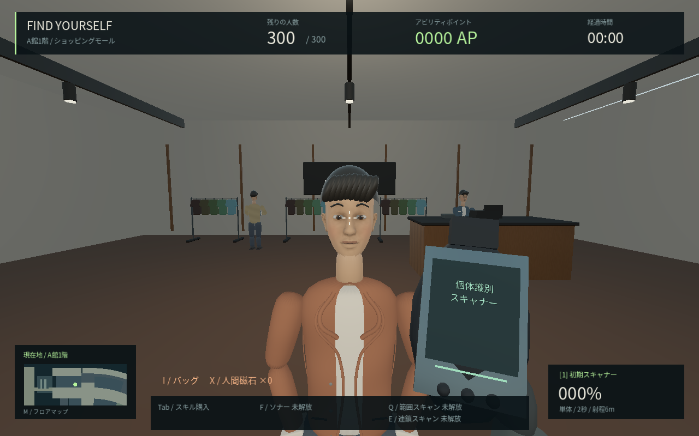
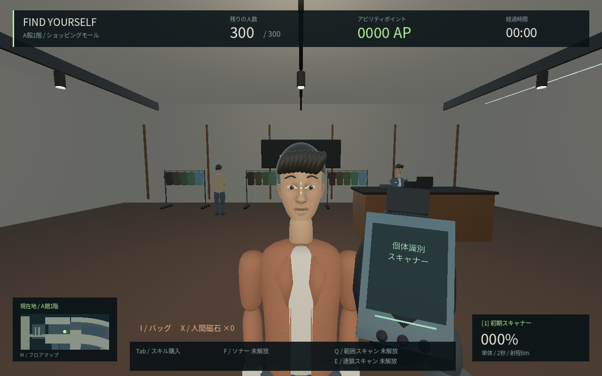
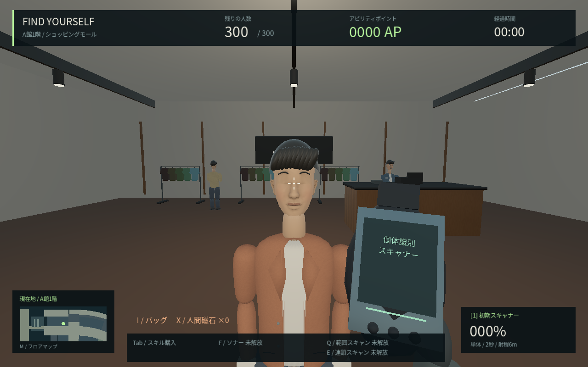
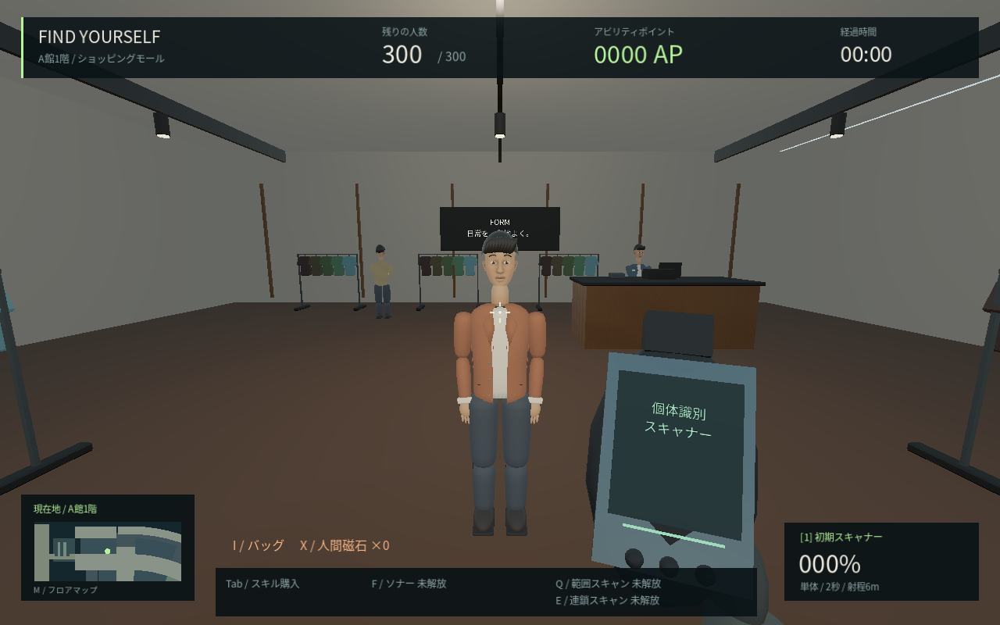

# 0.10 → 0.11の人物比較

肌・布の独自テクスチャと法線マップ、薄いラペル、まばたき・小さな視線と口元・歩行中の腕の更新。基礎の顔と設定は全員で共有し、本物のIDで見た目を変更しない。

| 対象 | 変更前：0.10 | 変更後：0.11 |
| --- | --- | --- |
| 近距離 |  |  |
| まばたきの全閉時刻 |  |  |
| 全身と服の縁 |  |  |

[まばたき・歩行ポーズ・会話時の動作プレビュー（MP4）](videos/character-preview.mp4)

静止画はGodot 4.6.3 Compatibility、Linux+Mesa llvmpipe、1280×800、300人・標準画質。0.10はコミット071540dの保存したソース、0.11はLinux release export。同じカメラ・主対象・姿勢の時刻を使い、画像の色や明るさを後から補正していない。背景の歩行客の初期位置は同一を保証しない。

動画は960×600・144フレームを24fpsに符号化した6秒のモーション確認用。主対象をその場へ固定し、まばたき、歩行ポーズ、会話時の姿勢を順に確認する開発用撮影。実際のプレイ速度やFPS、NPCの移動経路を測った動画ではない。通常プレイで本物や人の配置を動かす機能を追加したものでもない。

クラウド用の撮影引数は`-- --capture-people`、フレーム出力は`--people-movie`を追加。旧版を比較するための独立したスクリプトは`tools/capture_people.gd`。出力は`/tmp/fy11-*.png`と`/tmp/fy11-frames/`。肌と布は数値から作成した素材であり、実写の顔写真やスキャン素材ではない。

全身をつないだスキニング、衣服の自然な連続変形、精密な肌や髪、精密な手指、音声と口パク、店舗全域の仕上げは残る。『8番出口』相当の品質に到達したという意味ではない。[計測条件](PERFORMANCE.md)と[検証記録](QA.md)を参照。
