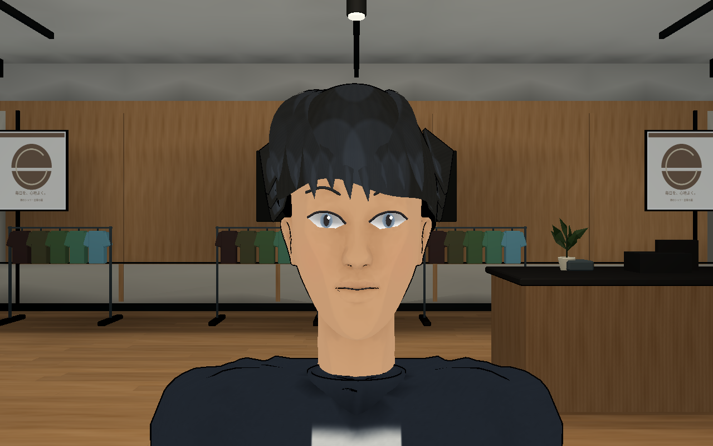
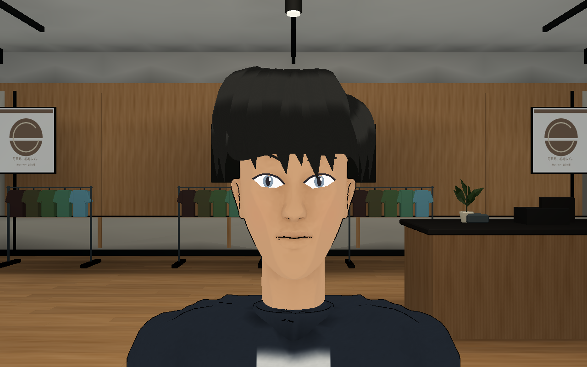
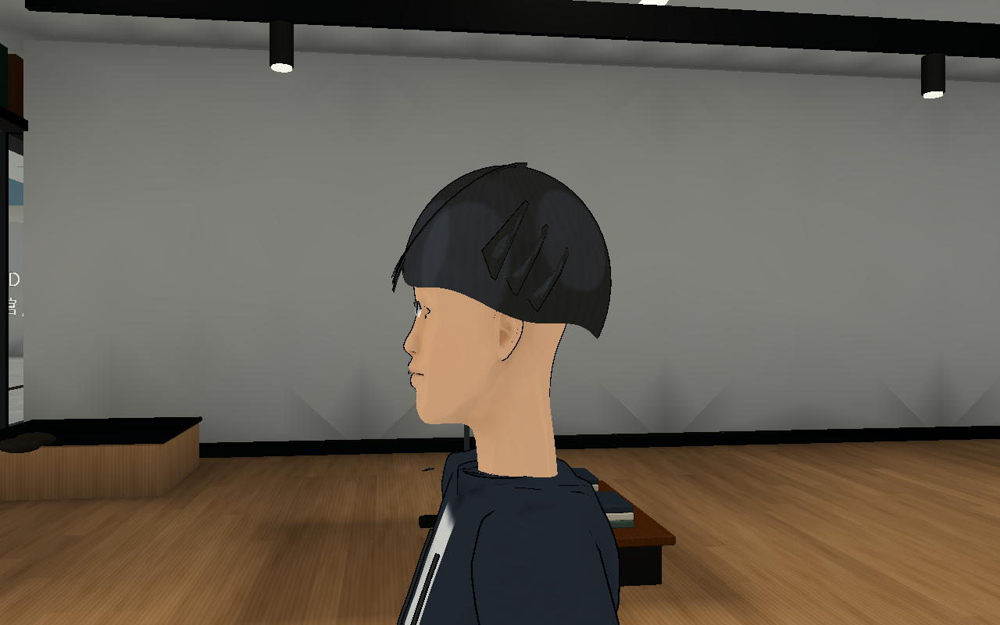
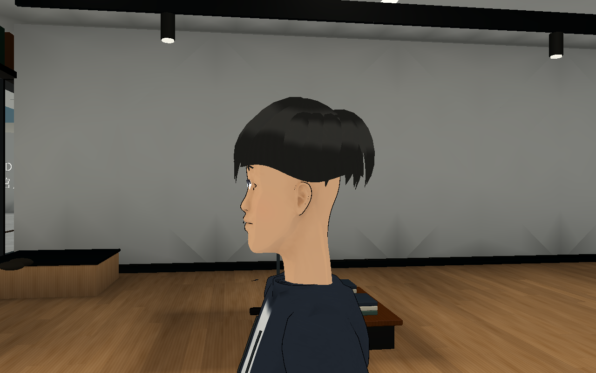
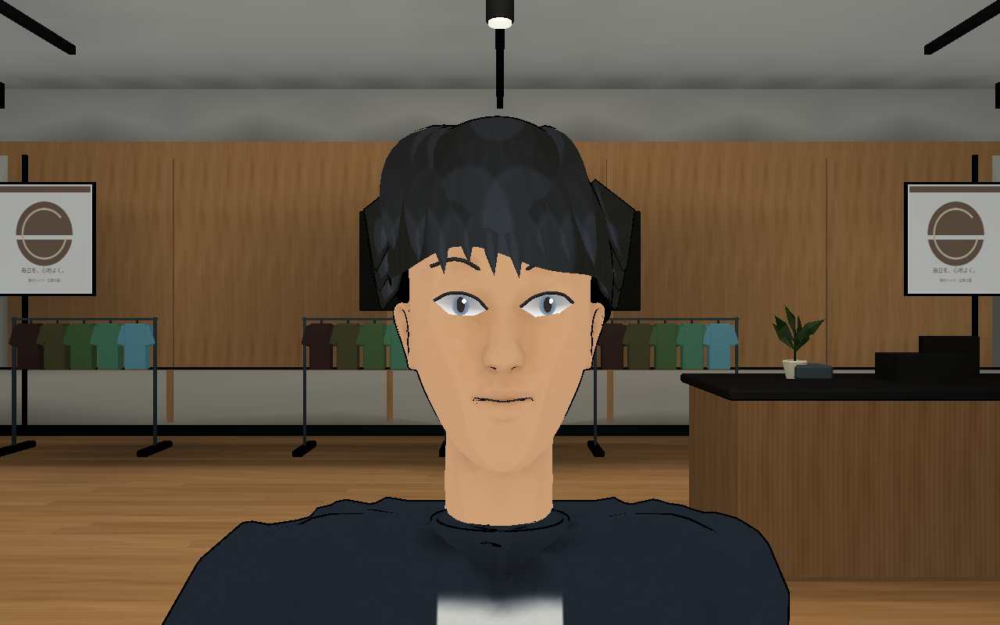
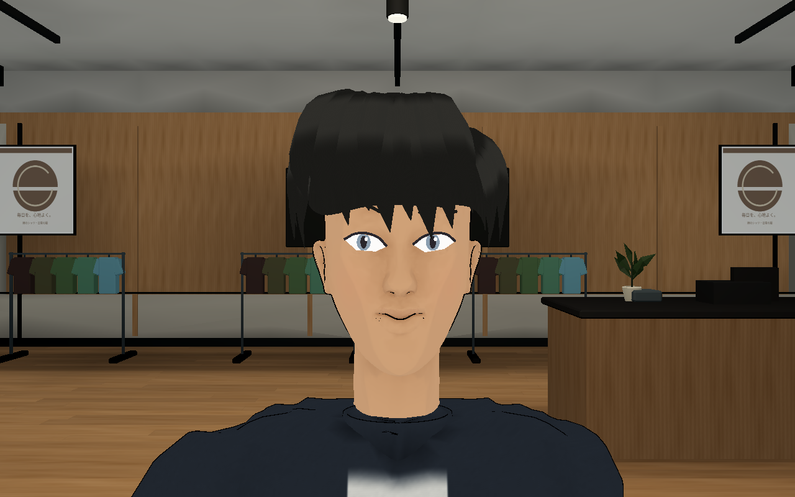
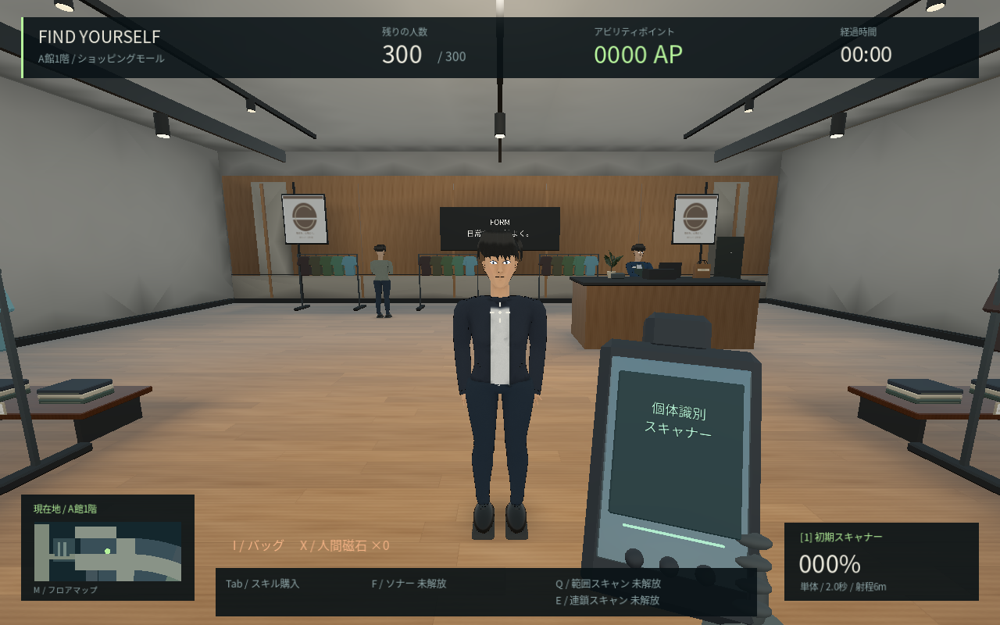

# 0.15 → 0.16：髪・肩と服・視線と口元

前回の若い成人の方向を継続し、髪の形と流れ、肩と襟・袖、黒目と口元の動きを変更しました。全員の基礎の顔・肌・髪・顔幅は引き続き共有します。

| 対象 | 0.15 | 0.16 |
| --- | --- | --- |
| 正面と髪・襟 |  |  |
| 横顔と後頭部 |  |  |
| 会話時の目と口元 |  |  |

髪は前髪・側面・後頭部の22の閉じた束とベースで作り直しました。髪の束に幅と厚みを持たせ、それぞれの長さに沿うUVで陰影を付けます。球状の強い反射や、細い束すべてへの太い輪郭の重ね描画を抑えています。衣服は肩を首から外側へ傾け、肘の折れを整え、丸首の襟に変更しました。

肌の細かな法線による凹凸は外し、顔の面による陰影を優先しました。黒目・瞳孔・反射点が、白目の輪郭を保ったまま小さく動き、目の端で白目の外へはみ出すことも防ぎます。会話時には眉と口元の線も動き、肌と線で同じ変形式を使います。服色や直前の表示スロットにいた別人の情報を視線に使わないよう、顔用の姿勢を共有テクスチャへ書き込みます。音声による口パクや、プレイヤーへ応対する新しい会話AIではありません。

比較はGodot 4.6.3 Compatibility、Linux・Mesa llvmpipe、1280×800。旧版は公開コミット`74b099417e5bf022f532c5bcf3b7667b80186e12`、新版は0.16のソース。同じマップ・光・カメラ・肌/髪/顔幅・ID 0・時計を使い、Crowdの実際のモデルと材質で描画しました。顔と横顔は時刻.4秒、会話は1.35秒。物理更新を停止した1人の近接確認で、通常の300人プレイやFPSの記録ではありません。画像の色や明るさを後補正していません。

`tools/preview_civilian.gd -- --portrait-pass`で再撮影できます。旧版へ同じスクリプトを渡し、`--before`を追加すると同じカメラになります。

## 配布ビルドの画面

300人・標準画質のLinux release exportから撮影。近接用のID 0を同じ場所に固定し、撮影中だけ物理更新を停止しています。通常プレイで本物を動かす機能を追加したものではありません。

髪の細かな造形、表情の種類と手指、服の自然なシワ、環境の照明となじませる調整は残ります。『ペルソナ5』と同じ完成度やSteam販売品質を達成したという意味ではありません。写真顔生成と音声連携は未実装です。[検査](QA.md)と[描画負荷](PERFORMANCE.md)を参照してください。Windows実機/実GPUのFPSは未測定です。
