# 0.14 → 0.15：若いアニメ調の人物へ

「人物が変わったように見えない」「おじさんに見える」という指摘を受け、肌の細かな質感より、顔・髪・体型・服の形と陰影を優先して変更しました。20代前半を意識したオリジナルの人物です。『ペルソナ5』のようにデザインされた若い人物を目指す方向であり、同作のキャラクターやモデル・テクスチャを使用したものではありません。

| 対象 | 0.14 | 0.15 |
| --- | --- | --- |
| 顔・首・髪 | 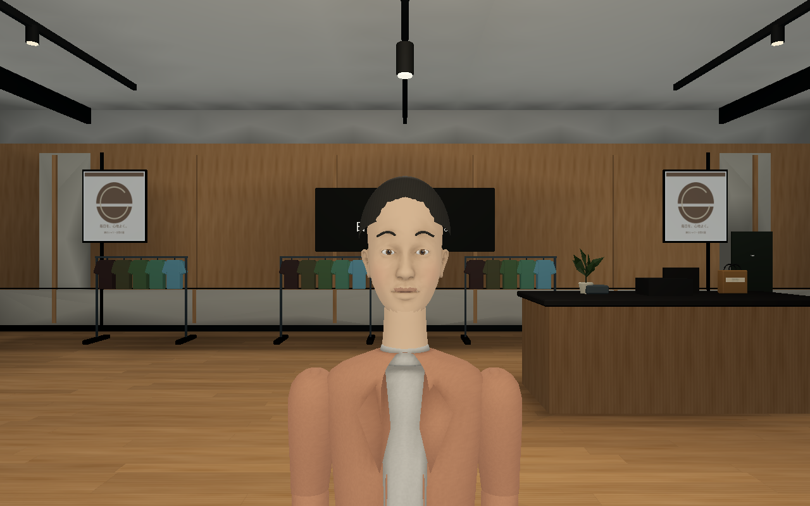 | 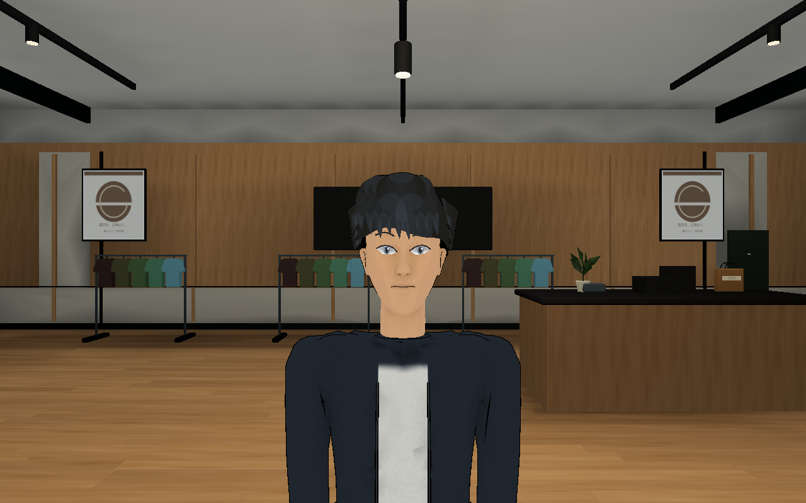 |
| 全身・服 | 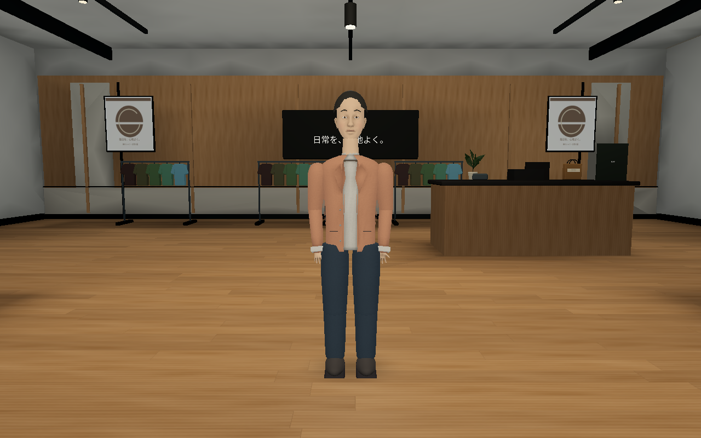 | 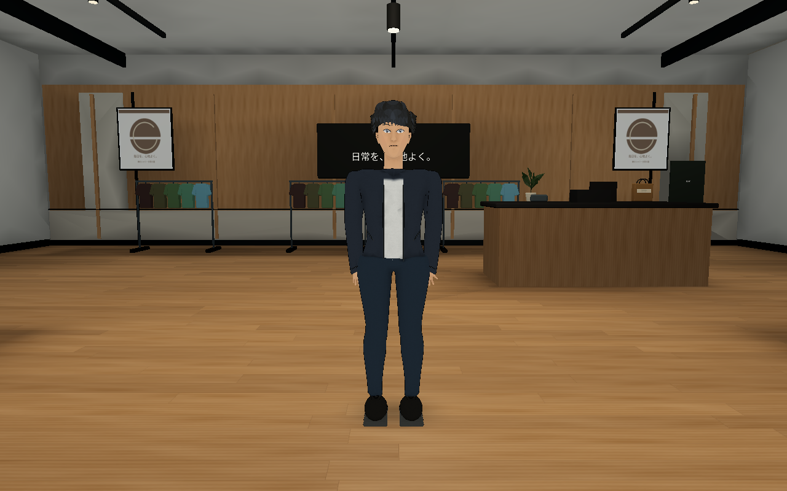 |
| 歩行姿勢 | 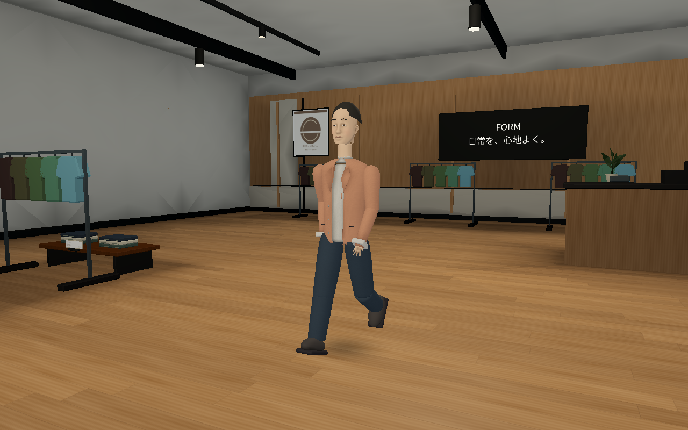 | 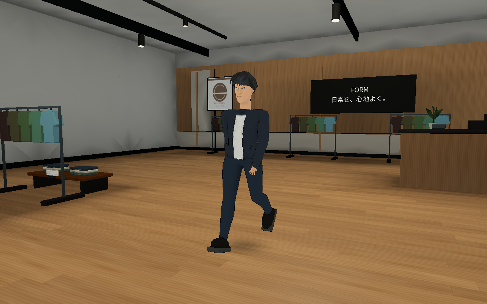 |

顔は細い顎と小さな鼻、白目が飛び出さない浅い目、まぶたの線へ変更。髪は前髪と側面のレイヤー、陰影は二段階の塗りと輪郭線へ更新しました。服は襟付きシャツから、短いジャケットと淡色Tシャツへ変更。まばたき・役割による動作・共通の肌/髪/顔幅の設定は保持します。

衣服は上着と袖、腰と左右のズボンがつながったメッシュです。肩・肘・腰・膝の重み付き変形と足の床補正を追加。頭と手は同じメッシュを全員で共有し、服色や役割で顔を変更しません。1人ごとのSkeleton3Dを追加せず、近距離だけを共有メッシュ・姿勢テクスチャで描画し、遠距離は簡易モデルへ切り替えます。

比較画像はGodot 4.6.3 Compatibility、Linux+Mesa llvmpipe、1280×800。0.14は公開コミット`7027142f34bd85400ce2ab0be407279ae559a09d`、0.15は今回のソース。同じ0.14の背景マップ、環境光・太陽・カメラ・ID 0・時計を使い、Crowdの実際のメッシュと材質で描画しました。人物1人の姿勢確認用で、300人の通常プレイ画面やFPSの測定ではありません。色・明るさを後補正していません。`tools/preview_civilian.gd`にカメラと姿勢を保存しています。`--comparison-world`は同じ背景を使う開発用引数です。

## フードコート

| 対象 | 以前の簡易什器 | 更新した什器 |
| --- | --- | --- |
| 食器・トレー | 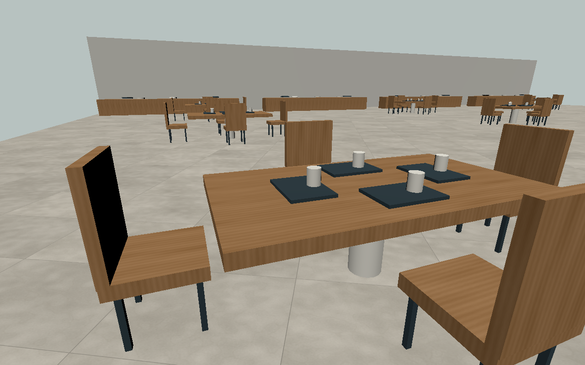 | 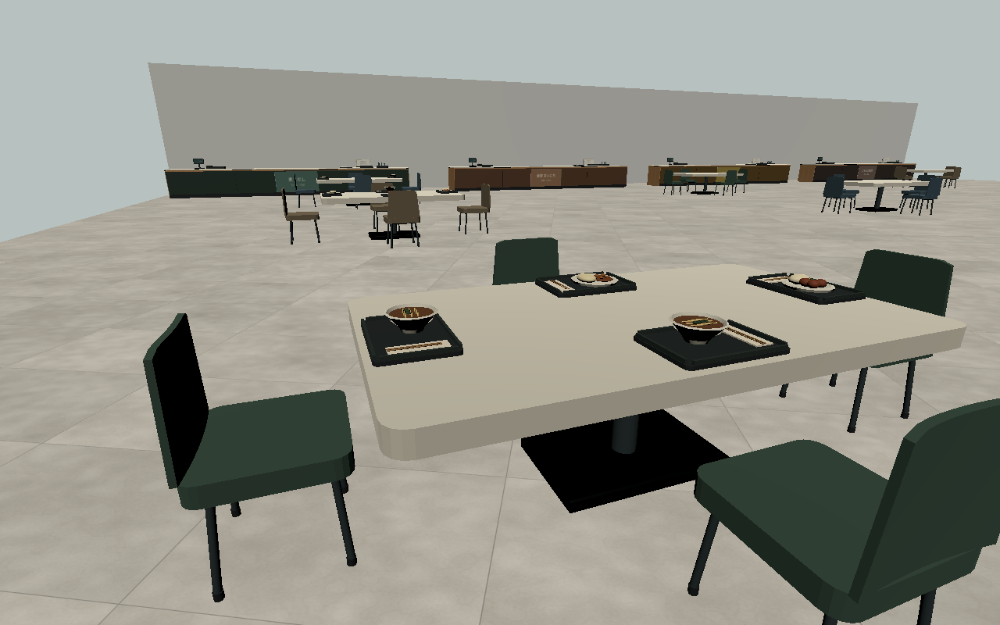 |
| カウンター | 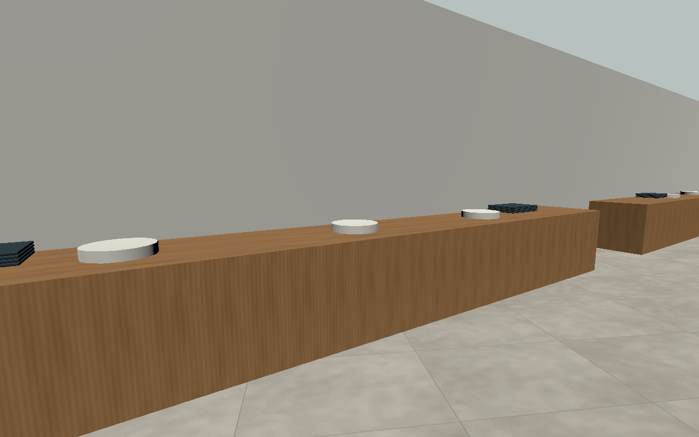 | 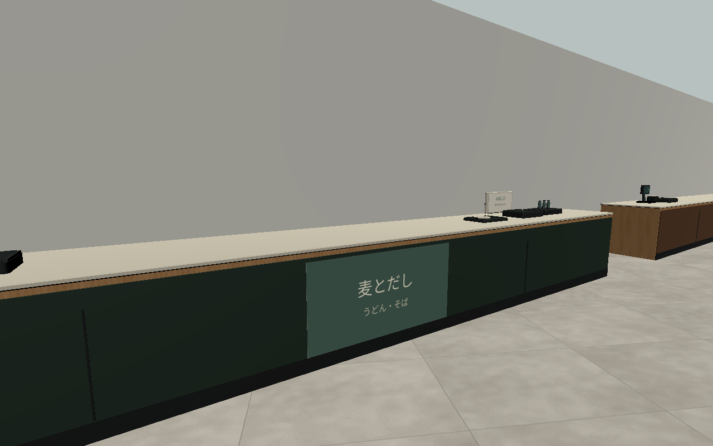 |

この2組は同じ小規模テストシーン・カメラ・光で什器だけを比較した実描画。`tools/check_dining_details.gd -- --before`、`-- --capture`で再撮影できます。丸いテーブル9台・椅子36脚・実際に食事する10席だけの料理・カウンター4か所を更新。350個の古い見た目を置換し、49個の衝突を残します。モール本体では36席の座る位置をテーブルへ寄せ、料理まで約55cmに調整しました。

更新後の配布Linuxビルドでも、300人の通常構成とHUDを含む画面を確認しています。`-- --capture-realism --character-style`で撮影でき、近接用のID 0だけを固定した顔撮影と、実際の初期着席枠の食事客を使っています。撮影中の物理更新を停止した実描画であり、NPCのプレイ中の移動やFPSを記録した画像ではありません。

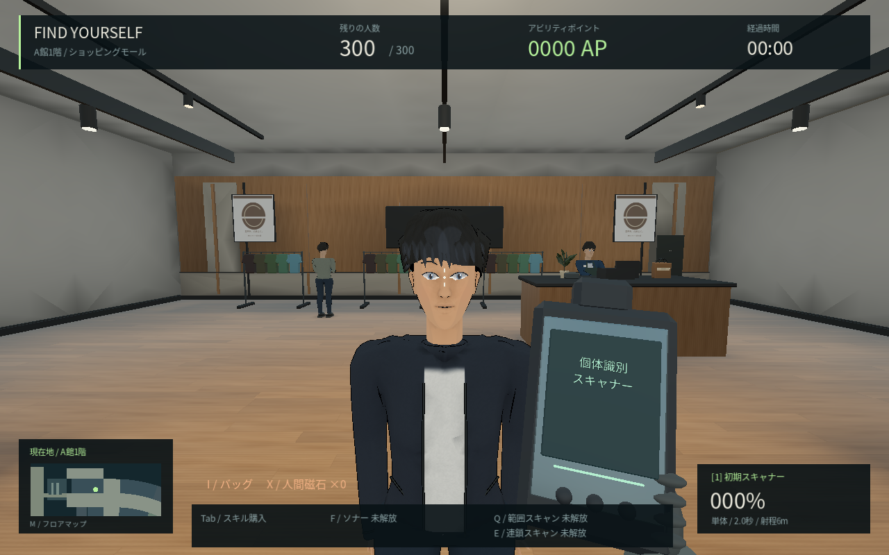

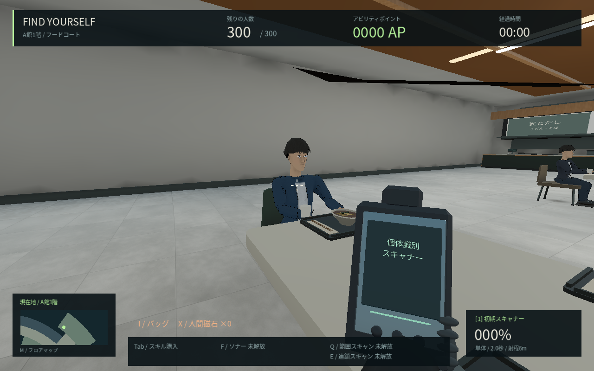

## 残る制作

髪の塊の作り込み、肩や服のシワ、手指・表情の演技、陰影と環境へのなじませ方はまだ基礎段階です。『ペルソナ5』と同じ完成度、実写品質、Steam販売品質に到達したという意味ではありません。モールの反射や間接照明、商品・施設利用のAI、5,000人への拡張も今後の工程です。

[動作確認](QA.md)、[負荷と測定条件](PERFORMANCE.md)、[素材の再生成](WORLD_BAKING.md)を参照。Windows実機の起動とRTX 4060 LaptopでのFPSは未測定です。
