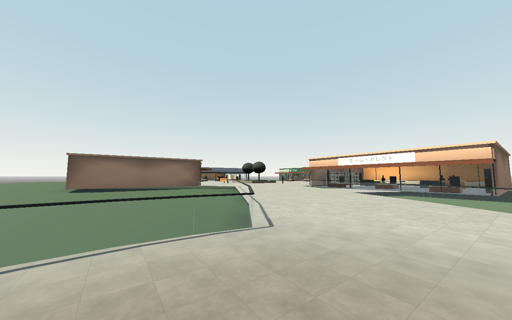
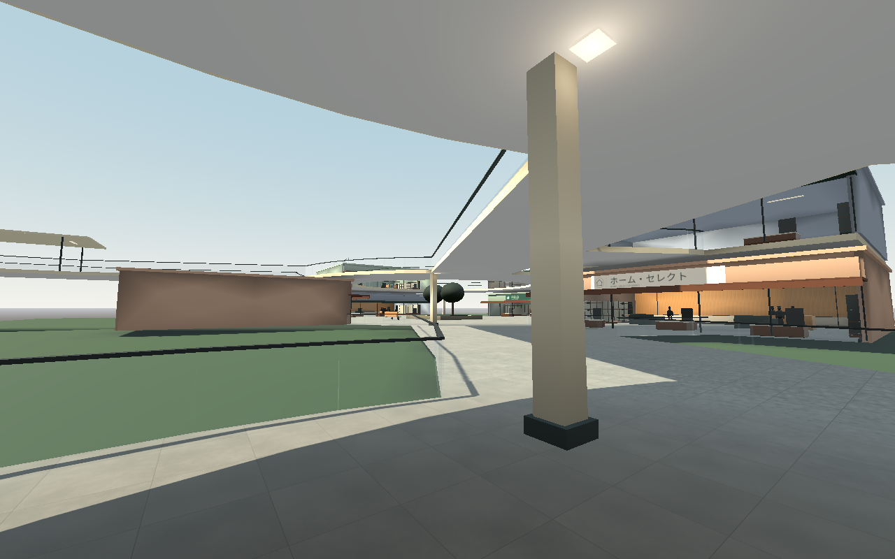
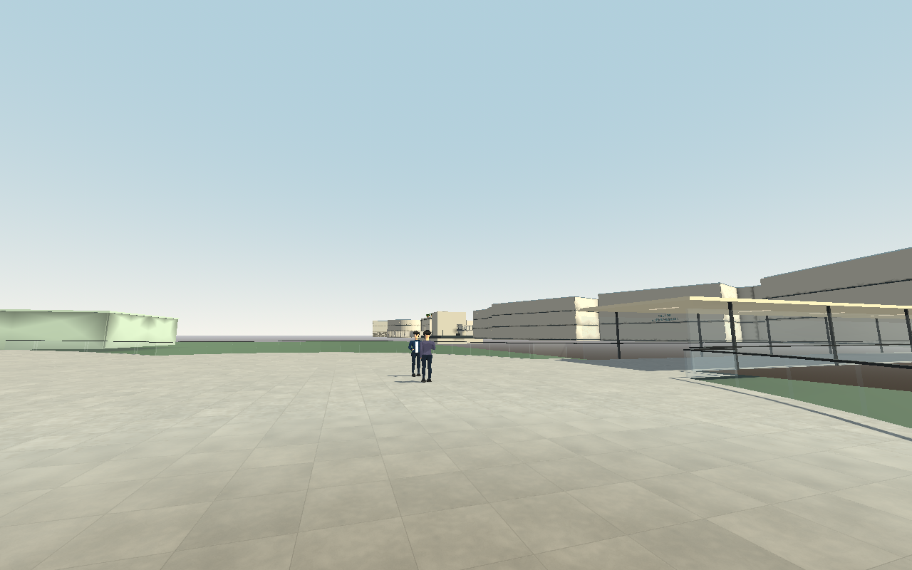
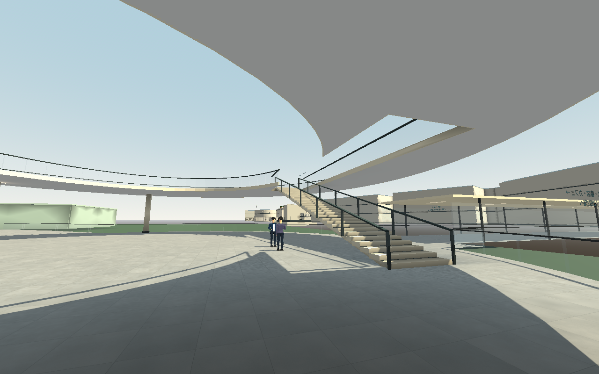
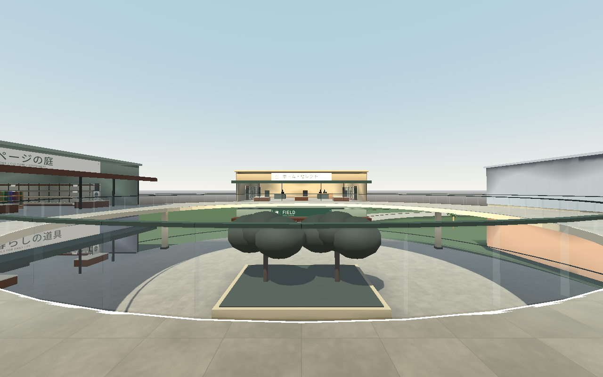
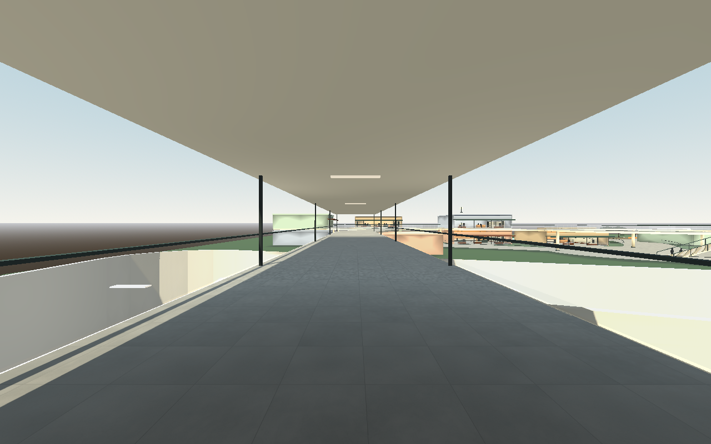
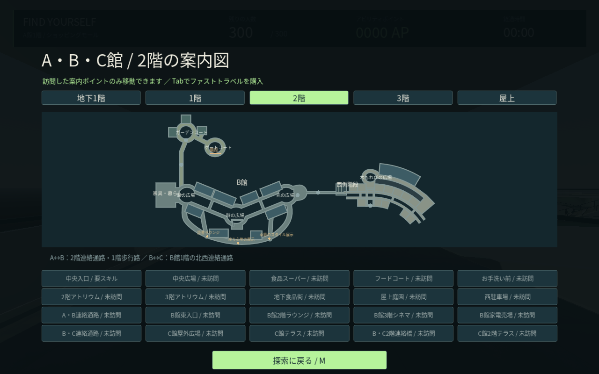
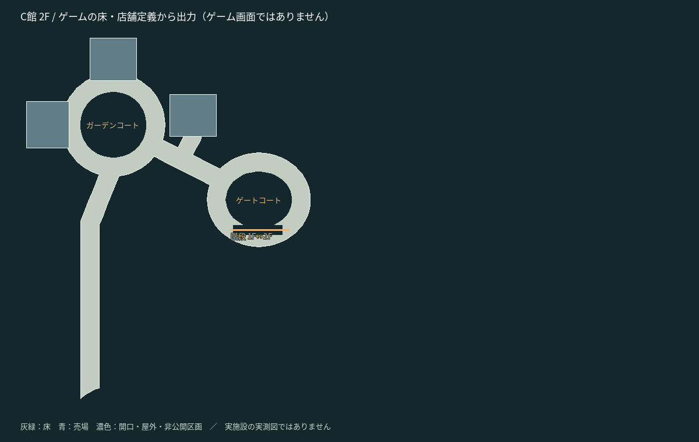

# C館2階とガーデンブリッジ — 開発版0.21

C館に2階を追加し、現在 **10/15フロア、89店舗/売場、既定1000人（比較用300人も選択可）、20移動地点**。A館は地下/1〜3階/屋上、B館は1〜3階、C館は1・2階まで。B館地下/屋上、C館地下/3階/屋上が残る。

## 今回実装した構造

- ゲートコートとガーデンコートの2階を幅8mの回廊で結ぶ。中央は床・衝突ともに開口とし、1階から見上げ、2階から見下ろせる。
- 1階の店舗の上に生活雑貨店、書店、カフェを配置。既存の架空ブランドのデザイン看板、棚・商品・レジを使用。
- C館1階ゲートコートの通常階段と、B館2階「翼の広場」からのガーデンブリッジを追加。橋幅8m、直線部分に屋根と照明を設ける。
- 回廊下に支持柱8本と照明を配置。柱の占有範囲を1階の猫/NPC経路から除外する。
- 新店舗には店員3人、買物客4人、カフェ着席客2人。既存のB館の閲覧客9枠をラン生成前に変更し、総数300人・固定267人/歩行33人を維持。既存C館1階の30人は維持する。
- 従来18地点の移動ID・順序・訪問キーを維持して「B・C2階連絡橋」「C館2階テラス」を末尾へ追加。地図を見るだけでは解放しない。

仕様として確定している「全員同じ顔」「本物のIDを開始時に一度抽選」「初期スキャナーだけで最終確認」は維持する。今回の店舗・回廊・階段の配置はゲーム用の採用案で、実在のレイクタウンの実測再現ではない。

## 到達方法

1階からはB館の従来の屋根付き通路を渡り、C館ゲートコートの階段へ進む。2階からはB館西側の翼の広場で北へ進み、ガーデンブリッジを渡る。2階の書店・生活雑貨店・カフェを回り、ゲートコートの階段で1階へ戻れる。Mの2階案内図に階段と橋を表示する。

## 床・経路の共通化

`assets/layout/mall_structure.json` のC上階定義を `tools/build_mall_structure.py` でコンパイルする。床メッシュ・衝突・開口・手すり・案内図・NPC/猫の公開床判定は同じポリゴンから生成する。B側との重なりを除き、接続位置の外壁と手すりを開ける。

階段は連続した傾斜の衝突面と見た目の段板を使う。上下の踊り場を実際の公開床に接続し、猫/NPCは既存の西側階段と同じ明示的な階段経路を利用。階段下の平面経路を除外し、階段を横切る近道を作らない。宝箱は接続済み公開床の候補点から選び、段板の途中には置かない。

新店舗の商品は既存の共有メッシュ/インスタンス方式を使用する。5,000人やWindowsの実機FPSを検証したという意味ではない。

## 実画面と全体図

比較は同じシード912、300人、標準画質、Linux/Mesa llvmpipeで撮影。通常のゲーム描画を使い、比較用の建築差し替えや断面表示は行わない。人物の静止、HUDと手持ち道具の非表示だけを撮影のため使用する。

|場所|0.20|0.21|
|---|---|---|
|C館入口から中庭を見る|||
|ゲートコートの階段|||

以下はゲームと共通の床・売場定義から出力した設計図で、ゲーム画面ではない。

同時にB館の立寄場所と案内端末を見直した。[B館の分析と改善](B_CONCOURSE.md) を参照。

人数の比較版は [1000人の配置と検証](POPULATION_1000.md) を参照。上記9人は基礎の300人配置に含まれ、1000人版ではこの位置を維持して追加の滞在客を配置する。

## 検証

新規 `tests/test_c_upper.gd` で、橋の物理床、店舗の入口、吹き抜けの開口、猫の全9人への到達、通常操作による橋/階段の通行、訪問済み移動、宝箱候補、本物の最終確認を検査する。既存の構造・NPC・スキャン・商品・看板・人物描画の回帰検証も実施する。25組944項目で失敗ゼロ。Linuxネイティブ版でも1000人を起動し、30フレーム後に終了コード0・実行エラー0を確認した。件数・結果・描画条件は [検証記録](c-upper-verification.json) に記録している。

人物モデルは今回変更していない。写実品質、全15フロア、5,000人、Windows/RTX 4060 LaptopでのFPS実測は未完了。
