# 0.11 → 0.12の内装比較

石材・オーク木部・塗装面の素材、A館上階の床仕上げ、店舗入口の枠と巾木、天井の空調グリル、ファッション店の背面パネルを更新。静的な壁・家具の床への接触陰影を事前生成する。人数・館の範囲・通路幅は維持する。

| 対象 | 変更前：0.11 | 変更後：0.12 |
| --- | --- | --- |
| A館の回廊 | 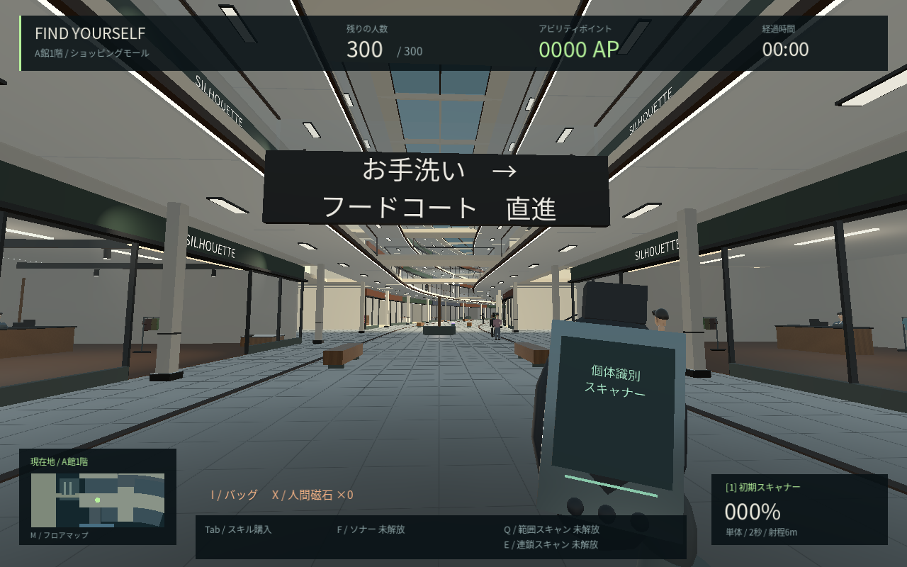 | 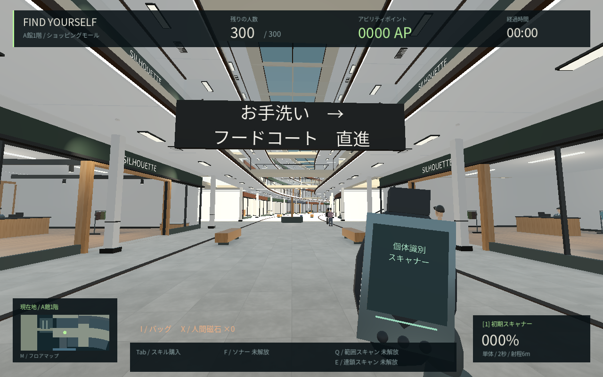 |
| ファッション店の入口 | 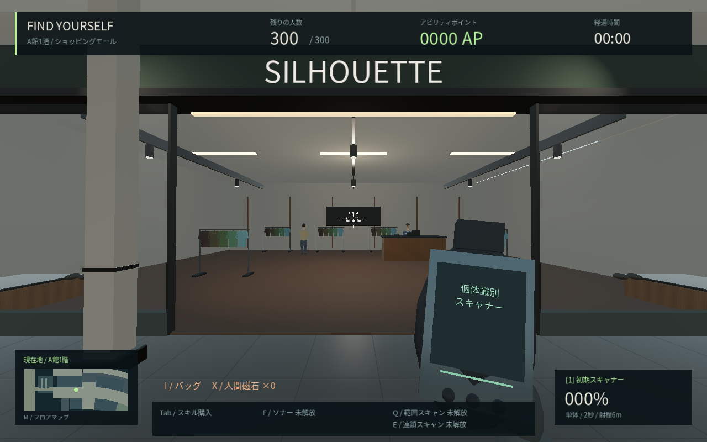 | 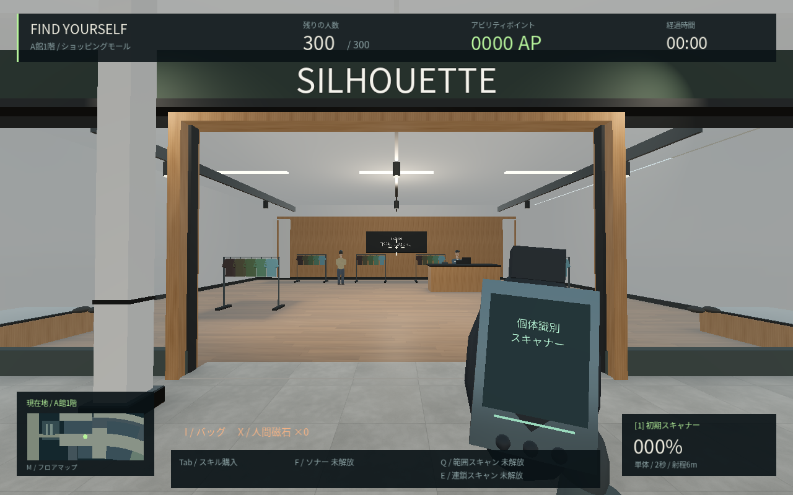 |
| 石と木の床 | 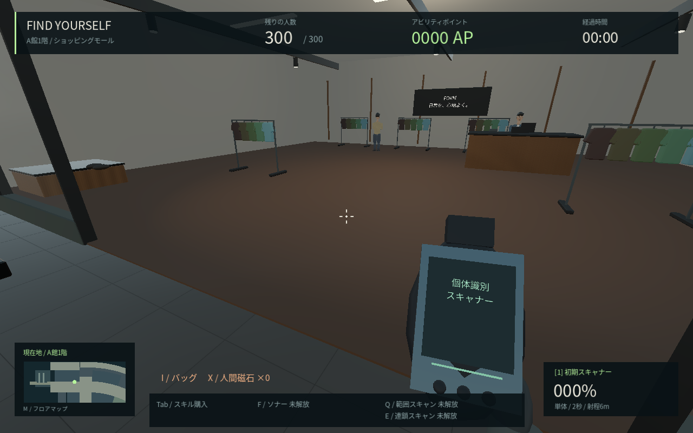 | 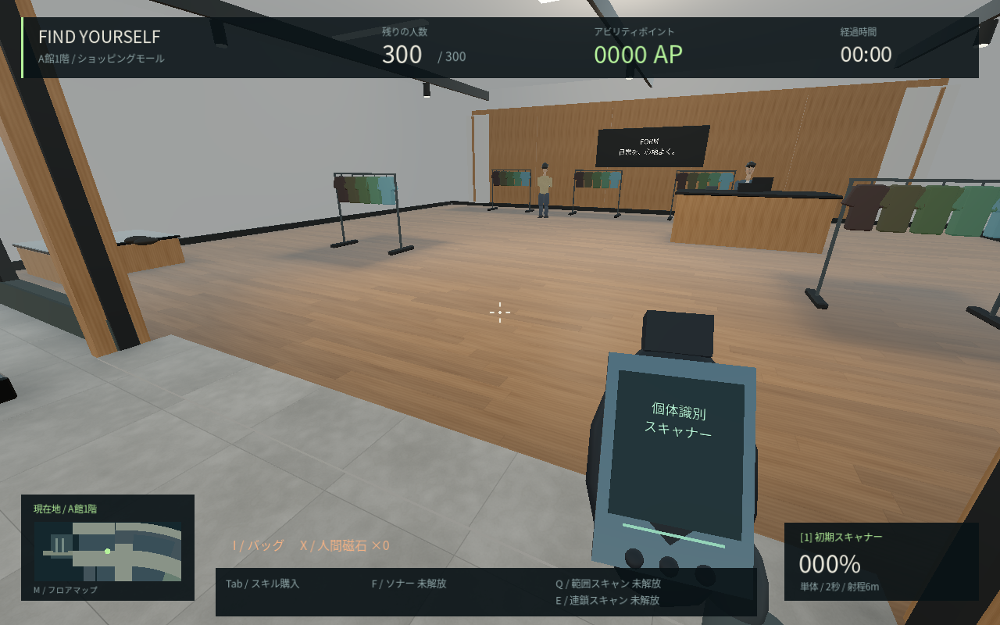 |
| 上階と吹き抜け | 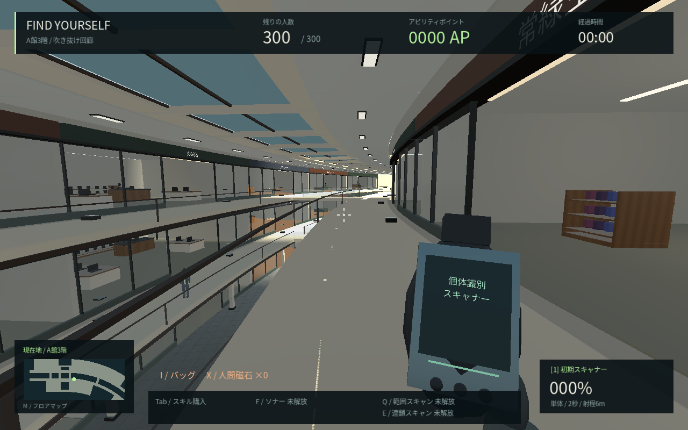 | 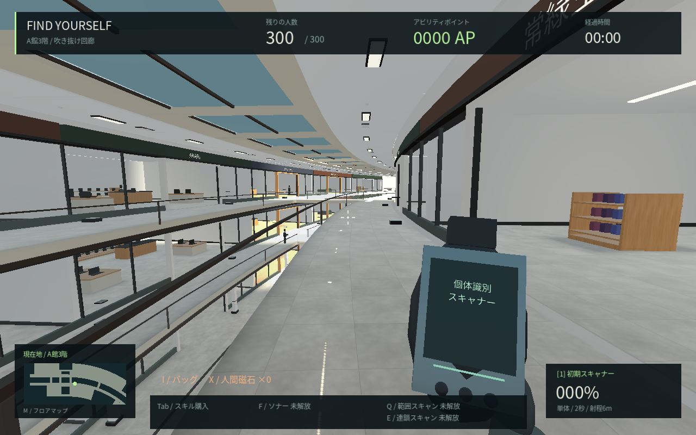 |
| 店舗の奥壁と什器 | 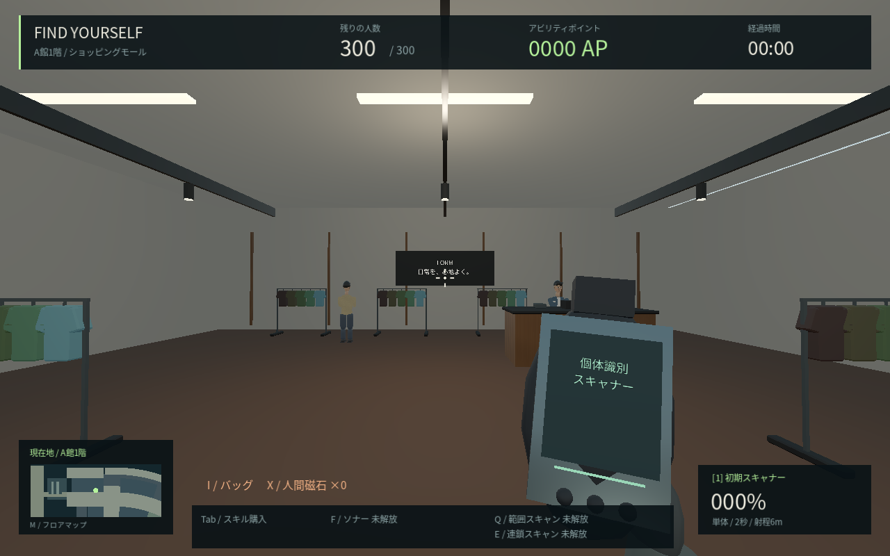 | 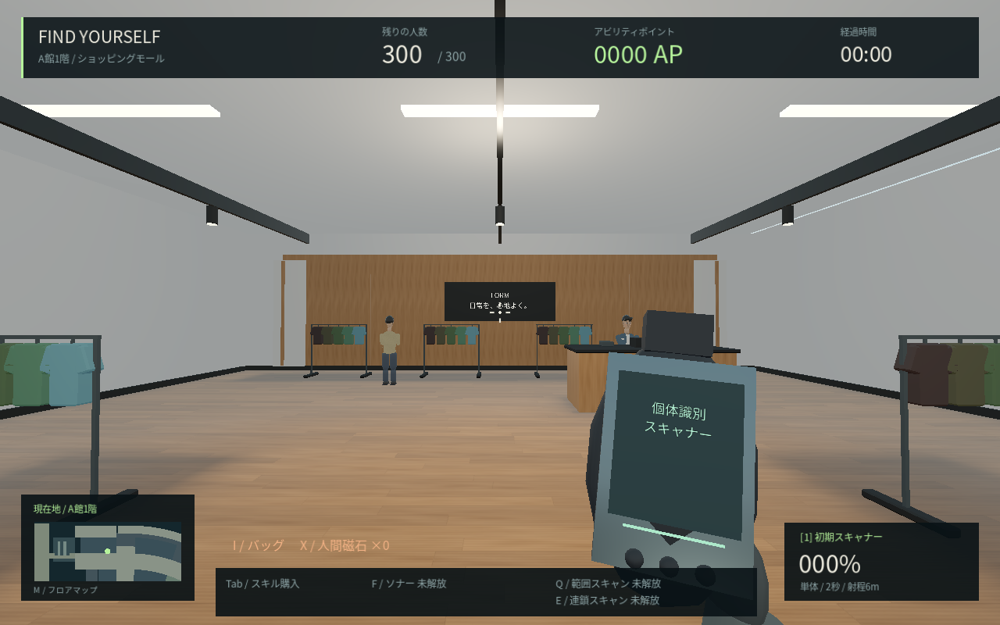 |

Godot 4.6.3 Compatibility、Linux+Mesa llvmpipe、1280×800、300人・seed 912・標準画質。0.11はコミット`4e7348c`の保存したソース、0.12はLinux release export。同じカメラ位置と向きで撮影し、画像の明るさ・色を後から補正していない。背景の歩行客の初期配置は完全な一致を保証しない。描画用の時刻は固定し、撮影中は人物とプレイヤーの物理更新を止めている。環境光・露出の変更もゲーム本体の更新に含む。

静的な床の陰影は、A館1〜3階の既存の衝突形状から作る近似マスク。動く人物や猫・宝箱の影、全館の間接照明、写真素材を用いたPBR仕上げ、リアルタイム反射を完成したという記録ではない。素材は数値から独自に作成したもので、実写・生成AI画像の加工ではない。『8番出口』相当の品質へ到達した扱いにはしない。

新しい床仕上げは上面だけを描き、直線の円柱は不要な縦方向の分割を削減する。見た目の更新を無負荷とは扱わず、描画命令数・計測条件は[性能記録](PERFORMANCE.md)に記載する。Windows実機のFPSは未測定。

配布実行ファイルの撮影用引数は`-- --capture-interiors`。旧ソース比較は`tools/capture_interiors.gd -- --before`を使う。出力は`/tmp/fy12-*.png`。通常プレイの人物や本物を配置し直す機能ではない。

## 共通素材の表示確認（0.12）

C館の屋外舗装は屋内と明るさを分け、太陽の影の縞を抑える。B館のスラブ下面は塗装天井として描く。以下は比較表と同じLinux配布版の記録で、両方とも0.12の画像。

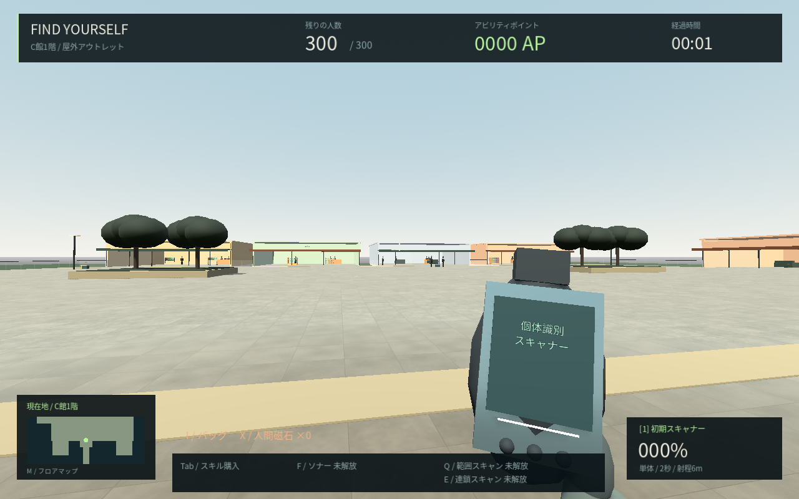

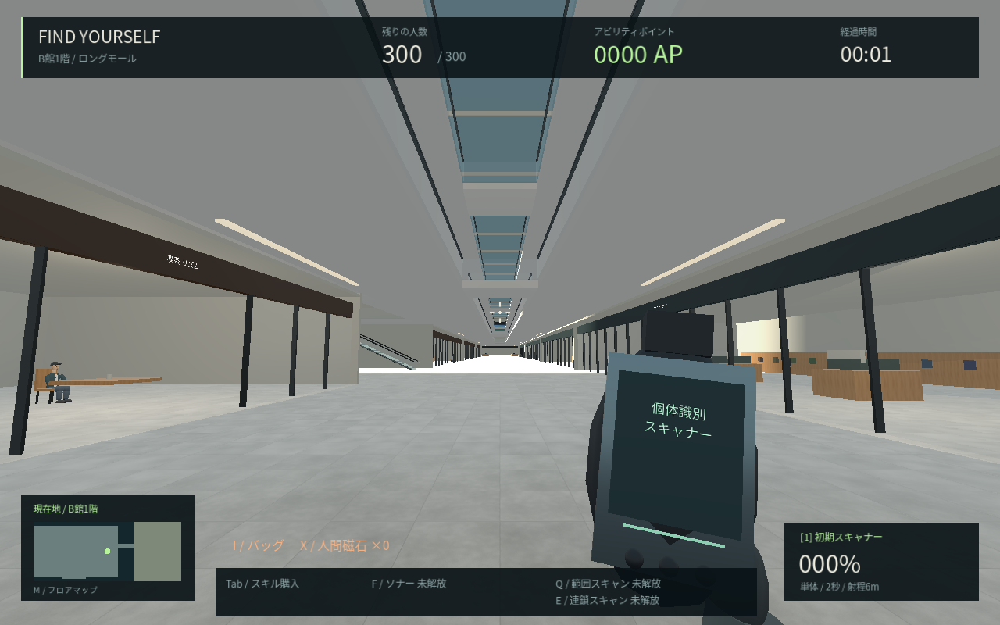
