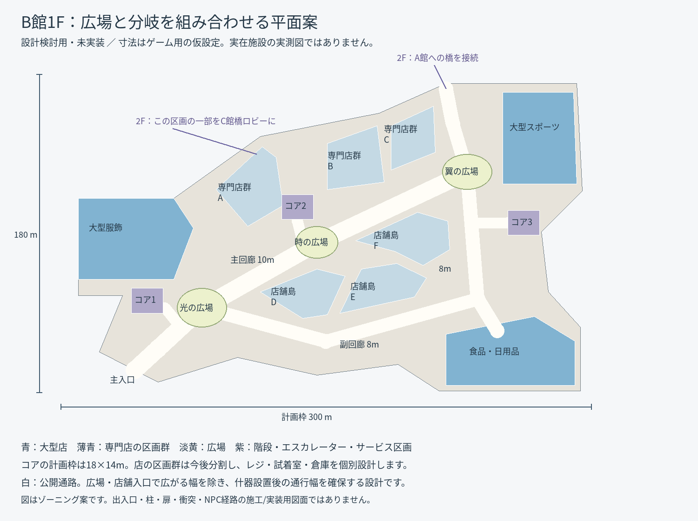
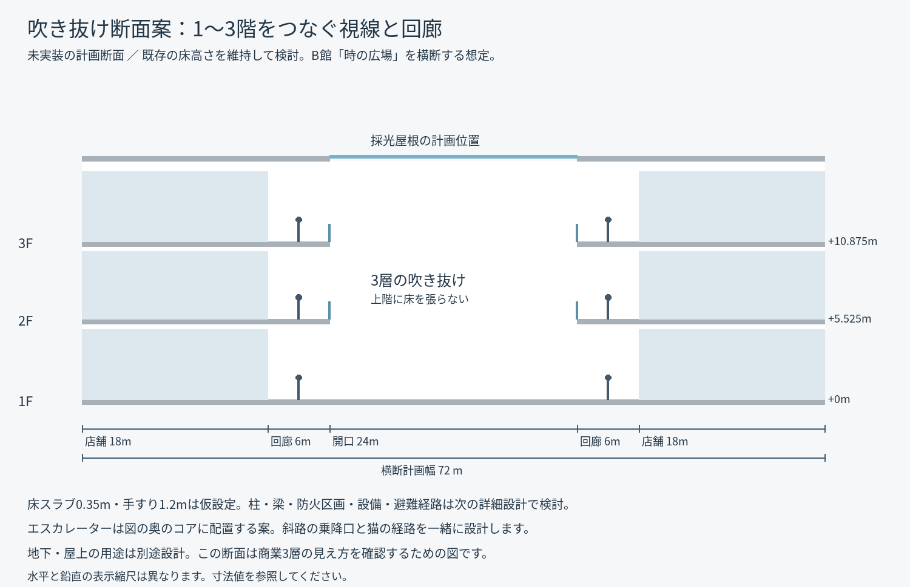

# モール改修：代表フロア設計と共通窓口の導入

2026-10-25（日本時間）。v0.16を基準とした段階改修の第1工程。

これは第1工程時点の記録。最新の[第2工程・0.17の実装](MALL_PHASE2.md)では上階店舗とトイレを改修している。

前回の[全体解析・15フロア案](MALL_REDESIGN_PROPOSAL.md)に続き、代表フロアの寸法検討と、案内図・移動地点の共通窓口を実装した。**図の形状は設計検討用で、ゲーム内の建物にはまだ適用していない。** 今回は内部構造を整える工程であり、新しい内装の完成版ではない。

## 代表フロア：B館1F

[拡大可能なSVG](images/mall-b-floor-study.svg)。図の向きはゲーム内のローカル座標で、実施設の方位を表していない。全体配置へ適用するときの向き・接続位置は別途合わせる。

| 項目 | ゲーム用の仮設計値 | 目的 |
| --- | --- | --- |
| 平面の計画枠 | 300×180m | 長い主軸と端部大型店、別経路を収める。枠全体が床や売場になる意味ではない |
| 主回廊 | 10m | 入口→光→時→翼の広場を結ぶ |
| 副回廊 | 8m | 店舗島の外側を回り、同じ広場へ別方向から着く |
| サービス接続 | 6m | コアに接続し、回廊の通過客と滞留客を分ける |
| 上階回廊 | 6m | 吹き抜け沿いの通過と立ち止まりを両立する |
| コアの計画枠 | 18×14mを3か所 | 階段・エスカレーター・サービス区画の位置を先に確保。設備の収まりは詳細設計で分ける |
| 光の広場 | 28×22mの楕円範囲 | 主入口側の目印 |
| 時の広場 | 24×18mの楕円範囲 | 主回廊と店舗島の中心 |
| 翼の広場 | 28×20mの楕円範囲 | 大型店と橋側の分岐点 |

これらは実在施設の測定値ではなく、最終寸法でもない。歩行速度・混雑・探索時間を検証して調整する。通路幅は什器で塞いだ後も確保する設計値で、全通路を同じ幅にする意図ではない。

青い大型店を目的地にし、薄青の区画群を店舗へ細分化する。図のベージュ部分には未割付領域を含み、バックヤード・設備・店舗拡張・公開通路を次の詳細設計で区分する。現時点で家具を置ける完成区画と扱わない。

同じ輪郭の上に同じ店舗を積み重ねず、次の用途を割り当てる。

- 1F：大型服飾・スポーツ・食品/日用品と、その間の専門店群。
- 2F：大型書店・生活雑貨・カフェ。店舗群Aの一部をC館への橋ロビーへ変更する案。橋側の首部をA館接続のロビーにする。
- 3F：映画館・ゲーム/体験施設・飲食街・ホール。厨房や上映室など、用途に必要な奥行きを確保して区画を統合する。

橋の注記は2Fの予約位置であり、1Fに通行可能な橋を追加したものではない。1FのB/C屋根付き接続、A/B歩行路の端点は、全体配置との調整を残す。

## 吹き抜け断面

[拡大可能なSVG](images/mall-atrium-section-study.svg)。水平と鉛直で表示縮尺が異なるため、寸法値で読む。

床高さは当初の互換性を優先し、現在と同じ1F=0m、2F=5.525m、3F=10.875m、屋根付近=16.4mを検討の出発点にする。断面は店舗18m＋回廊6m＋開口24m＋回廊6m＋店舗18mの計72m。床スラブ0.35m・手すり1.2mは仮値。

1Fには連続した床を置き、2/3Fの中央には床を張らない。向かい側の店と下の広場が見える構成にし、採光屋根の位置を揃える。エスカレーターは断面の奥のコアへ置く案。柱・梁・防火区画・設備・屋上の扱いは未確定で、これを施工用の建築図とは扱わない。

平面/断面の入力は[検討用JSON](mall-b-floor-study.json)、再生成は `python tools/draw_mall_study.py`。Pillowと同梱フォントを使う開発者向け処理で、ゲームを遊ぶ側には不要。生成先は資料フォルダーのみで、ゲームの素材やワールドを変更しない。

## 実装した共通窓口

`scripts/mall_layout.gd` は既存定義を読み取る互換アダプター。床・壁を別の値で複製して再生成する方式にはしていない。

- `A/B1`〜`C/RF`の15フロアIDを定義。実装済み9フロアと未実装6フロアを区別し、未実装の階に床や移動地点を作らない。
- 現在の床領域・上階領域・付属区域・障害物を、棟/階ごとの読み取り専用スナップショットとして提供。
- 座標変換・案内図用ポリゴンの窓口を用意し、従来のMallCurveへ委譲。案内図をこの窓口へ接続。
- 18移動地点に安定したIDと所属フロアを付与し、訪問判定と移動処理を接続。従来の日本語キー・並び順・座標・2m訪問条件・スキル条件を維持。未訪問地点への移動は拒否する。
- スキャン候補点や定位置NPCを所属フロアに分類する照会を用意。今回のNPC生成・猫のAStar・宝箱抽選は従来処理を継続する。

毎フレーム全候補点を分類する処理は追加していない。床スナップショットと移動地点をキャッシュし、案内図の表示範囲とポリゴンも従来どおりキャッシュする。

## 今回移行していない部分

床・衝突・描画生成の本体は `Mall` / `MallAnnex` / `BWing` / `CWing` に残す。エスカレーター経路、店舗内部の固定描画、棟名表示の座標閾値、NPCの生成は今後の移行対象。**全システムの単一定義化が完了したという扱いにはしない。**

今回の窓口は生成済みワールドの形状を変えないため、ワールド入力ハッシュと既存キャッシュを維持する。`mall_layout.gd`を将来ワールド生成に使う段階では、`WorldCache.INPUTS`へ追加して依存を追跡し、実描画環境で再ベイク・検証する必要がある。ハッシュだけ更新して旧形状を新形状と扱う移行はしない。

本物の抽選・NPCのID/人数・スキャン・AP/スキル・猫・宝箱のゲーム仕様は変更していない。配布ZIPも今回の作業では更新しない。

## 検証結果

| 確認 | 結果 |
| --- | --- |
| 互換窓口の追加テスト | 130項目・失敗0 |
| 既存の基本ゲーム | 146項目・失敗0 |
| 上階・スキャン・宝箱 | 59項目・失敗0 |
| 地下・屋上・駐車場 | 62項目・失敗0 |
| B館 | 43項目・失敗0 |
| C館 | 40項目・失敗0 |
| 保存済みワールドの実描画検査 | 6項目・失敗0 |
| 合計 | 486項目・失敗0 |

追加テストの基準データは変更前コミットから採取した `tests/fixtures/layout-v016.json`。全階の床領域と湾曲済み案内図ポリゴン、全固定NPC枠、経路/宝箱候補点の順序、4つのseedでの宝箱抽選結果が一致する。18地点すべてで旧訪問キーと新IDの対応・所属階・座標、訪問/スキル条件を検査した。

ワールドの入力ハッシュは `2974f5139435938fb2a4231590f6a275aee61717ab29cf4656dfc5d4f373497e` のまま。ヘッドレスのロジック検査と、Xorg/Mesa llvmpipeによる実描画検査を分けた。Windows/RTX実機のFPS検証や5,000人の描画試験は今回行っていない。

300人のゲームを実描画で起動し、地下・1F・2F・3F・屋上の案内図を切り替える確認も完了。18地点の操作部と案内図が描画され、実行時エラーはなかった。

## 次の実装範囲

段階2はA館上階の代表店舗とトイレを、実際に歩ける比較区画として作る工程。床形状を保った小区画で店舗用途・什器・照明・役割配置を整え、猫の到達性とスキャンの遮蔽を確認する。扉を導入する場合は、Fソナーとの操作優先と動的衝突/経路をそこで扱う。

B館の新しい外形と不足フロアの生成は、その後の工程。今回の検討図を直接ゲームへ投入して全館を置き換える作業は行わない。
