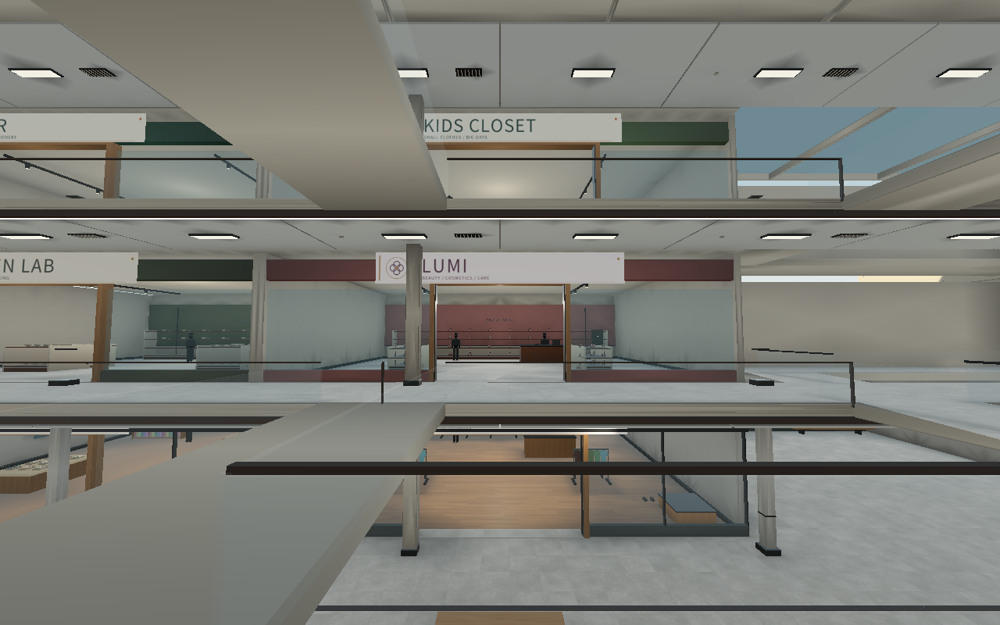
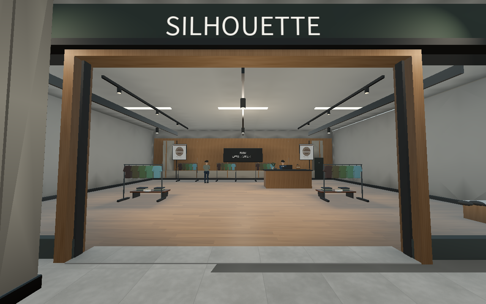
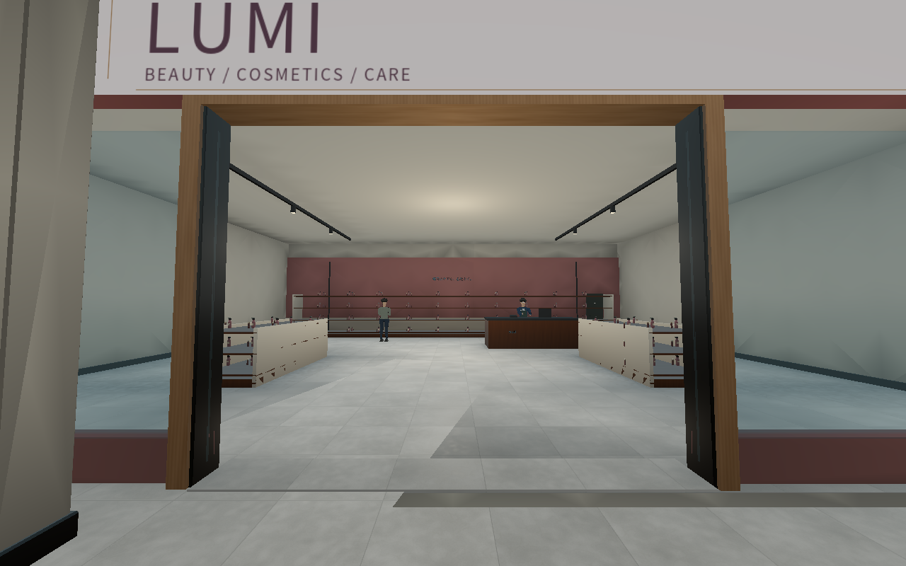
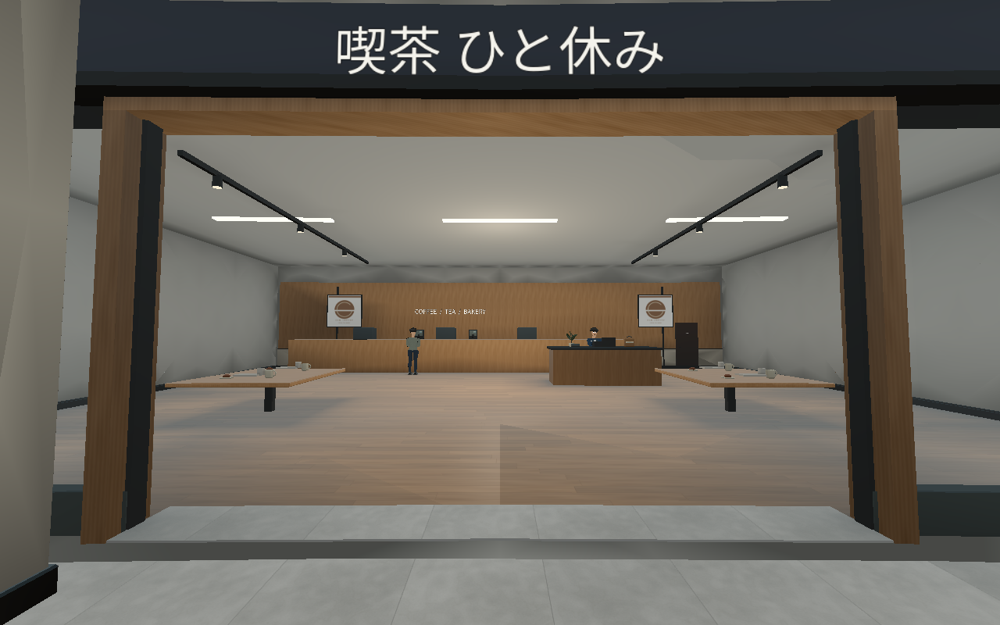
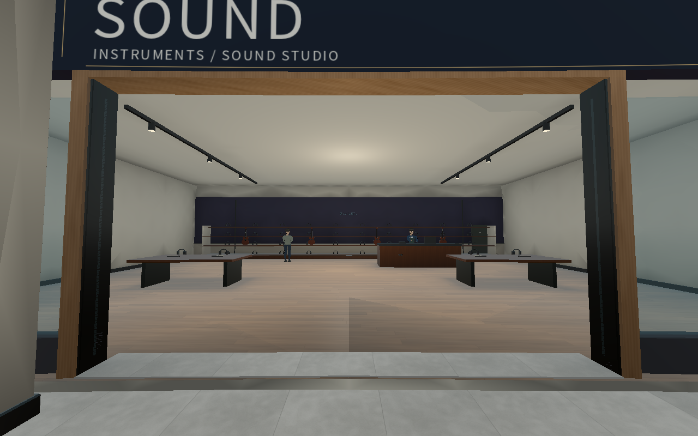
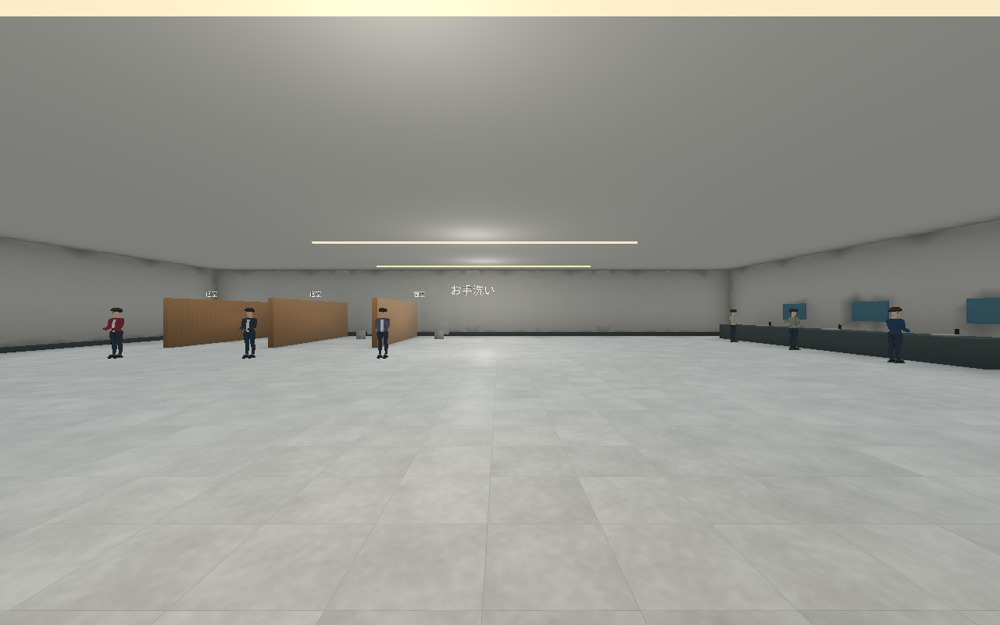
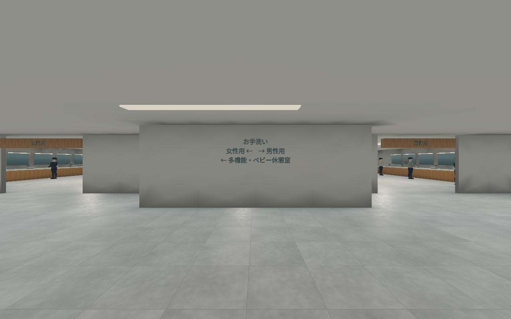
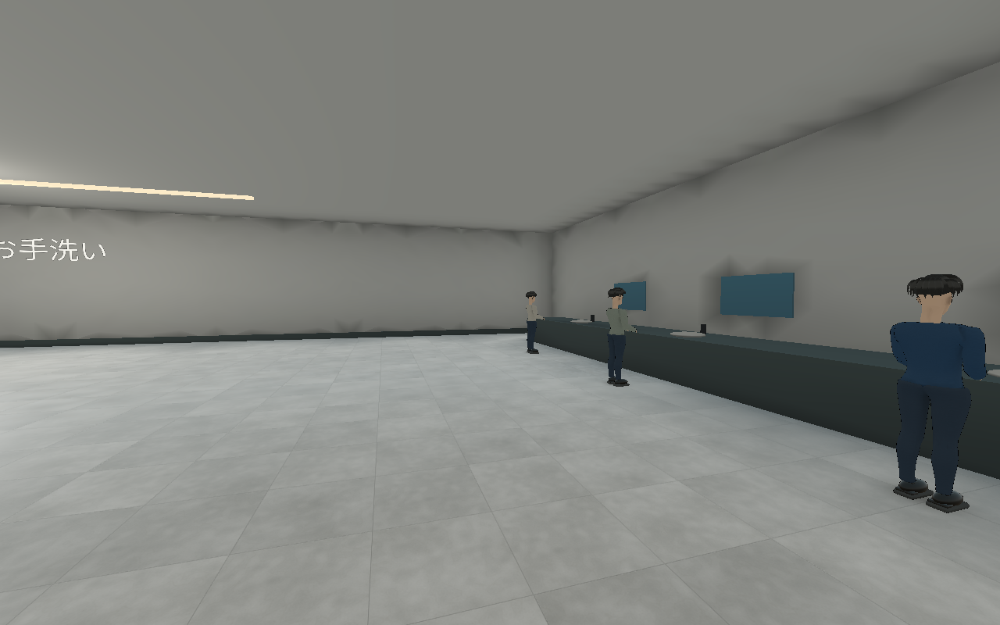
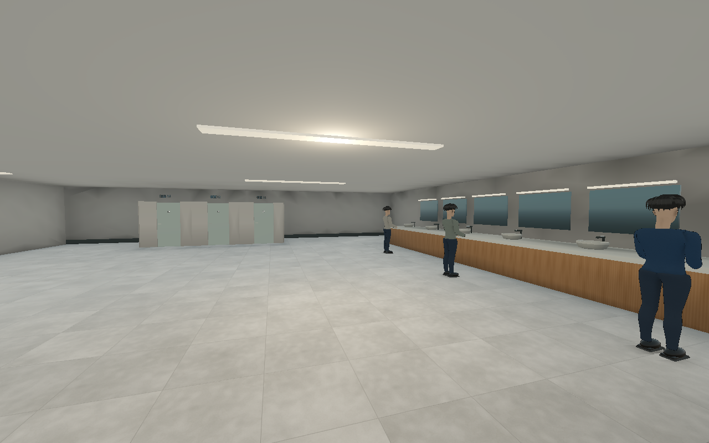

# 0.17：A館上階の店舗とトイレ

その後の **0.17.1** で専門店以外も含む全83店舗へ看板を拡張した。[全店舗の対象一覧と実画面](MALL_SIGNAGE.md)。以下の42ブランド/68店と671項目は0.17.0時点の記録。

2026-10-25（日本時間）。[全体改修案](MALL_REDESIGN_PROPOSAL.md)と[第1工程](MALL_PHASE1.md)に続く、実際に歩ける内装の更新。

**実装済み：A館2/3階の業種別24店舗、A館1階トイレ、個室・試着室等の開閉扉13枚。** 建物外形と館間の位置関係を保ち、B/C館拡張と不足6フロアは後続工程に残す。

追加指示に合わせ、全68専門店の看板を42の架空ブランドのデザインへ変更。人物モデルはv0.16の顔・髪・体型を引き継ぎ、今回の変更は内装・看板・初期配置が中心。

## 店舗看板のデザイン

[42ブランドのデザイン一覧](../assets/retail/store_signs.png)。ロゴマーク・文字組み・配色・業種表示を組み合わせた独自のアートを使用。コスメは花形、楽器は音の波形、服飾はモノグラム、眼鏡はフレーム、旅行用品は軌道、書店は本などの図形を配置する。実在企業のロゴは使用しない。

1枚の画像アトラスを共有し、曲線と回転した店にも対応した面へ貼る。元の店名文字は該当する68箇所だけ非表示にし、館内案内や会話は維持。看板は近傍の階/区画ごとにまとめ、75mで距離カリングする。物理床・猫の経路・スキャン判定には追加の障害物を作らない。

## 店舗を階ごとに変更

従来は1階の12店舗を同じ内装で2/3階へ再配置していた。今回は上階専用のカタログと什器定義から生成する。床の18×16m区画は維持し、入口幅・レジ・展示・奥壁・試着室を業種に応じて変える。

| 階 | 今回の構成 |
| --- | --- |
| 2F | キッチン用品、コスメ、レディース、眼鏡、バッグ/旅行、寝具、アクセサリー、メンズ、靴、服飾雑貨、カフェ、生活家電 |
| 3F | 画材/文具、こども服、おもちゃ、模型、楽器、ゲーム、スポーツ、児童書、アウトドア、旅行、デザートカフェ、文具/小物 |

輪郭のあるハンガー衣類、ポンプ瓶、眼鏡/アクセサリーのショーケース、キャリーケース、ベッド、ギター/鍵盤、ぬいぐるみ/模型などを配置。看板・床・奥壁の色・照明器具も業種に合わせる。実在ブランドや店舗画像を使っていない。

2F・変更前：

2F・変更後：

3F・変更前：

3F・変更後：

## トイレ

長い洗面ブロックと3枚の仕切りを、用途が分かる区画へ変更した。入口正面に目隠し壁と方向案内を配置し、男女別入口、洗面12台、鏡、蛇口、個室9を設置。便器はボウルの内側・台座・タンクを持つ形へ。多機能トイレとベビー休憩室に手すり、洗面、交換台、ベンチを配置した。天井を約3mへ下げ、照明と案内板の高さを揃える。従来の利用者6人は新しい洗面位置へ初期配置する。

入口・変更前：

入口・変更後：

洗面/個室・変更前：

洗面/個室・変更後：

## Fキーの扉操作

2.6m以内で個室・多機能室・ベビー室・試着室の扉を狙うとFの開閉案内を表示する。扉を狙っているときは開閉を優先し、ソナーのクールダウンを消費しない。それ以外のFは従来のソナー。

扉は実際の衝突を持ち、閉じているとスキャンの光線を遮る。開閉はアニメーションし、プレイヤー/NPCが動く範囲にいると停止する。メニュー中も停止し、新ランでは閉じた状態へ戻る。動く扉は静的メッシュ統合やAOへ焼き込まず、起動後に生成する。

個室と試着室は今回は空室。NPC・宝箱を配置せず、猫/歩行客の経路にも使わない。プレイヤーは開けて入れる。NPCが個室を占有して扉を使う施設利用AI、鍵操作、鏡への人物の映り込みは未実装。

## 既存システムとの整合

`UpperRetail.fixtures()` と `RestroomWing.walls()/obstacles()` から実物と経路用の占有範囲を対応させる。空の私室は入口状態によらずNPC/宝箱候補から除外する。

本物のID・スキャン・AP・成長のロジックを維持。300人（267定位置/33歩行）、18移動地点も継続。上階48枠とトイレ6枠はラン開始前の配置を家具に合わせ、それ以外の213固定枠は旧版と同じID順・位置・役割を保持する。本物をラン中に移す処理は追加していない。

案内図は第1工程の棟/階の窓口を使用。移動中のミニマップを画面枠で切り取る際、重複頂点や面積のない細片によって三角形分割が失敗するケースも修正した。

## 検証と描画データ

**18組・671項目、失敗0。** [実行条件と各項目数](mall-phase2-verification.json)。基本ゲーム、階段/エスカレーター、B/C館、猫、宝箱、スキャン、小物、保存された描画データ、人物描画、看板を検査した。

追加検証では変更した54人すべてについて猫の接近位置と初期スキャナーの見通しを確認。100パターンの宝箱配置が入口から到達可能で、全13扉の注視・開閉・通過、接触防止、メニュー停止、ソナーとの優先、ラン開始時のリセットを確認した。

| 保存データ | v0.16 | v0.17 |
| --- | ---: | ---: |
| 専門店の小物用メッシュ | 68 | 68 |
| 小物モデル配置数 | 2,775 | 3,207 |
| 静的区画 | 438 | 438 |
| 静的三角形 | 1,183,147 | 1,185,743 |
| 小物三角形 | 705,064 | 1,020,728 |
| 全サーフェス | 1,869 | 1,858 |
| 経路点 | 18,226 | 18,013 |

小物配置数は各版の集計で、3,207点を旧版に追加した意味ではない。ポスター88・商品札123は別集計。サーフェス数は同時描画回数やFPSではない。細かな商品で小物の三角形数は増えている。従来の小物LOD（標準40m/軽量28m/高画質55m）と共有材質を利用し、無負荷とは扱わない。

表は保存済みワールドの値で、起動時に追加する看板と開閉扉の描画は含まない。看板はミップマップと異方性フィルターを使い、遠方や斜め方向からの文字のちらつきを抑える。制作元は `tools/build_store_signs.py` と同梱Notoフォント。

ワールドを実描画環境で再生成し、24方向・半径2.4mの局所遮蔽を再計算。1,204個の静的インスタンス変換を再読込検査した。GIの完成を意味しない。

実描画はLinux/Xorg/Mesa llvmpipeで検証。Windows版はクロスビルドで、Windows実行・RTX実機FPS・5,000人の描画性能は未測定。比較画像は同じカメラ/画質設定の実描画で、HUDと道具を隠した内装確認用。NPC配置は今回の変更対象。写真・生成画像による目標イメージではない。

## 配布と次の工程

新しいZIP全体を旧版と別フォルダーへ展開する。ソース版はGodot 4.6.3 Standardで `project.godot` を開き、F5で起動。Blender/Pythonはプレイに不要。

ソースZIPにはゲームのコード・素材・ツール・テストと今回の比較画像を収録。過去版の比較画像はGitHubへのリンクに置き換え容量を抑える。リポジトリ側の画像は削除しない。オフライン起動に影響しない。

次はこの区画のプレイ確認を踏まえ、B館の広場・分岐・大型店を含む骨格へ進む。全館の外形、残る6フロア、店舗固有の高精細素材、設備の細部、施設利用AI、製品品質の照明/反射は後続工程として残る。
