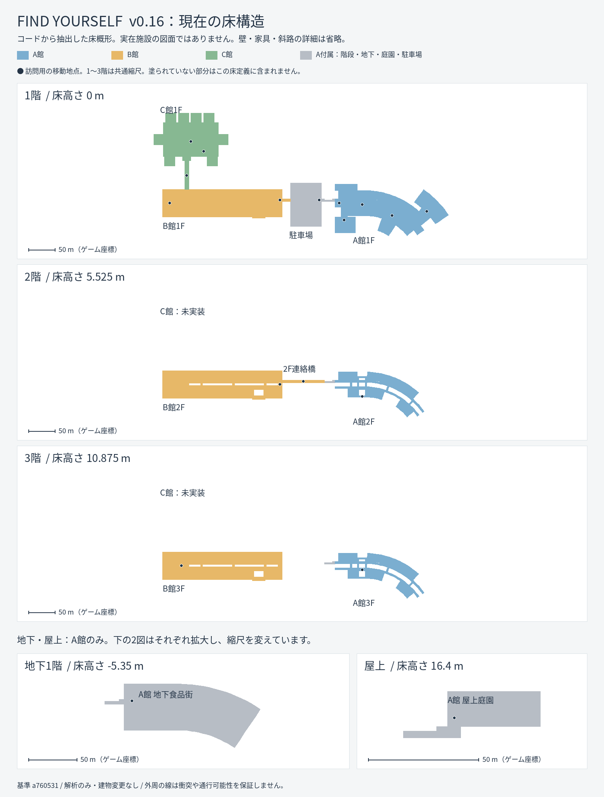
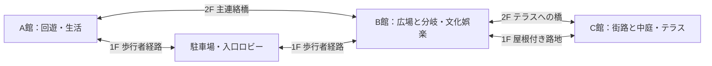

# モール構造の解析と15フロア改修案

作成日：2026-10-24。解析基準：v0.16、コミット `a760531aab0c6ce24884c4c5c585b5fffade4901`。

**0.19時点の進捗：建物の外形・通路の骨格は未改修。** 0.17〜0.19で店舗用途・トイレ・看板・陳列・素材を更新したが、本書のB館主軸/副回廊/店舗島/3広場は設計段階のまま。内装改修を構造改修の完了として扱わない。[次の構造改修の範囲](MALL_STRUCTURE_NEXT.md)。

その後の作業：[代表フロアの寸法案・断面・共通窓口の第1工程](MALL_PHASE1.md)。以下は解析時点の記録。

**これはレビュー用の設計案。建物、ゲームコード、NPC、配布ZIPは変更していない。** 本文の「現状」はコードと保存済みマニフェスト、「参考図」は今回添付されたkaze 1F・2F・3F、「提案」は未実装・未確定を示す。

## 1. 解析対象と資料の限界

指定された [DESIGN.md](DESIGN.md)、[ART_AND_LAYOUT.md](ART_AND_LAYOUT.md)、[WORLD_BAKING.md](WORLD_BAKING.md)、[mall.gd](../scripts/mall.gd)、[mall_annex.gd](../scripts/mall_annex.gd)、[mall_curve.gd](../scripts/mall_curve.gd) を確認。加えてB/C館、群衆の経路、宝箱、HUD、移動、描画統合、キャッシュ処理を確認した。

添付図は**kazeの地上3階分**。mori・OUTLETの平面全体、敷地全体の正確な方位・距離、地下平面、断面は今回の資料では未確認。公式サイト本文もネットワーク制限で取得できていない。以下は施設全体の実測調査ではない。画像上の上下左右を、そのまま東西南北と解釈しない。

参考図の白い領域には通路・広場等も含まれるため、白い箇所すべてを吹き抜けとは扱わない。吹き抜けの開口範囲・天井・採光は、以前の内観写真も参考にしつつ追加資料で確定する。**各棟B1〜屋上の5層、計15フロアはゲームの既定目標であり、実施設の階構成を示すものではない。**

## 2. 現在の3棟

上図は現在の床定義をGodotから読み出し、`MallCurve.polygon()`で変換したもの。実在施設の図面ではない。領域の重なりを含む床概形と移動地点を示し、壁・家具・手すり・斜路・歩行可能領域の細部は省略している。各パネルは共通縮尺。B1・屋上の小図はA館周辺を拡大している。

| 棟 | 実装階 | 平面・上下動線の現状 | 主な制約 |
| --- | --- | --- | --- |
| A | B1・1F・2F・3F・屋上 | 論理180×16mの主通路を途中から湾曲。両側の専門店、センターアトリウム、横断橋3か所、1→2→3階のエスカレーター。1Fにスーパー・フードコート・トイレ・読書/倉庫。西側折り返し階段で5層を接続 | 一つの主軸への依存が強い。2/3Fの専門店は1Fの12店を再生成して高さを変える方式。上階の床・障害物も共通 |
| B | 1F・2F・3F | 主通路184×16m、西端の42×52m大型区画、両側8専門店×3層。上階両側回廊は論理幅6m、中央開口4m、横断橋3か所。東寄りの広場に上下接続 | 分岐と周回の選択が少ない。専門店の並びは3層共通。大型区画のみ家電→生活→映画館と変化。地下・屋上は未実装 |
| C | 1F | 104×64mの屋外広場に8店舗。植栽島2つ、ベンチ、喫茶席。B館1Fから幅8m・長さ54mの屋根付き通路 | 一つの矩形広場を囲む構成。屋外街路の分岐・複数の中庭がない。地下・上階・屋上は未実装 |

寸法は**コード上の論理寸法**で、実施設の実測値でも敷地総面積でもない。Cの104×64mは広場部分で、店舗床を含む全体寸法ではない。

実装済みは **9/15フロア**。A屋上は42×16mの西側庭園を中心とする部分区画で、建物全体の屋上完成を意味しない。A西の58×82m駐車場は付属屋外区域で、別の階数として数えない。専門店はA36・B24・C8の計68店で、スーパーや地下7食品カウンター等は別枠。

### 現在の位置関係

ゲームの平面座標ではAの西側に駐車場、その先にB、Bから図上方にCが伸びる。実在敷地への一致は意図されていない。

- A–B：1Fは駐車場側の歩行路、2Fは駐車場をまたぐ長さ84m・幅5mの連絡通路。
- B–C：現在は1Fの屋根付き通路のみ。
- A–C：直接接続なし。A/B接続とB/C接続は離れている。
- ファストトラベルは全体で18地点。訪問済み・解放条件を満たす地点へ移動する。

### 湾曲の実装と注意点

`MallCurve`は、論理x=-35mを境に半径130mの変換を適用する。A主通路の東端まで約55度曲がるが、**個別の分岐路を設計する機能ではなく、一つの平面をまとめて曲げる方式**。B/Cは現在その境界より西にあり、ほぼ直線のまま。将来B/Cを東側へ移すと同じ変換が作用する。

描画・衝突・NPC位置・経路・案内図・移動地点がこの変換に依存するため、半径や原点だけを変更する改修は避ける。

## 3. 添付されたkaze図との主な違い

| 参考図から確認できる構成 | v0.16との差 | 設計への反映案 |
| --- | --- | --- |
| 図左の大型店、右上の大型店、右下の大型店など、端部に大きく異なる形・面積の店舗 | A/Bとも規則的な店舗列が目立つ | 大型店を目的地にし、その間に小中規模店を連ねる。矩形モジュールの等間隔配置を減らす |
| 斜めの主通路、外側の湾曲通路、中央区画の周囲を回る別経路 | Bはほぼ一本の軸、Cは一つの広場 | 主軸＋回遊路＋短い接続路にし、2つの目的地の間に別ルートを設ける |
| 「光・時・翼」の広場と中央飲食区画が節になる | 広場が少なく、施設の距離感や方向の手掛かりが弱い | 役割と形の異なる2〜3の主要広場を設定。広場で通路幅、天井高、採光、床仕上げを変える |
| 2Fにmoriへのセンターブリッジ、OUTLETへの2つのブリッジ表示 | 現状はA/B2FとB/C1Fの単純な接続 | B2Fを館間接続の拠点にする。Cへの2F橋と屋外街路の接続を設計する |
| 同じ端部でも1Fスポーツ、2F書店、3F映画館等と用途が変化。左側大型店や中央飲食も階で構成が違う | 既存専門店は上下階でほぼ同じ | 用途に応じて区画の統合・分割、厨房、試着室、客席、ストックを変える |
| 駐車場側出入口や広場付近に複数のトイレ・縦動線、3F図に屋上駐車場の案内 | トイレはA1F中心で簡易造形。縦動線も少ない | 各棟の複数コアにトイレ等をまとめ、上下階で設備位置を揃える。駐車場からの入口も目的地として設計する |

参考図にある実店舗名は比較のために読み取ったもの。ゲーム側では架空の店名・看板・商品を使用する。

## 4. 建物別の改善案（未確定）

**A館：回遊・日常利用の館。** 主回廊と副回廊が2つ以上の広場で合流する構造へ。広い中央アトリウムと小さな採光広場を描き分け、端部に食品/生活系の大型店を置く。2Fは服飾・美容・住まい、3Fは家族・本・趣味・飲食へ用途を変える。既存の読書・食品・着席客を活かす。参考の中心は回遊型モールの考え方で、moriとの正確な対応は資料を追加してから決める。

**B館：kaze図を主に参考にする館。** 直線の長さを残しつつ、斜めの主軸と湾曲した副回廊、中央の店舗島、端部大型店を組み合わせる。3つの広場を駅側入口・中央・館間橋側に配置する案。2FはA/Cへの橋と書店・カフェ、3Fは映画・ゲーム・飲食を目的地にする。現状の長大通路という性格を保ち、袋小路だらけの迷路にはしない。

**C館：屋外の街路と中庭の館。** 店舗列をずらし、植栽・舗装・庇・短い屋根付き路地で2〜3の中庭を結ぶ。2Fは橋からつながるテラス回廊、3Fは後退した小規模店舗・体験施設とする案。Cまで一体の密閉箱にすると3棟の違いが失われる。B1・3F・屋上の構成は、現実のOUTLETの再現ではなく15フロアを成立させるゲーム用の創作案。

**共通の内装。** 柱割り、床目地、店舗境界、入口高さ、吹き抜けのスラブ厚、手すり、空調・照明・設備点検口を整合させる。店は商品を増やすだけでなく、販売面積・レジ・試着室・厨房・ストック・客席の関係から作る。採光と店内照明を分け、まず代表区画で質感・露出・影・性能を確認してから広げる。現在の局所AOを、完成した間接照明と扱わない。

**トイレ。** 現在の38×30m区画には長い洗面ブロック、3枚の仕切り、簡易便器があるが、男女/多機能の区画分けや可動扉はない。改修案では視線を遮る入口、洗面、個室、男女別/多機能・家族向けの区画、清掃用設備を設計する。複数コアへ分散し上下階の位置を揃える。NPCは洗面・待合・個室など役割を分け、扉の占有と退避経路を持たせる。

Fキーの扉操作は既存Fソナーと競合するため、扉を狙って近いときだけ「F：開ける」を優先する案、または再割当を設計時に選ぶ。現時点ではキー仕様を変更しない。個室扉でスキャン光線を遮断し、閉じた扉を猫が通り抜けない設計が必要。未到達/開かない区画に宝箱や必須NPCを置かない。

## 5. 完成形の15フロア構成案（未確定）

各セルで1フロア、計15。棟全体を等面積で積み重ねず、上階の後退・吹き抜け・大型店の床面積差をつける。

| 階 | A館：回遊・生活 | B館：都市型・文化娯楽 | C館：屋外・アウトレット |
| --- | --- | --- | --- |
| B1 | 食品街、生鮮/惣菜、公共通路、倉庫・搬入を分離 | 地下駐車場、公開売場、縦動線ロビー、分離したバックヤード | 半地下駐車場、公開ロビー、小規模売場、分離した搬入区画 |
| 1F | スーパー、日用品、家族向け店舗、イベント広場 | 大型服飾/スポーツ/食品店、主入口、3広場、複数の回遊路 | 屋外専門店街、カフェ、中庭、休憩席 |
| 2F | 服飾、美容、住まい、サービス、A/B橋のロビー | 大型書店、生活雑貨、カフェ、A/C橋への分岐ロビー | 橋につながるテラス、服飾・雑貨、屋根付き回廊 |
| 3F | 子ども用品、書籍/趣味、家族向け飲食、イベント | 映画館、ゲームセンター/屋内遊園地、飲食街、ホール | 後退した店舗群、スポーツ/体験施設、展示、屋外デッキ |
| 屋上 | 庭園、休憩テラス、設備区域を分離 | 屋上駐車場、歩行者経路、階段/エレベーターロビー | スカイテラス、庭園、展望歩廊、設備区域を分離 |

地下を含む公開区画は通常移動だけで到達可能にする。ファストトラベルは短縮手段であり、解放前に必須の移動手段にしない。大型店の階高や吹き抜け寸法は、この表だけで確定しない。

### 館間の接続案

接続関係の案であり敷地の方位・距離を示す配置図ではない。橋の追加数・実長・A/C直接接続は未確定。各橋の到着先を広場やロビーにし、店舗裏や狭い廊下へ突然接続しない。全体配置と接続端点を先に仮固定し、各館の詳細設計を進める。

### 人数と終盤の探索

元の仮配分を維持した検討出発点：

| 階 | A | B | C | 合計 |
| --- | ---: | ---: | ---: | ---: |
| B1 | 180 | 320 | 100 | 600 |
| 1F | 420 | 650 | 370 | 1,440 |
| 2F | 420 | 600 | 330 | 1,350 |
| 3F | 350 | 580 | 300 | 1,230 |
| 屋上 | 130 | 150 | 100 | 380 |
| 合計 | 1,500 | 2,300 | 1,200 | 5,000 |

これは実測で成立を確認した配分ではない。公開床面積・通路の実効幅・店舗内の占有・滞在時間から密度を評価して調整する。現在の267定位置・33歩行の300人設定を、そのまま倍率で増やさない。固定の店員・着席・会話・施設利用と移動客を組み合わせる。

終盤は階/区域ごとの探索履歴、最後に確認したNPC位置、ソナーの瞬間表示、訪問済み移動地点を組み合わせる案。マップ上の情報粒度は能力の価値と合わせて調整する。本物だけを特別表示して先に教える仕組みにはしない。

## 6. 改修で壊れやすい既存の結び付き

| 関連箇所 | 現状と改修時の対応 |
| --- | --- |
| `mall.gd:37–178` | 床と経路障害物を矩形リストで別に管理。上階2層が床/障害物を共有するため、フロア別の店舗変更には分離が必要 |
| `mall.gd:126–132` | 高さから共通の5階層へ丸める。最初は既存階高を維持し、棟ごとの異なる高さはフロア識別を分離してから導入する |
| `mall.gd:197–209`, `c_wing.gd:contains()` | 棟/区域の識別にx/z閾値を使用。棟を動かす前に棟ID・区域ポリゴンによる識別へ置き換える |
| `crowd.gd:42–110` | 2mグリッドのAStar3Dと手動の斜路接続。猫・歩行客・アイテム誘引の経路が関連。エスカレーターを見た目だけ移すと接続が残る |
| `run_loot.gd:28–48`, `cache_field.gd:nearest()` | 候補点から6m間隔を確保して10箱を抽選し、開封は距離と壁遮蔽を検査。新しい狭い部屋/扉では、箱本体を置ける余白と開封位置まで検証する |
| `mall.gd:HUBS`, `main.gd:679–697` | 18地点を位置で訪問判定し直接移動。改修後は安定した地点ID、所属階、安全な着地空間、訪問条件を対応させる |
| `hud.gd:241–287` | 外形の表示範囲は床定義から自動算出される。一方、階段・店・主要区画の描画には固定定義もある。新しい棟/階の切替と詳細地図を共通データから作る |
| `mall_curve.gd` | 全体に共通の論理/実空間変換。棟の再配置と曲線の追加には、所有棟が分かる座標変換の互換層が必要 |
| `render_chunks.gd`, `world_cache.gd` | 静的形状を区画統合して保存。可動扉を統合すると動かせなくなる。可動物は静的ベイクから分離する |
| `floor_contacts.gd` | A地上3層・固定範囲の1024角RGB近似陰影。15フロア全体の照明としては使えない。範囲/階別の素材・陰影設計を拡張する |

## 7. 既存システムを保つ実装手順案

**段階0：設計レビュー（今回）。** 全体配置、主要広場、橋の接続端点、各階用途、公開/非公開区画を確認する。次に代表フロアの寸法入り平面と吹き抜け断面を作る。上表の用途はこの時点で変更可能。

**段階1：現状を再現する共通データと互換層。** `(building_id, floor_id)` ごとのフロア定義を用意する。外形、歩ける床、吹き抜け開口、店舗/什器、衝突、上下接続、NPC役割地点、宝箱候補、移動拠点、表示区画を関連付ける。既存の生成/管理クラスは維持し、最初はv0.16と同じ形状・地点を出力する。表示名をID代わりにせず、改名で訪問履歴や接続が切れない形にする。

座標変換は先に窓口を統一し、Aは従来の湾曲、B/Cは従来位置を保持する。将来は各館の曲線・分岐を実座標のポリゴンとして設計する案だが、全呼び出しを一度に別座標へ置換しない。各段階で順変換/逆変換、棟・階識別、表示と経路の一致を確認する。

**段階2：代表区画で品質を確認。** 既存A館2/3階の一部で用途と什器を変え、サービスコアのトイレ1組を作り込む。既存床の範囲内を優先する。必要なら可動扉をここで独立した動的オブジェクトとして検証。内装・照明・人の配置・FPSを同じ画角と移動ルートで比較し、広げる品質基準を決める。

**段階3：B館の骨格。** 承認された配置に従い、1Fの主軸・副回廊・3広場・大型区画を作り、2/3階へ吹き抜けと縦動線を通す。各階は専用の店舗構成にする。A/B橋の到着点を合わせ、C向け2F橋の接続端点を確保する。1フロアずつ接続/性能を検証してから次へ進む。

**段階4：A館の回遊構造。** 二つ目の経路・広場・採光開口、各階の店舗統合/分割、分散したトイレと上下コアを実装する。既存の地下・庭園・駐車場への接続を保つ。入口から上階を見上げる画角と、上階から下を見る画角を確認する。

**段階5：C館と不足6フロア。** C1Fを街路と中庭へ改修し、C2Fテラスと橋、C3F、C地下/屋上、B地下/屋上を順に追加する。各階で公共経路とNPC/宝箱の到達性が成立してから公開する。外観・駐車場動線も、この時点で各棟の出口と揃える。

**段階6：5,000人と全域品質。** 群衆を段階的に増やす。屋内外、全層が見える吹き抜け、橋、密集した飲食街、特殊スキャン直後、終盤の疎な探索を計測する。結果でLOD・AI頻度・区画表示・配置密度を調整する。最後に条件を明示した10万試行以上の時間モデルを新マップに合わせて更新し、実プレイ時間と区別する。

各段階は独立した変更・比較資料としてレビュー可能にする。建物全面の差し替えを一度に行わない。

### 各実装段階での確認項目

- プレイヤーの通常移動で各公開区域を往復できる。上下の斜路・踊り場・入口をカプセル寸法で確認し、見えない床/壁や転落箇所がない。
- 全歩行グラフの必要区画が接続し、猫が各定位置NPCのスキャン可能位置へ到達できる。ガラス/閉扉を通り抜けず、階差で誤判定しない。
- 10宝箱の個数・種類比を維持し、扉の初期状態を含めて配置/接近/開封可能。開放必須区画に解除不能な扉を作らない。
- 案内図の棟・階・外形・開口・橋・現在地が実空間と一致。移動先の足場/頭上/周囲が安全で、未訪問地点にワープできない。
- 本物IDは開始時に全員から等確率で一度だけ選び固定。地形変更は新規ラン開始前に完了。描画省略や遠距離AIでもID/位置の状態を失わない。最初のスキャナーだけがクリア確定し、他手段は通知。その他のNPCを消さない。
- 建物入力を変えた後は実描画環境でワールド再生成→局所遮蔽→保存検証。ソースハッシュ、MultiMeshの非ゼロ変換、衝突/経路/役割地点を検査。ヘッドレスでマップを再保存しない。

## 8. 5,000人に向けた描画・AI設計案

現状はCompatibility renderer、静的区画統合、MultiMesh、距離による人物/小物LODを使用。保存済みマニフェストは438区画・静的/小物合計1,888,211三角形、経路18,226点・31,471辺。これは**生成済みデータの数で、同時描画数や実機FPSではない**。現在300人からの拡張余地を数値だけで保証しない。

- 論理上の5,000人は常時保持し、近くは詳細、遠くは簡易な表示・更新へ分ける。店員や着席客まで毎フレーム経路探索しない。遠方客の移動も扉と経路の状態に従い、未処理NPCを都合のよい位置へ移さない。
- 店舗・階・翼単位の表示範囲と、吹き抜け/窓/橋から見える関係を設計する。上下階を単に非表示にすると吹き抜けで破綻する。現在の区画統合だけで屋内遮蔽やストリーミングが完成しているとは扱わない。
- 長い通路の見通し、ガラスの重なり、同時に見える高密度区画、影付き照明の数を、間取りと合わせて抑える。人の密集だけを理由に通路を一律に広げず、滞留場所と通過動線を分ける。
- 同じ顔/衣服の素材共有と詳細人数の上限を使い、読み込みやAIをフレームに分散する。描画資産の出し入れとゲーム内の人物状態を分離する。
- 計測は同一路線でのフレーム時間の中央値・p95/p99・大きな停止、CPU/GPU時間、メモリ/VRAMを記録する。ユーザーのRTX 4060 Laptop実機での性能は未測定。クラウドのソフトウェア描画結果をその実機のFPSと扱わない。

## 9. 今回の確認結果と未確定事項

Godotで床定義・変換済み外形・18移動地点を読み取る解析のみ実行した。マップの生成・保存・再ベイク、ゲーム動作変更、配布物の更新は行っていない。解析時のワールド入力ハッシュは保存済みマニフェストの `2974f5139435938fb2a4231590f6a275aee61717ab29cf4656dfc5d4f373497e` と一致した。

未確定：各館の最終寸法・向きと離隔、mori/OUTLETとの対応、開口の正確な輪郭、橋の数と実長、専用上り/下りエスカレーターやエレベーターの仕様、扉キー、各階の店舗数、照明方式と性能予算。今回の提案を確認してから、寸法入りの代表フロア案へ進む。
