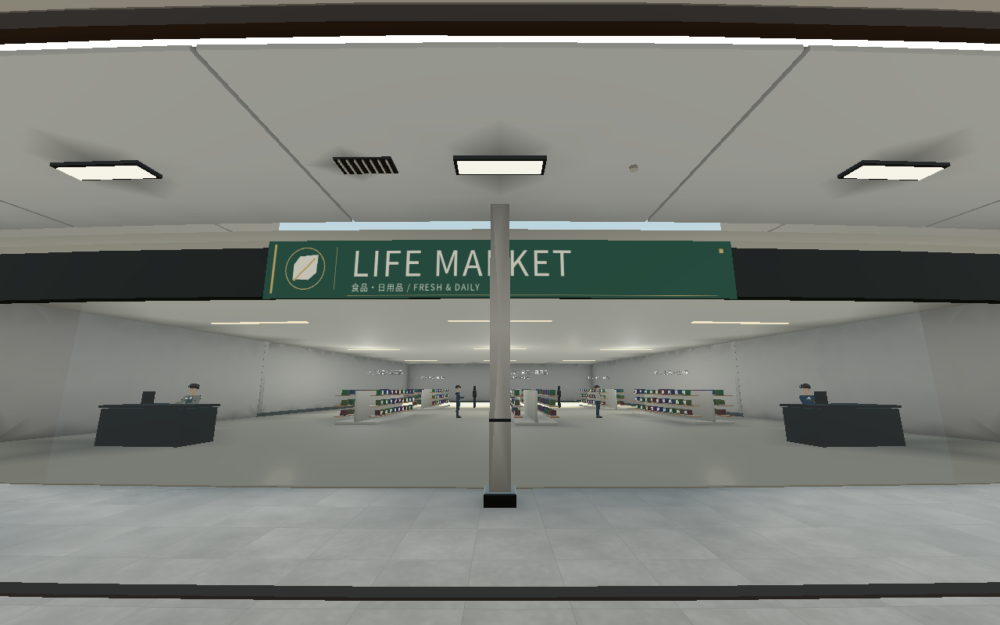
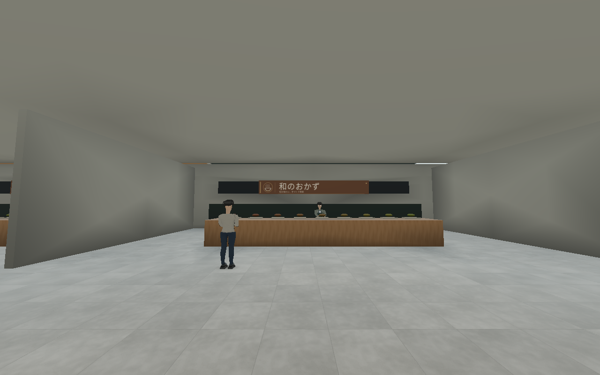
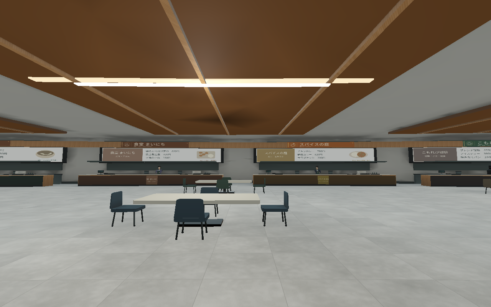
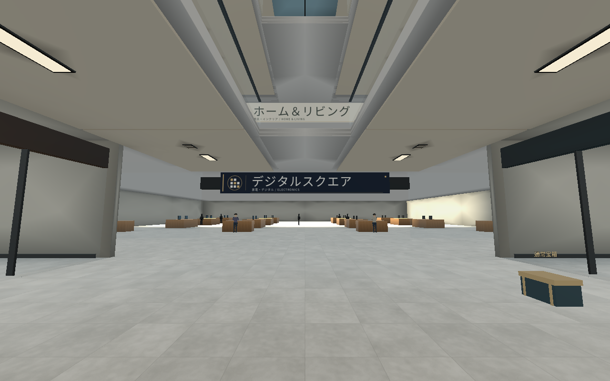
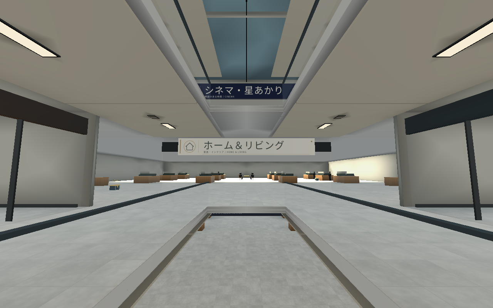
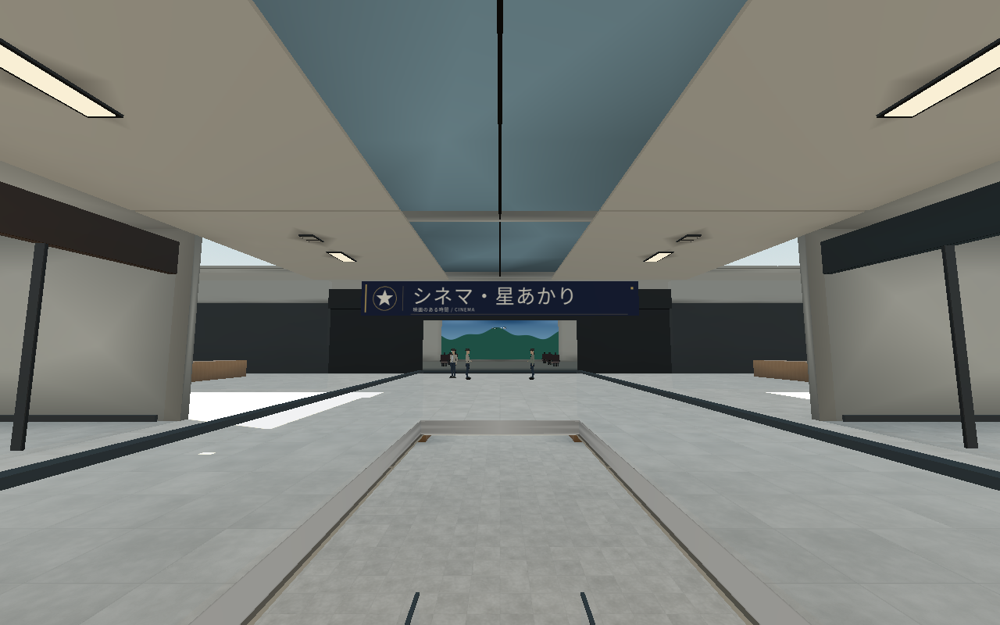

# 0.17.1：全店舗のブランド看板

前版では専門店68店だけが対象だった。今回は現在のマップに実装済みの**全83店舗**に適用し、入口・店内の補助看板を含め**88枚、58の架空ブランド**とした。未実装フロアの店舗はこの数に含まない。

| 対象 | 店舗数 |
| --- | ---: |
| A館1〜3階の専門店 | 36 |
| B館1〜3階の専門店 | 24 |
| C館の専門店 | 8 |
| A館食品スーパー | 1 |
| A館地下食品街 | 7 |
| A館フードコート | 4 |
| B館家電・家具・映画館 | 3 |
| 合計 | **83** |

スーパーの奥壁、書店読書ラウンジ、フードコートの入口と左右壁の5枚も同じブランド表現へ変更。旧店名文字84箇所を非表示にし、フードコート4店には梁前面へ看板を追加した。既存メニュー・価格・商品案内と館内誘導表示は読みやすい表示を維持する。

## 実画面

[58ブランドのデザイン一覧](../assets/retail/store_signs.png)。食品には麦穂・器・果物・カップ、映画館には星を使用し、店ごとに図形・配色・日本語店名・業種の組合せを作る。実在企業のロゴは使っていない。

## 描画と既存処理

4096×1920の共有画像1枚と共有材質を使用。近傍区画ごとにメッシュをまとめ、75mを越える看板を非表示にする。ミップマップと異方性フィルターを継続。新しい看板に衝突・AI・フレームごとの更新処理は追加しない。

建物・メニュー・NPCの配置・経路・宝箱・スキャン・APは変更せず、0.17.0の保存ワールドを使用する。人物モデルも変更していない。版番号の表示はプロジェクト設定を参照するようにした。

## 検証

看板の20項目と基本ゲームの146項目、計166項目が成功。全83店舗の対象数、88枚の固有ID、84箇所の旧文字の置換、壁面の向き、アトラスUVと三角形、共有材質、距離カリング、経路用キャッシュ、メニューと案内の保持を検査した。

実画面は300人を配置したLinux/Xorg/Mesa llvmpipeで確認し、`tools/capture_all_store_signs.gd`で撮影。HUDと道具を隠した内装確認用で、目標イメージではない。Windowsでの実行とRTX実機のFPSは未検証。

旧版と別のフォルダーへZIP全体を展開し、Godot 4.6.3 Standardで `project.godot` を開いてF5で起動する。
