# 0.20：A・B・C館の構造改修

これまでの内装更新に加えて、今回は床・通路・広場・開口・店舗位置を変更する。実装済みのA館1〜3階、B館1〜3階、C館1階が対象。A館地下/屋上と既存の館間接続を維持する。

**全15フロアやレイクタウンの完全再現を完成した版ではない。** 現在は9/15フロア、300人（定位置267・歩行33）。添付されたkaze図を参考に、主軸・副回廊・広場・大型店で方向を把握できる架空施設として改修している。

## A館：北側の回遊路と新しい吹き抜け

既存の湾曲する主通路を残し、中央の案内ラウンジから北へ分岐する。新設した「木もれびの広場」、北側ショッピング回廊、大型売場、東側の飲食方面を結び、主通路へ戻れる経路を作る。新しい広場の中心は1Fが床、2/3Fが開口。上から下、下から上の視線が通る。

新しい大型売場は、1Fが生活雑貨、2Fが服飾、3Fが模型・ホビー。既存12専門店に各階1区画を加え、A館は39専門店となる。旧案内板は分岐を塞がない側面へ移し、隣のストック区画は公開通路から壁で分ける。非公開区画へNPCや宝箱を置かない。

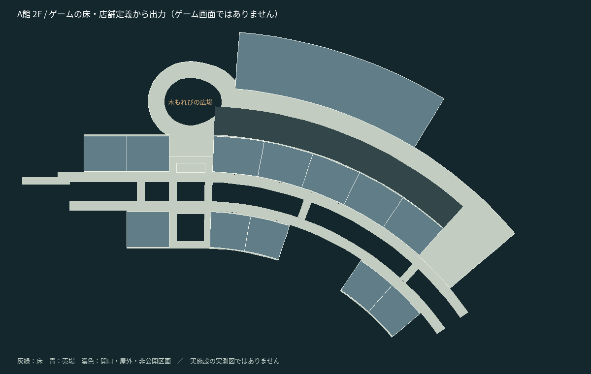

この図はゲーム画面ではない。湾曲を含む床定義と店舗の位置から生成した図。濃色の領域には吹き抜け・屋外・非公開区画が含まれる。

## B館：3広場、斜めの主回廊と湾曲した副回廊

以前の長方形の直線モールを組み直す。「光の広場」から「時の広場」で主軸が折れ、「翼の広場」と西側大型店へつながる。店舗島の外側を回る副回廊と横の接続路により、同じ目的地へ別方向から到着できる。

主回廊の計画幅は32m、上階回廊は片側6.5m、副回廊は10m。実施設の測定値ではなくゲームの論理寸法。3広場と中央の開口を1〜3階で揃え、横断橋と「時の広場」のエスカレーターを接続する。上階の床は斜路の頭上を塞がない形へ切り欠く。

各階8店と西側大型店の内装を再配置し、階ごとに用途とブランドを変える。2階は服飾・美容・雑貨・書籍、3階はキッズ・ゲーム・文具・模型・楽器・飲食を中心にする。西側の家電・家具・映画館を維持。A/Bの1F歩行路と2F橋、Cへ向かう1F屋根付き通路は、新しい館内動線へ接続する。

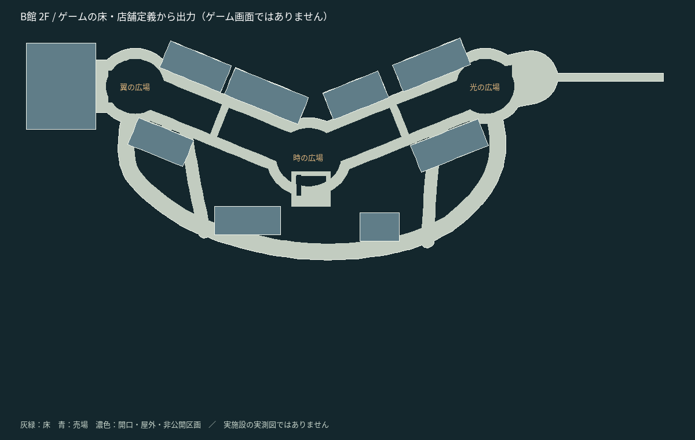

この実装は[以前の寸法検討](MALL_PHASE1.md)をそのまま施工したものではない。既存A/C館への接続を維持するために向き・広場の位置・幅・店舗配置を調整した。吹き抜けを含む床と回廊を先に成立させる構造改修で、全店舗島の造作やバックヤードの詳細完成を意味しない。

## C館：3つの中庭を結ぶ屋外街路

一つの矩形広場を囲む配置から、「ゲートコート」「ガーデンコート」「テラスコート」を街路で結ぶ配置へ変更する。8店舗を中庭と街路に向けて配置し直し、別の街路を通って戻れるようにする。各入口に接近用の床を設ける。

屋外の性格を維持し、既存の店員・買い物客・喫茶客・ベンチ客と会話客、計30枠を新配置へ移す。植栽とベンチも中庭に対応させ、街路の外側に低い庭園の地面と池を設ける。B館からの屋根付き通路は従来の接続端点を維持する。

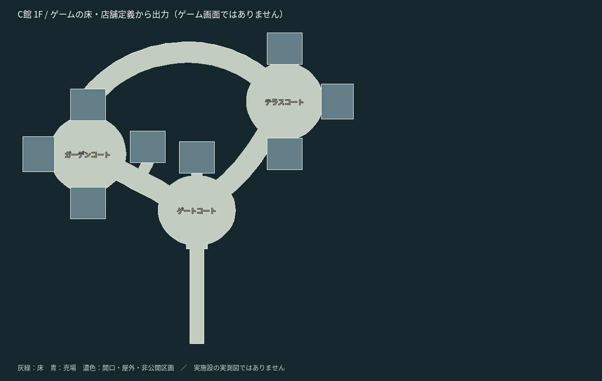

C館2F以上と地下/屋上、B館地下/屋上は今回追加していない。C館2Fの橋やテラスは、上階の床と通常移動の接続が成立してから追加する。

## ゲームシステムとの対応

- `assets/layout/mall_structure.json` が改修部分の平面入力。`tools/build_mall_structure.py` が床の穴を含むポリゴンと三角形を `scripts/mall_structure_data.gd` へ生成する。ゲームの起動にPythonやShapelyは不要。
- 同じ床ポリゴンを描画・床の衝突・移動候補の内外判定・案内図で使用。既存店舗のローカル内装と什器を配置変換し、NPCの初期位置、商品、看板、照明も合わせる。
- 回転したB館の什器は、世界軸の大きな矩形に膨らませず、店舗内の座標へ戻して経路の占有を判定する。1mの経路点を論理座標で取り、斜めの接続も壁との余白を検査する。
- マップ生成中の床照会を再利用し、経路生成後に一時キャッシュを解放する。保存前に全経路点が中央入口につながることを確認し、孤立点があれば保存を中止する。
- A館の新しい大型売場へ既存9枠を再配置し、そのうち3枠を店員へ変更。B/Cも新規ラン開始前に初期位置を組み直す。267枠の並びと300人の人口を維持し、ラン中に本物を移す処理は追加しない。
- 18移動地点のID・訪問記録を維持。B館の映画館/家電、C館の広場/休憩地点の4か所は新しい足場へ変更する。未訪問ワープは禁止のまま。
- 初期スキャナーだけで最終確認、銃・猫・特殊スキャンは通知のみ、AP・スキル・宝箱10個の仕様を維持。人物モデルそのものは変更していない。

## 比較資料と検証

旧版はコミット `81931ee3373143d03c4ad897bac390b069633ea0` の0.19。変更後も同じシード912、300人、標準画質、固定したNPCの時計を用いる。通常の視点ではHUDと手持ち道具を隠して撮影する。

俯瞰比較は**構造確認用のカット表示**。実際のゲームを起動した後、撮影中だけ屋根と上階を高さで切り、細かな商品を隠して床と壁を見やすくする。通常プレイの表示や製品機能としての透視図ではない。前節の図面画像とも区別する。

### 構造確認用のカット表示

同じ直交カメラと確認用の材質を使用する。陰影や商品の仕上げを比較する画像ではなく、床と壁の変化を確認する画像。

| 館 | 0.19 | 0.20 |
| --- | --- | --- |
| A館 | 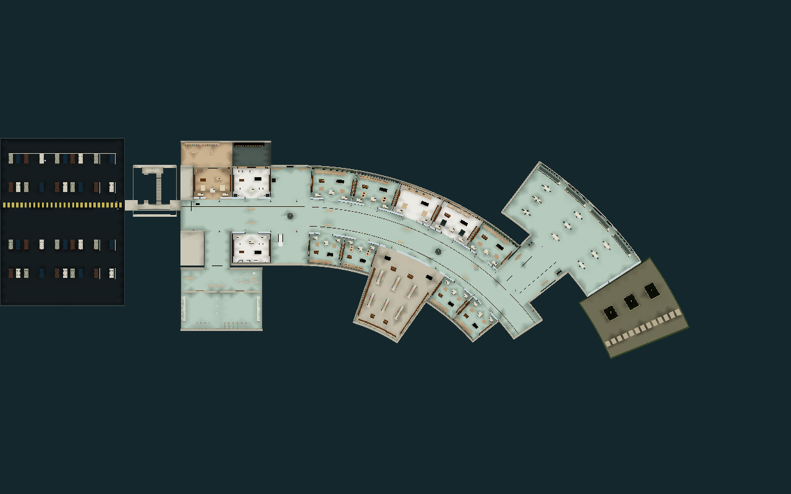 | 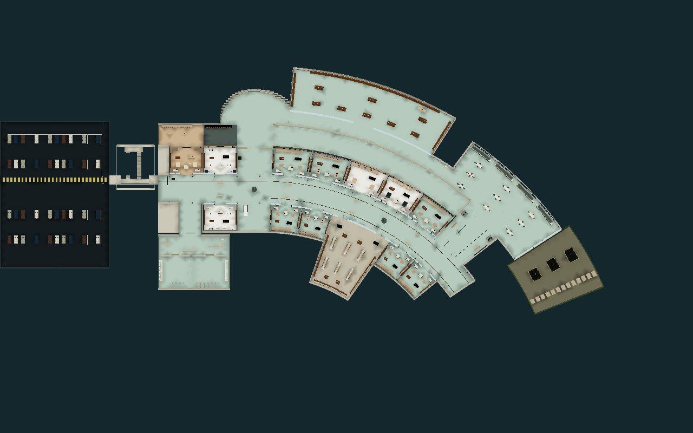 |
| B館 | 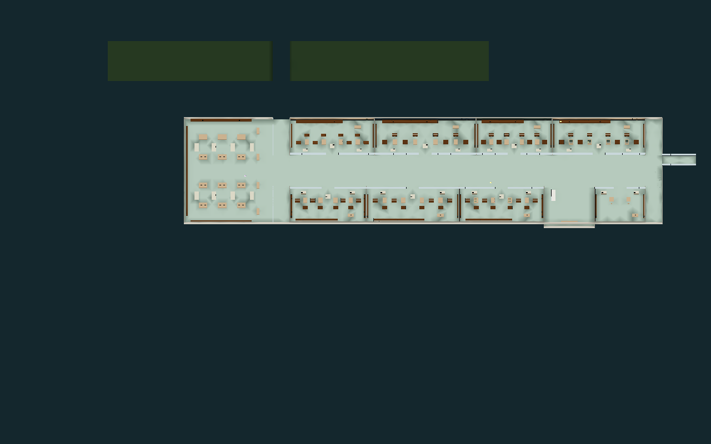 | 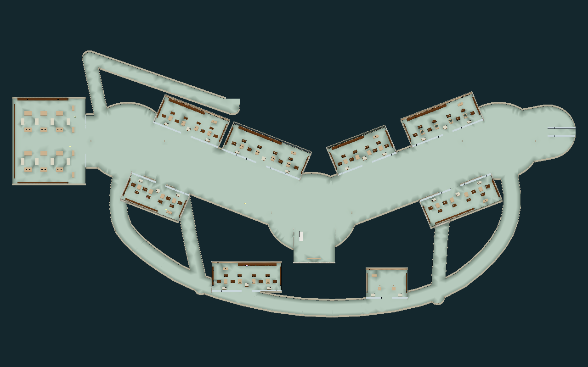 |
| C館 | 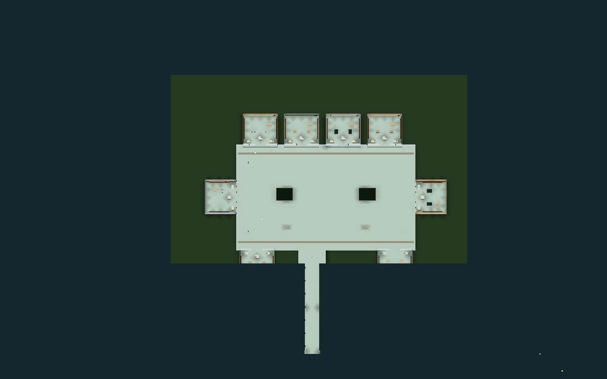 | 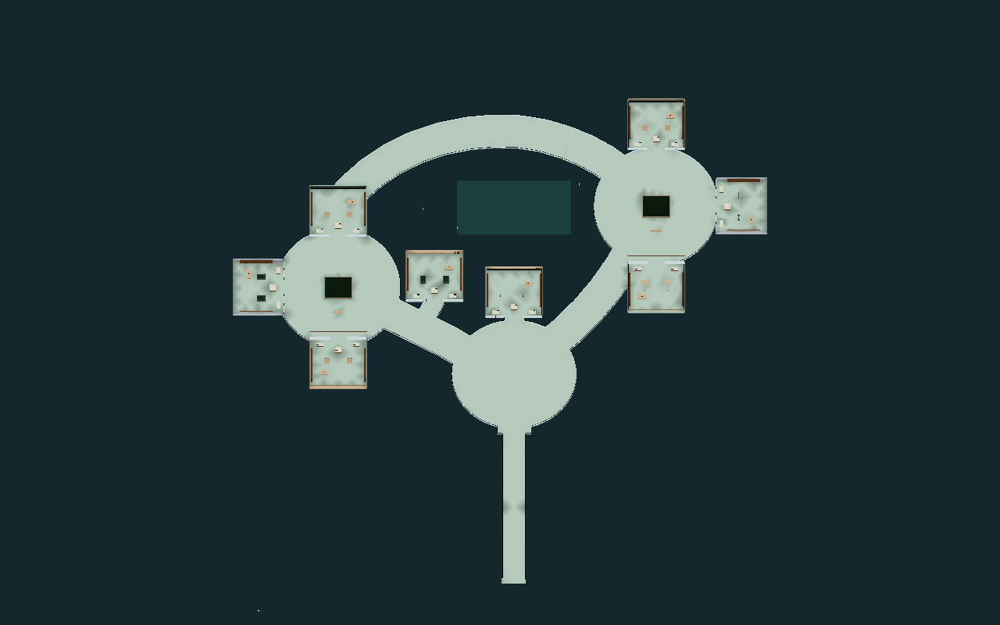 |

### 通常の視点

A館の分岐、B館入口、C館入口は同じカメラ位置・方向で撮影。

| 視点 | 0.19 | 0.20 |
| --- | --- | --- |
| A館・中央から北へ | 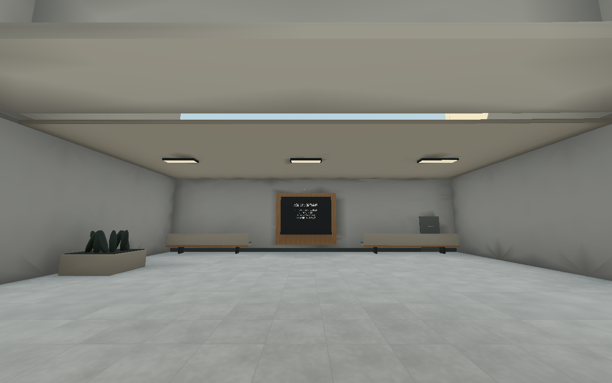 | 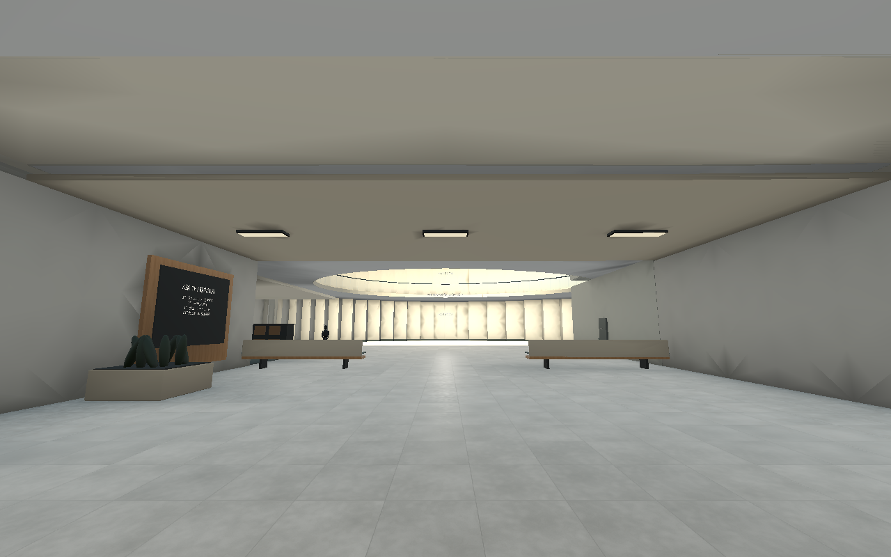 |
| B館・入口 | 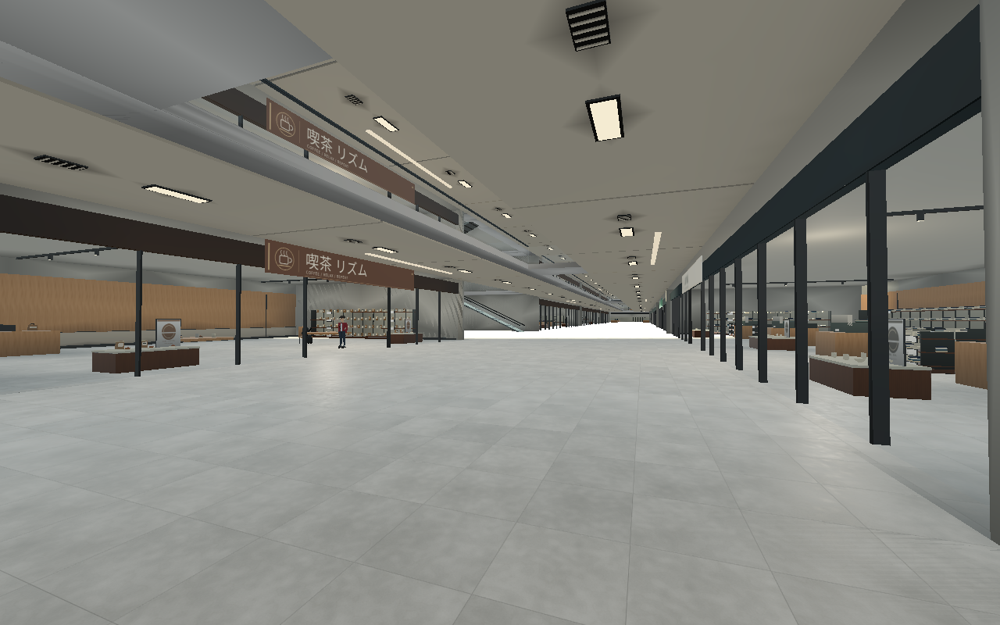 | 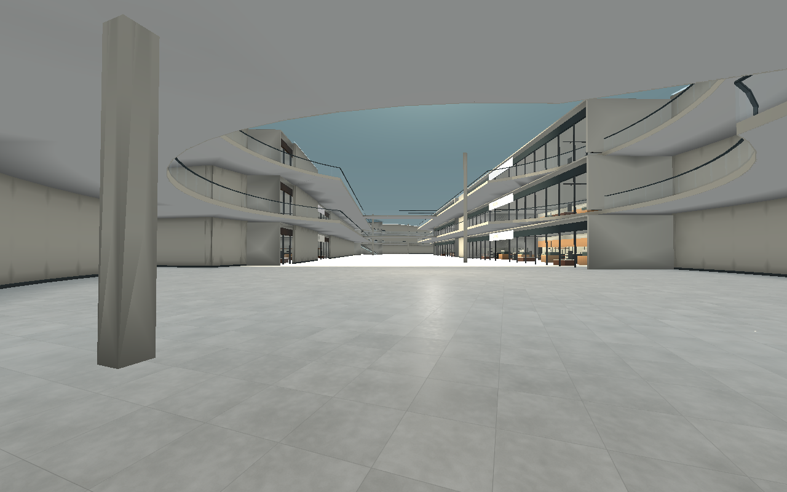 |
| C館・入口 | 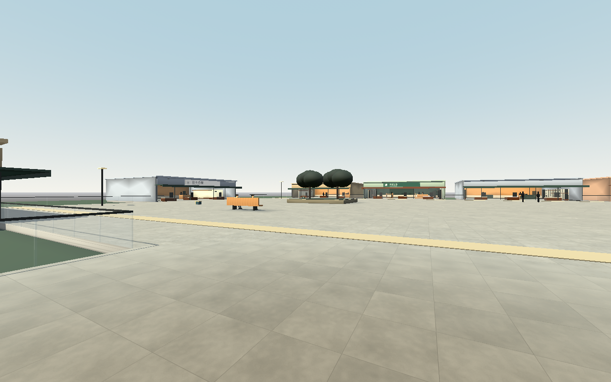 | 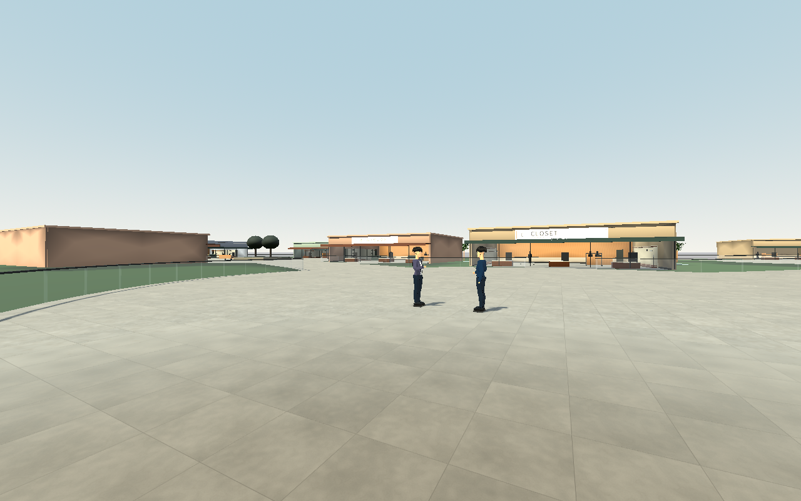 |

新しいB館の中央広場から主回廊を見る視点：

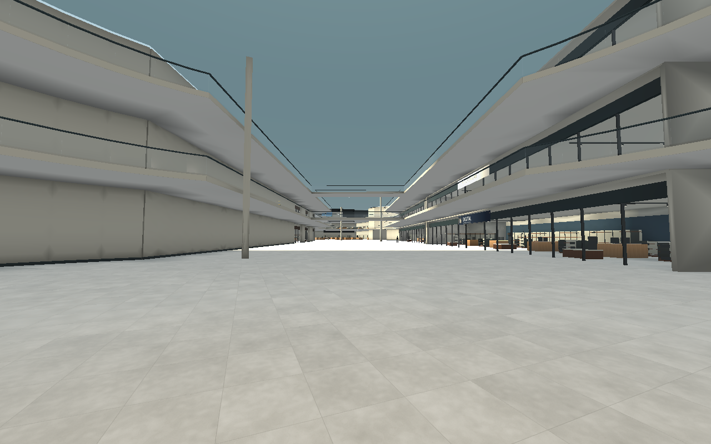

### 実際の案内図

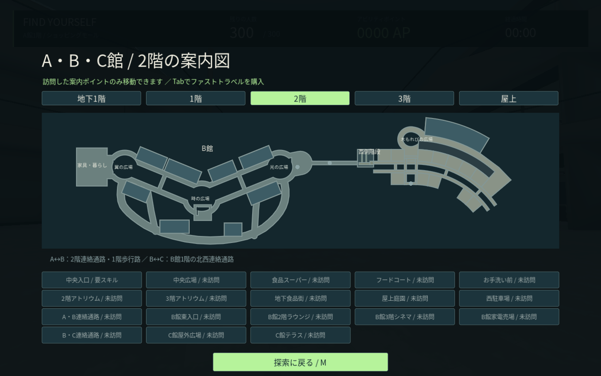

[1階の案内図](screenshots/mall20-after-map-1f.png)、[3階の案内図](screenshots/mall20-after-map-3f.png)。18移動地点の操作部を維持し、棟ごとの新しい床と上階開口を表示する。広場名と大型売場の表示位置も更新した。形状と境界をキャッシュし、移動中のミニマップで遠い館を毎回組み立てない。

### 検証結果

**21組・822項目、失敗0。** [検証条件と保存データ](mall-structure-verification.json)。構造専用の119項目で、全経路点の接続、3広場の床/開口、各店の入口、全267定位置NPCへの猫の接近、宝箱候補、18移動地点の足場、A館1〜3階の回遊とB館からC館への通しの歩行を検査した。B館の斜路は上り下りとも既存の実歩行検査を更新して確認する。

経路42,280点・267,891辺は、中央入口から全点へ接続する。商品・小物31,112組、通常の静的/小物メッシュ2,821,816三角形、静的インスタンス29,044個を保存。三角形数はインスタンスで描画する商品の全三角形や同時可視数を含まず、FPSの測定値ではない。

592基の追加什器の物理上面とNPCの余白、91枚のデザイン看板、保存したMultiMeshの非ゼロ変換、陰影と埋込テクスチャも確認。実描画はLinux/Xorg/Mesa llvmpipe。通常視点・確認用カット・案内図を分けて撮影している。

経路検索は実行時に一様な重み0.8を設定して、探索をやや積極的に進める。保存した点・辺・衝突形状を変えず、経路が少し長くなる場合がある。クラウドCPUで中央入口から48地点を調べた単回比較では、重み1.0から0.8で検索時間のp95が17.357→13.001ms、経路長はこの48本で最大1.035倍。比較順は1.0→0.8。これはCPUの経路検索のみの観測で、フレーム時間やWindows実機の性能改善を保証する値ではない。

今後は、回廊の天井設備・構造梁、店舗島の造作とバックヤード、各館の外観・館間到着ロビー、不足6フロアを段階的に作り込む。

Windows実行、RTX 4060 LaptopのFPS、5,000人の描画性能は未測定。図形データの個数やクラウドでの生成時間を、ユーザー実機のFPSや3時間の実プレイ測定として扱わない。

再生成用ツールは `shapely==2.2.0`、図面描画はPillowを使用する。`build_mall_structure.py --check` で入力と生成済みデータの一致を確認できる。`export_structure_plan.gd` → `draw_structure_overview.py` は現在の床・店舗の定義から説明図を生成する。3Dワールドは既存の実描画ベイク手順に従う。
