# B館1〜3階の骨格改修 — 開発版0.24

添付資料との[比較・施工計画](MAP_MASTER_PLAN.md)を作成した後、B館の1〜3階を先行改修した。元のゲーム本体はv0.23。**今回の完了範囲はB館の基本構造・吹き抜け・エスカレーターと既存機能との統合であり、全館の完成ではない。**

## 配置と寸法

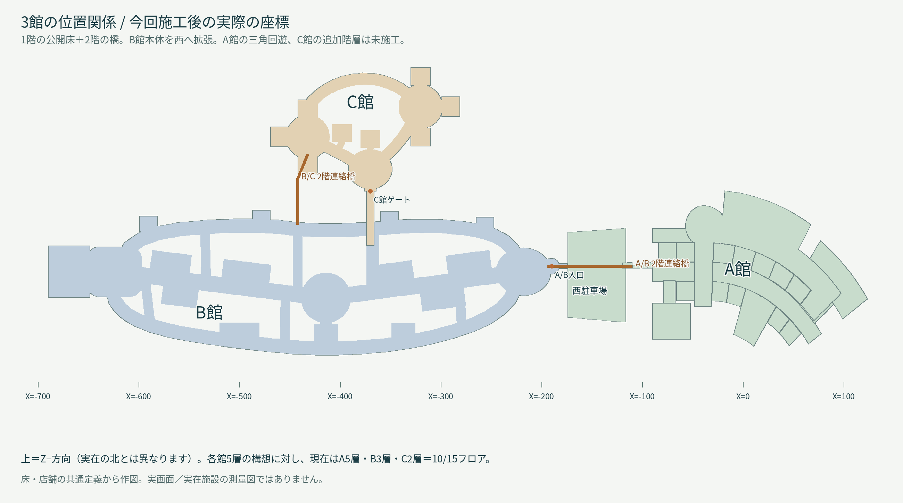

上面図は現在の共通床・店舗データから作図した説明図。ゲームの実画面や実在施設の測量図ではない。図の上はZ−方向で、現地の北を示さない。

|項目|v0.23|v0.24|
|---|---|---|
|B館本体の東西長|約306m|約508m（X=-690〜約-182、連絡通路を除く）|
|南北の外接範囲|約137m（地上店舗と回廊。1F連絡路込み約161m）|約144.5m（Z=-61.5〜83）|
|主軸|32m帯と細長い連続開口|16mの主軸＋独立した3つの大開口|
|副回廊|南側14m|北側・南側とも基準14m|
|分岐|主に南側への2本|北・南へ非等間隔の10m基準の接続路|
|店舗・売場|各階13、B館39|各階13、B館39を移設して維持|
|階高|0 / 5.525 / 10.875m|維持。1→2Fは5.525m、2→3Fは5.35m|
|B館のエスカレーター|3広場・計12本|12本を新しい広場へ移設、上下対を維持|

床の外接範囲には敷地内の非公開の余白や売場も含む。連絡通路を含む各階の床面積は1F約33,850m²、2F約31,899m²、3F約31,538m²。これは床ポリゴンの面積で、商業施設の延床面積・売場面積・実際の歩行面積を意味しない。壁・棚・席の占有は別に除外する。

通路は添付の暫定12/8/7mより広い16/14/10mを採用。既存の店頭と対向NPC、猫、手すりや衝突の余白を確保した初期値であり、5000人時の混雑試験で確定した幅ではない。距離の増加に対する店舗密度・目的地の追加は次工程。

## 各階の上面図

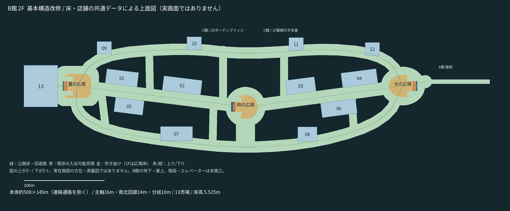

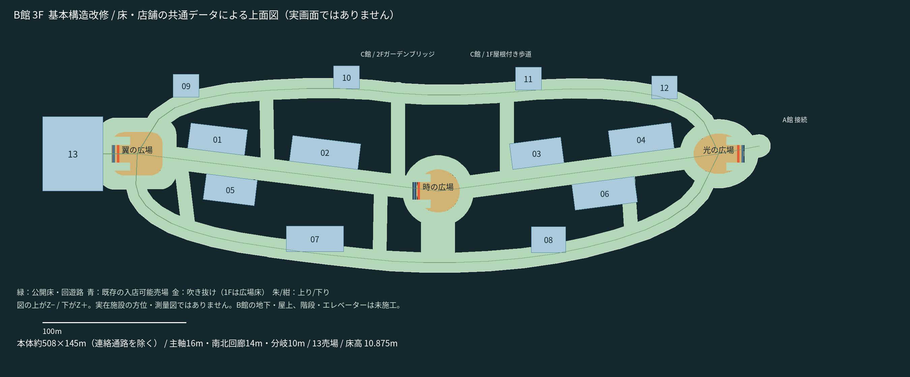

青は既存の入店可能な売場。01〜08は既存の主軸・店舗島、09〜12は移設した周辺売場、13は西側の家電／生活／映画館。空き区画を新しい店として数えていない。金色は上階の実際の開口（1Fでは広場床）。昇降機・踊り場が使う部分は開口から除外する。細かな什器は図では省略する。

トイレ、通常階段、エレベーターを新設した図ではない。B館のそれらの設備は未施工。現在は1〜3階を3組のエスカレーターで移動する。A館の既存通常階段は地下〜屋上、C館の既存階段は1〜2階を結ぶ。不足階層へ行けると報告しない。

## 通常のゲーム画面

1000人・シード912・標準画質。撮影中だけ人物の動作とプレイヤー入力を停止し、HUDと手持ち道具を非表示にした。建築・屋根・材質・照明を撮影専用モデルに差し替えたり、上階を切断していない。Linux/Mesa llvmpipeであり、Windows実機のFPS検証ではない。

|広場|1階から上を見る|3階から下を見る|
|---|---|---|
|光：楕円|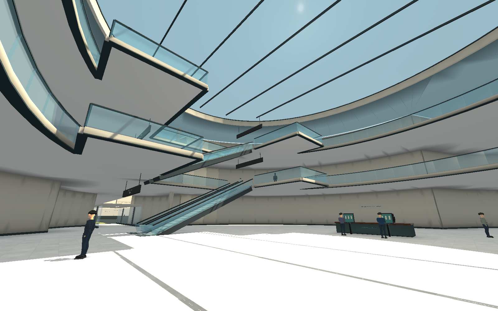|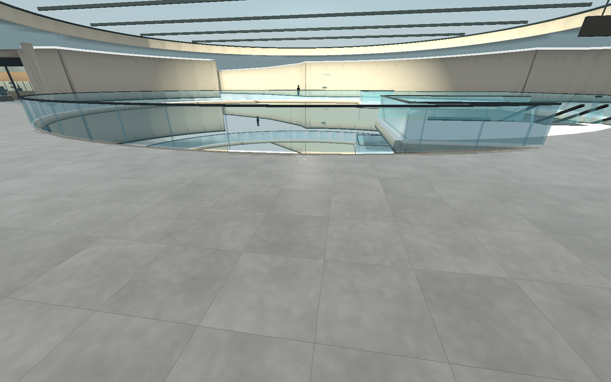|
|時：円|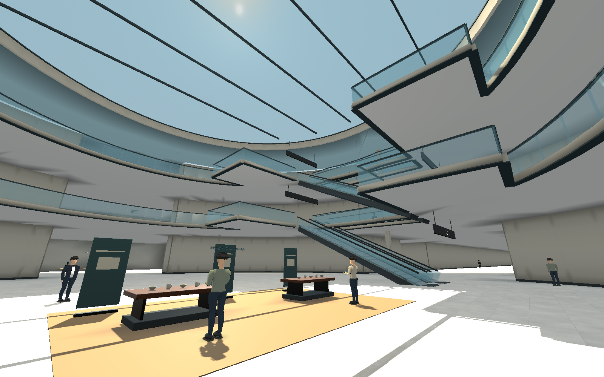|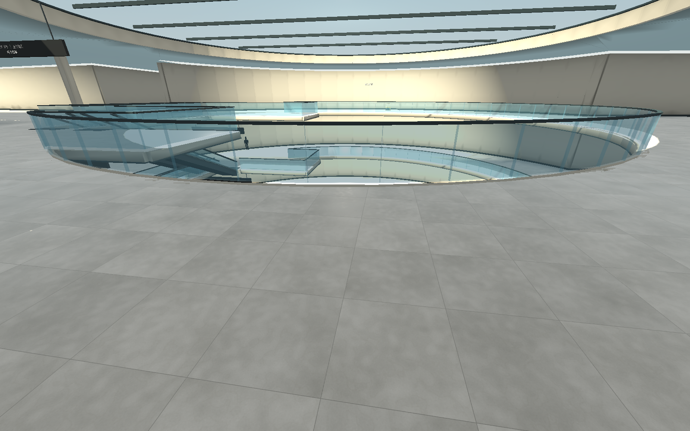|
|翼：角丸長方形|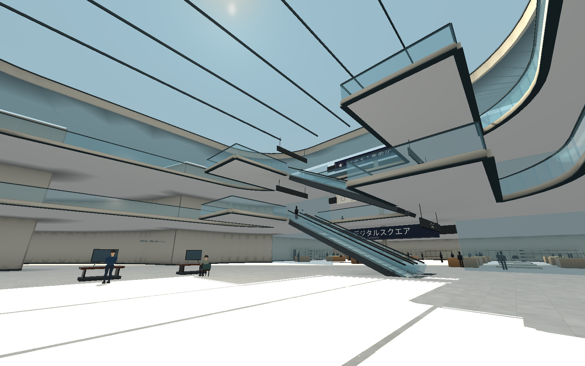|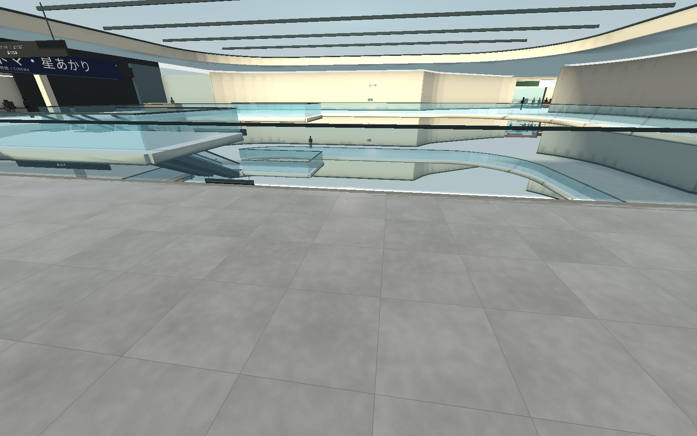|

名目開口は光35×28m、時は直径30m、翼35×30m。開口位置は2/3Fで揃う。縁には昇降機と踊り場が入るため、この矩形寸法の全域が何もない空間ではない。屋根には実際の開口、ガラス、枠、横桟を設けた。

名目輪郭内で踊り場等を除いた開口面積は、光約672m²、時約624m²、翼約850m²。[寸法と計算条件](map-master-dimensions.json)も保存した。開口の外側へ延びる昇降機シャフトの面積を加えた値ではない。

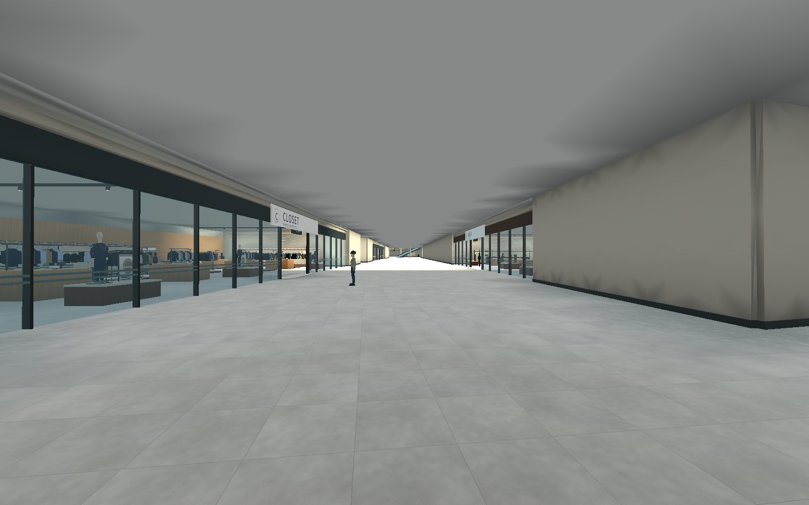

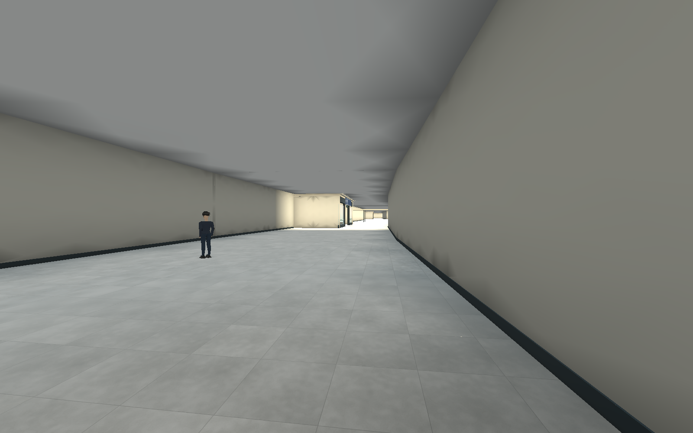

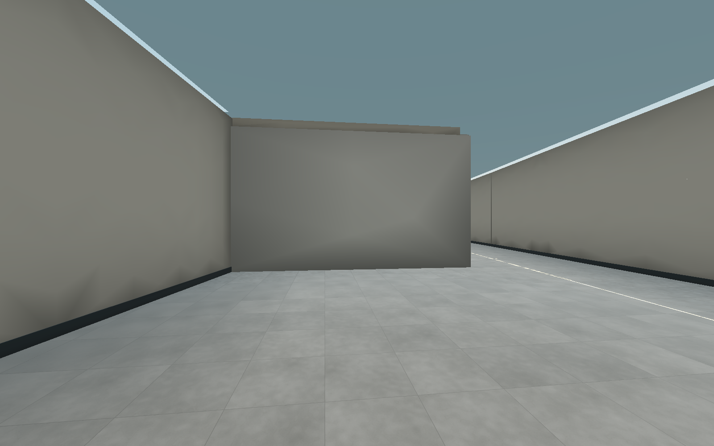

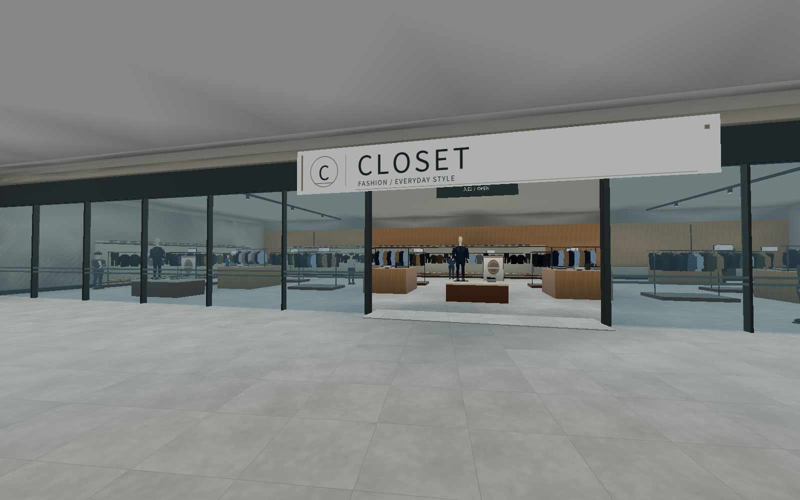

## 接続とゲーム機能

- A館東・B館西・C館北西の位置関係を維持。A/Bの1F歩道と2F橋の端点を維持した。
- B/Cの2F橋はX=-442を維持し、B館側の端をZ=-17から-47へ寄せた。C館への到着部・店舗・中庭・通常階段は維持。新しいB北回廊と橋の境界は共通ポリゴンで重複を除去する。
- B/Cの1F歩道が新しいB北回廊を横切るため、旧外壁と歩道ガラスを交差部で開けた。歩道のガラスは描画・衝突・NPC障害物に同じ分割定義を使う。
- 西側大型店の座標を移し、家電・映画館の移動地点も対応。光の広場の拡張で昇降機に重なった2階ラウンジの着地点はX=-192、Z=-5.5へ移した。IDと訪問済み条件は維持。
- 南側の既存回廊ラウンジは3面の壁を経路障害物へ明示し、背面の南回廊から壁をすり抜ける経路を防ぐ。前面には時の広場へ接続する幅12mの入口床を補った。
- 101売場、1000/300人、AP、スキャン、猫、宝箱10個、20移動地点、初期スキャナーのみの最終確認を維持。NPCやスキルを追加していない。人物モデルも今回変更していない。

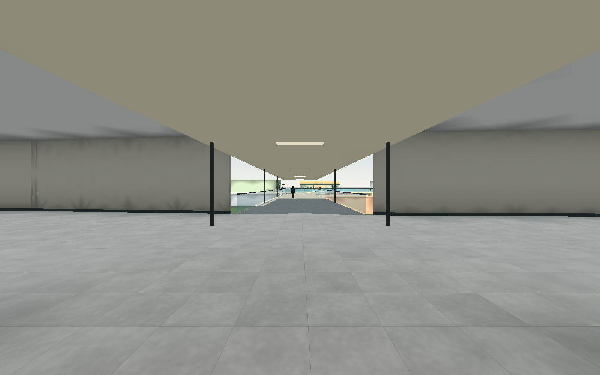

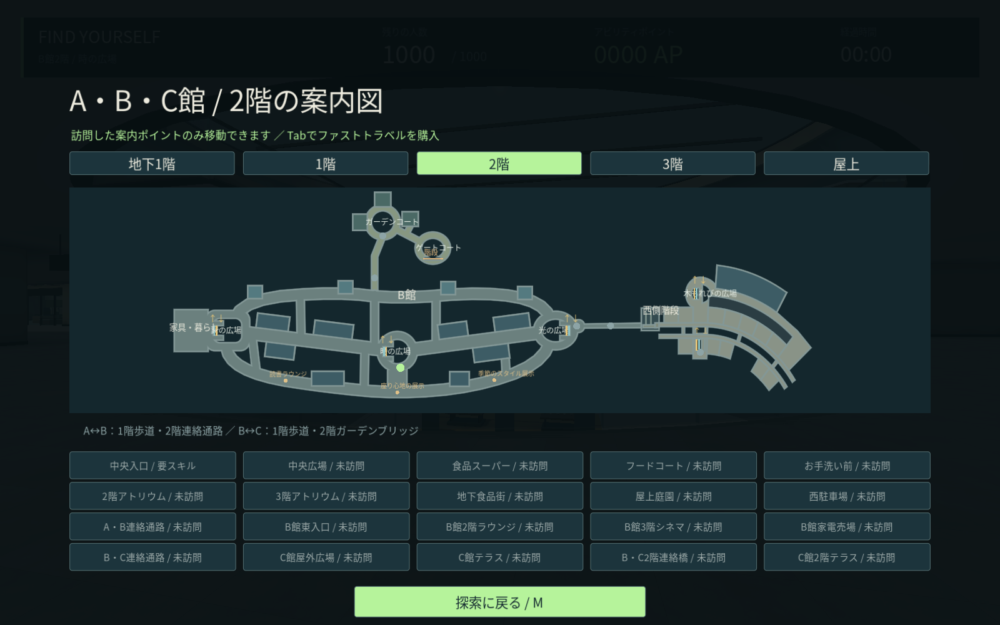

## 検証資料

[検証集計](map-master-verification.json)、[実歩行の各経路と終点](map-master-movement.json)、[撮影条件と座標](map-master-captures.json)、[各階の床・売場定義](map-master-floor-plans.json)に結果を記録する。実歩行はプレイヤーの入力とCharacterBodyの衝突を使い、昇降後に回廊・店舗へ出るところまで確認する。床の監査は公開点と水平接続中点を物理レイで調べる。

歩行の回帰検査は固定60Hzのヘッドレスシミュレーションで入力を自動操作する。画面の実描画・保存インスタンスの検査は別途GL描画で行う。自動操作の終了までに要したクラウド上の時間を、実機の操作感・FPS・平均プレイ時間へ換算しない。

初回の移動検査でB/Cの旧外壁、南ラウンジの経路不一致、Bラウンジの着地点を検出し、修正した。検査用の旧座標は新配置へ更新し、頭や手すりを通り抜けさせる処理で合格にしていない。実描画が必要な検査はダミー描画と分けて実行する。

最終の機能検証は**31組・1450項目、失敗0**。うち改修マップの自動歩行は111項目。床の監査は54,416公開点と320,427水平接続中点で欠落0。全54,819ナビ点の接続、20本の昇降機の実乗降、既存店舗への出入り、猫の接近、訪問済み移動、宝箱を含む。

最終撮影で、案内図の1つの輪郭がピクセル丸めにより自己接触し、塗りつぶせなくなる問題も検出した。丸めた輪郭の三角形化が失敗するときは、有効な元のクリップ座標を使用する。全階の案内図・96か所のミニマップについて101項目、664個の描画ポリゴンを検証した。

## 残る問題と次の施工

1. **店舗の密度が不足。** 500mの骨格に既存13売場／階を移した段階。回廊には長い壁・未利用区画が残り、商業施設としての密度は未完成。次は店舗の間口・奥行き・内部ゾーンを複数種類にして配置する。
2. **B館のサービス核が未施工。** トイレ、通常階段、エレベーター、授乳・休憩、フードコートへの分かりやすい経路が必要。現在の総合案内サインは、全設備を実装済みと保証するものではない。
3. **広場の個性・仕上げ。** 開口形状は分けたが、時計・ベンチ・イベント・翼の装飾、天井設備・構造梁・素材・外観の密度が不足。昇降機はすべてZ方向に上がる配置を継続しており、広場ごとの向きの変化は次の設計対象。
4. **全15階層へ未到達。** A5層、B3層、C2層＝10/15。Aの三角回遊、B地下/屋上、C地下/3階/屋上、追加の連絡動線を今後施工する。
5. **探索距離と性能。** 42探索区画の抽選・閉鎖、5000人での描画と混雑、ユーザーのWindows/RTX実機性能、平均3時間は未検証。今回の機能検証と混同しない。

再生成：`tools/build_mall_structure.py` → 実描画でワールド生成 → AO計算・適用。図面は`export_structure_plan.gd -- --map-master`と`draw_map_master.py`、実画面は`capture_map_master.gd`、閲覧PDF/ZIPは`build_map_master_review.py`。描画保存にヘッドレスを使用しない手順は[WORLD_BAKING.md](WORLD_BAKING.md)を参照。
