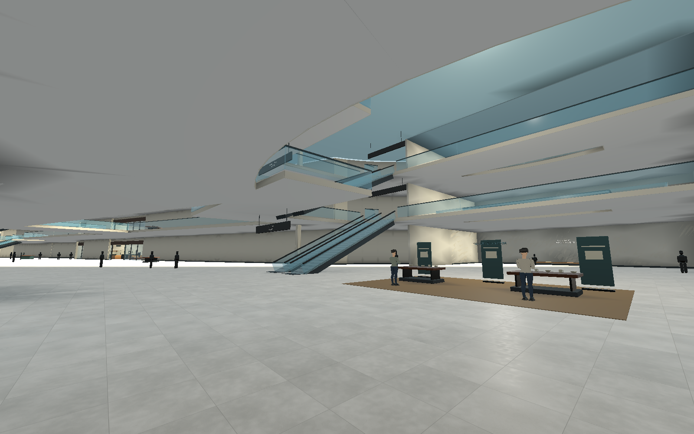
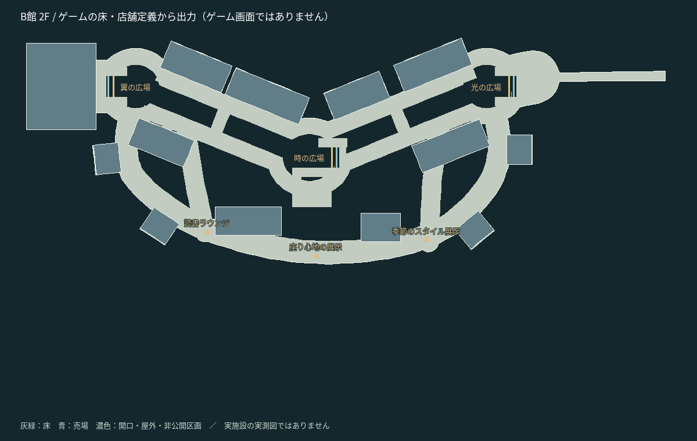

# モール改修計画 — v0.23との比較とB館の先行施工

2026年10月26日。基準はコミット `66f816d` のゲーム本体v0.23。ユーザー提供の[詳細設計書](reference/map-master-v1/FIND_YOURSELF_MAP_MASTER_SPEC.md)と[構造図](reference/map-master-v1/FIND_YOURSELF_MAP_LAYOUT.svg)を設計参考として保存した。添付内の寸法・店舗数・42探索区画は目標であり、実装済みの事実として扱わない。本書は施工前の計画。施工後の寸法・画像・検証は別紙に記録する。

## 現状と、小さく／簡素に見える理由

|対象|v0.23の実体|設計資料との差・改修方針|
|---|---|---|
|A館|曲がった主軸と北側ループ。1〜3F、地下食品街、部分的な屋上庭園。1Fは18売場、2/3F各13。上階の外接範囲は約208×155m（付属階段込み）|三辺を連続して歩く三角回遊ではない。次工程で既存店を保ちつつ三つ目の辺と角広場を設ける。300×220mは再検討値。今回は形状を変えない|
|B館|3広場と折れた主軸、南側の副回廊。1〜3F各13売場。建物本体の東西長は約306m、西端X=-496。1Fの外接範囲は連絡端まで322×161m|北側の連続回廊がない。床面積の拡大に対して店舗・サービス核が少なく、広い無目的な床と長い壁が目立つ。吹き抜けの連続する細いスリットが店前の保護床で削られ、大広間に見えにくい|
|C館|3中庭、屋外街路、1F8店／2F3店。1Fの外接範囲188×177mはB館への細い歩道も含む|中庭群の体験は別物だが、上階の街並み・独立棟・外部階段・日除けが不足。260×200mは敷地／棟群の目標として再整理。今回は形状を変えない|
|階層と接続|A5層＋B3層＋C2層＝10/15。A/BとB/Cの1F・2F接続。B上下対12本、A8本|B地下/屋上、C地下/3F/屋上は存在しない。エレベーターも未実装。案内上だけ増設済みにしない|

外接寸法は世界座標の床定義から算出した値で、施設の有効売場面積や実在レイクタウンの寸法ではない。通路の単純な拡幅は、かえって陳列・サイン・入口の密度を下げる。人の尺度になる入口枠・什器・天井梁、目的地のある分岐、広場間の距離、明確な光の変化を組み合わせる必要がある。

現状の代表画面：

## B館1〜3階の先行改修

1. **東側の既存接続を固定し、西へ伸ばす。** X=-190付近のA/B入口とX=-442のB/C橋を残す。建物本体を東西約500m、南北約150〜170mで試作する。既存のショップ内装を一律拡大して棚・扉まで巨大にしない。
2. **主軸と両側の回廊を作る。** 主軸は約16m、両側回廊は約14m、分岐は約8〜12mから試験。設計書の12/8/7mより広い初期値を使う理由は、既存の対向NPC・店頭滞留・猫・衝突の余白を維持するため。最終値は実歩行で判定する。均等格子にせず、広場・店舗間の抜けに分岐を置く。
3. **3つの独立した大開口へ。** 光＝楕円、時＝円、翼＝角丸長方形。2/3Fで同一の輪郭を使う。名目開口は約35×28m、直径30m、35×30mを基準にする。エスカレーターと踊り場が占める縁の部分は別に図示する。広場間は通常の床と天井を持つ通路にし、全長に細い穴を繰り返さない。
4. **上下対の12本を広場に統合。** 各広場に1↔2F・2↔3Fの上り/下り。乗降口の平坦部から周回路、店舗へ通常歩行でつながることを検査。手すり、衝突、猫/NPCの片方向経路、搬送方向を同じ配置から生成する。
5. **店舗と既存機能を移設する。** 既存13売場×3階＝39を保持し、入口・奥行き・陳列・スタッフを共通の店舗変換で移す。75/75/65店という添付の目標数を、空の区画や工事壁で水増ししない。新たに生じる余白は次工程の店舗・サービス区画として明示し、内装完成扱いにしない。
6. **ゲームへ統合して比較する。** 保存ワールドを実描画で再生成し、床・案内図・全移動地点・宝箱・既存NPCへの到達を検査。1/2/3F上面図と通常のプレイヤー視点を提出する。図面とゲーム画面、未施工と施工済みを区別する。

## 全15階層の完成像と段階

|階|A：三角回遊|B：長大な3広場モール|C：屋外棟群|
|---|---|---|---|
|B1|食品、惣菜、搬入／倉庫を分離|駐車・食品・設備・荷捌き|地下駐車・倉庫・独立棟の下部|
|1F|大型店、生活、入口広場|服飾・スポーツ・生活、催事、総合案内|アウトレット、庭園、中庭カフェ|
|2F|服飾・美容、角広場|書籍・生活・カフェ、館間到着ロビー|テラス、書籍・雑貨、連絡橋|
|3F|キッズ・ホビー・飲食|映画・体験・飲食、ファミリー待合|小規模な屋内売場と屋外デッキ|
|RF|庭園＋設備を分離|屋上テラス・イベント・設備|散策庭園・展望・設備|

施工順はB館1〜3F骨格→B店舗/トイレ/サービス核→A三辺回遊→C棟群と上下街路→不足5階層と階段/エレベーター→42探索区画と5000人の負荷評価。今回のB館1〜3階の改修に、地下階の実装は含めない。

42探索区画による人数別の閉鎖／抽選は、現在の1000/300人の全域探索と異なる機能である。今回の構造改修へ混ぜず、到達保証・宝箱候補・閉鎖表現をまとめて別工程で設計する。

## 守る条件と検証

- `mall_structure.json` → 生成データを床描画・衝突・床照会・案内図で共用。旧座標の壁や手すりを残さない。
- 全ナビ点の接続、各店舗への実歩行、全昇降機の上り/下りと到着後の離脱、吹き抜けの上下視線、手すりの物理遮蔽を確認。
- 猫の到達・NPC定位置・宝箱10個・20移動地点・訪問前ワープ禁止を維持。本物の固定抽選と初期スキャナーのみの最終判定を維持。
- NPCやスキルは追加しない。性能は実機測定と区別。Linuxのソフトウェア描画で得た値をRTX 4060 LaptopのFPSとして扱わない。
- 各工程の報告には座標付き上面図、実画面、寸法、完成した売場数、検証結果、未完成箇所を添える。15フロアと5000人、全店内装の完成は今回の完了条件に含めない。
