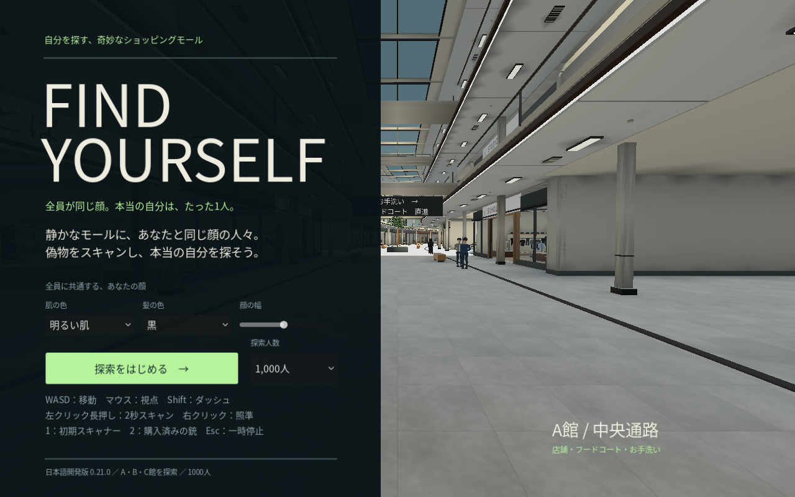
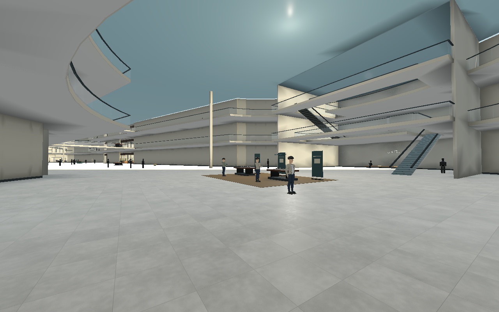
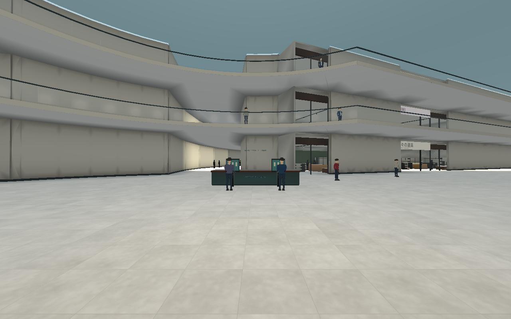
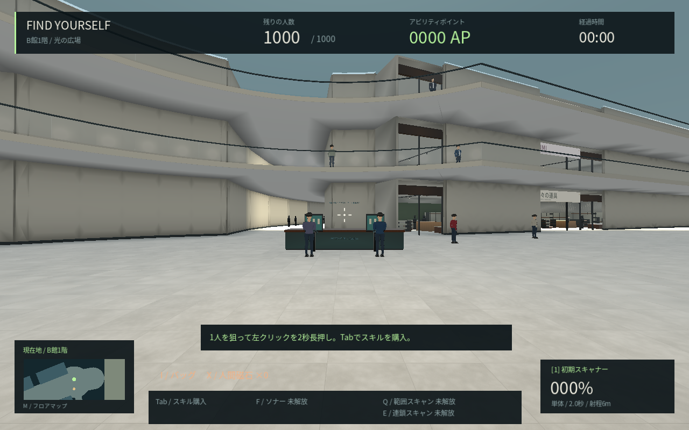

# 1000人の比較プレイ — 0.21

タイトルの「探索人数」は既定 **1,000人**。同じ画面で **300人** を選べる。一時停止からの再開始はそのプレイの人数を保持する。

## 人数と初期配置

1000人版は **滞在900人・歩行100人**。滞在の内訳は **A館300人・B館450人・C館150人**。歩行100人は既存の階別経路から初期点を選ぶため、この内訳には含めない。

従来の固定267人のID・位置・役割を維持し、追加633人を店内の閲覧客と公開通路の滞在客として配置する。追加分の約75%を売場へ、残りを公開通路へ分散する。各売場を順番に割り当て、最初の大型店だけに集中させない。追加の着席客を椅子なしに配置せず、既存の店員・着席客・会話客を保持する。追加の立ち位置は実際に接続済みの経路点を使い、既存/追加人物から1.6m以上、移動地点から2.4m以上離す。

300人版は従来通り **固定267人・歩行33人**。どちらの版も全員に個別のスキャンIDと当たり判定があり、本物は全人口から一度だけ抽選する。配置生成は本物のIDを参照しない。追加633人も本物になり得て、通常の初期スキャナーだけで最終確認する。

`PopulationLayout` は保存済みの床・経路・売場定義からラン開始時に追加配置を生成する。最初に作った結果を再利用し、保存済みの267人配置やワールドの形状を上書きしない。歩行者の経路生成は、人数を増やしても従来の「1物理tickにつき最大1件」を維持する。

## AP

スキル価格の式は変更していない。スキャン銃は人口に応じ、**1000人版で3,330AP、300人版で1,000AP**。探索猫は従来通り100AP。偽物1人10AP、初期スキャナーの最終確認、宝箱10個は共通。

## 動作確認と制限

クラウドLinuxの最初の配置生成/開始は約0.95〜0.99秒だった。これは初期生成のCPU時間であり、FPSやWindows実機の性能ではない。25組944項目で失敗ゼロ。Linuxネイティブ版の1000人起動も終了コード0・実行エラー0を確認した。実施結果と環境は [検証記録](c-upper-verification.json) を参照。

`test_population.gd` は全1000個のスキャンID、900/100の配分、建物ごとの配置、追加633人の公開床と間隔、全追加滞在客への猫の到達、歩行経路のtick予算、本物の抽選保持、特殊スキャンと初期スキャナーの役割、300人への切替を確認する。`test_population_ui.gd` では人数選択と4桁表示の配置を確認する。

以下は標準画質・本物抽選シード912・1000人の通常描画。人物を静止し、比較画像ではHUDと手持ち道具を非表示にした。歩行者の初期点は既存のランダム配置である。

Windows/RTX 4060 Laptopでの実測は未実施。実機比較では同じ画質で300人と1000人を試し、移動中の重さを比較する。今回は5,000人や販売品質の完了ではない。B館は人数と立寄場所を増やしたが、店舗密度と回遊路の長さを見直す課題は残る。
