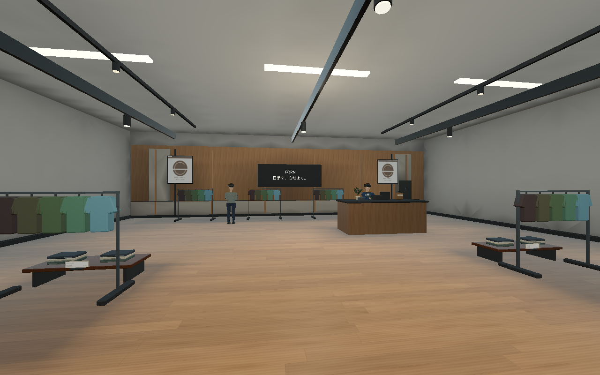
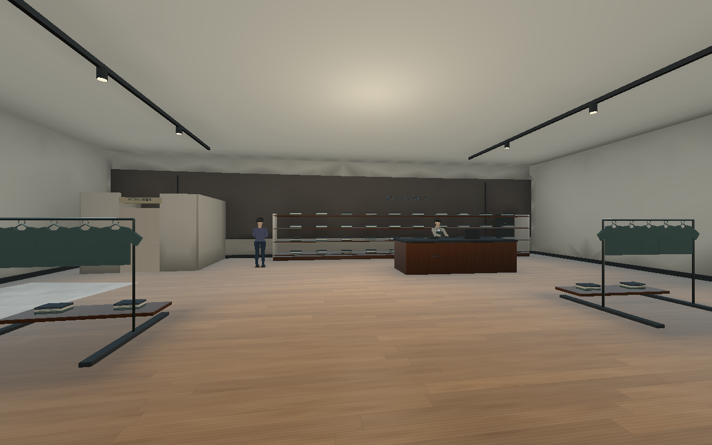
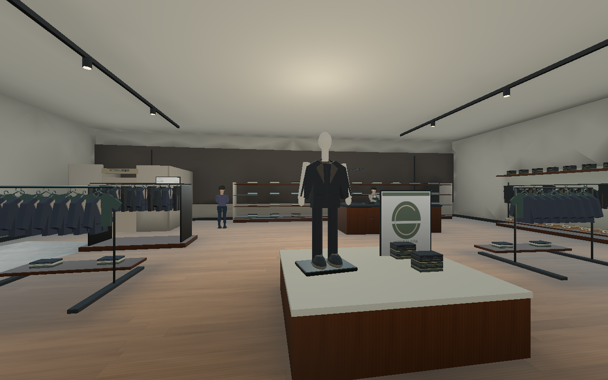
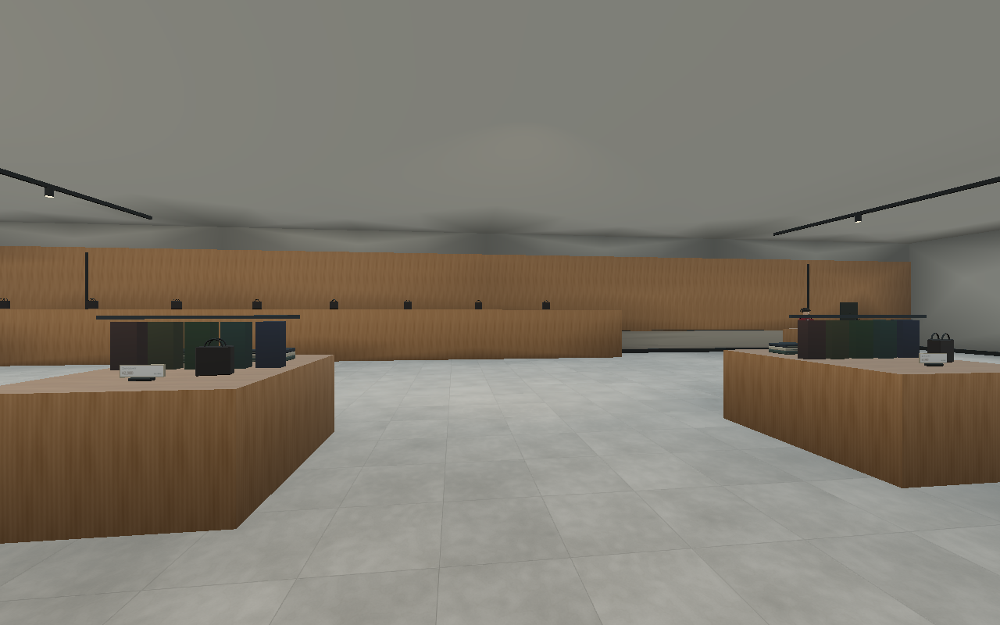
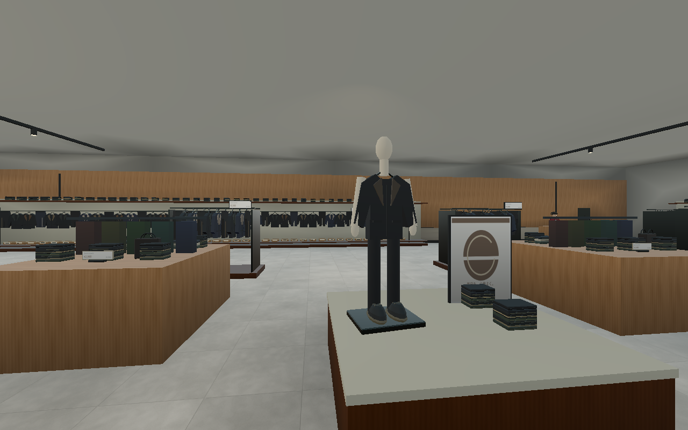
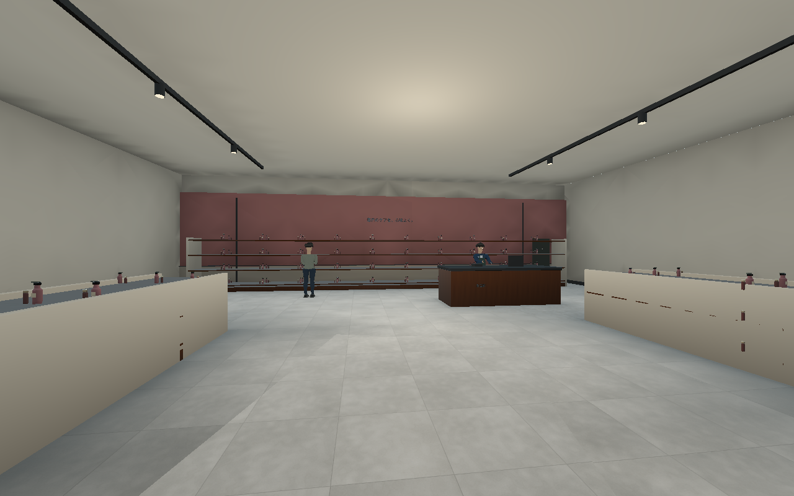
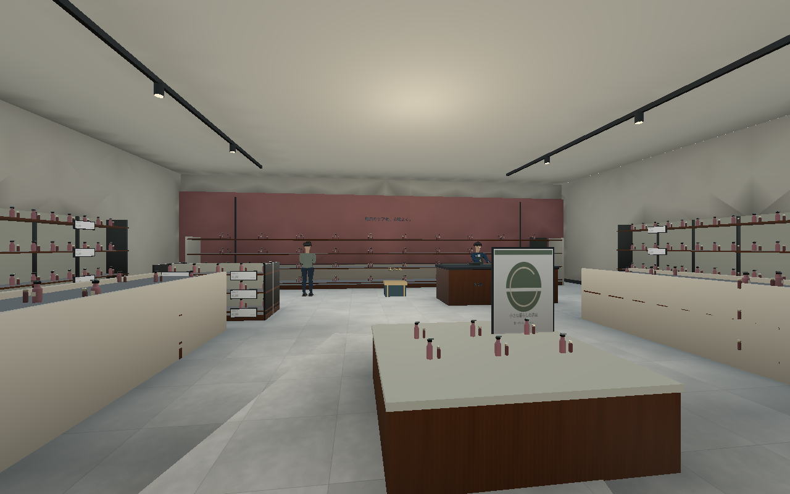
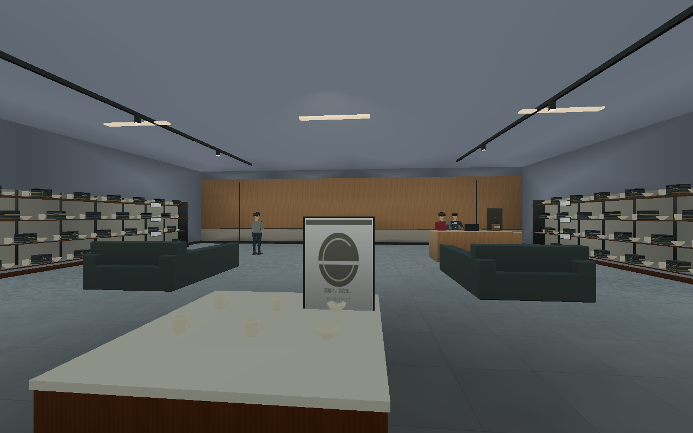
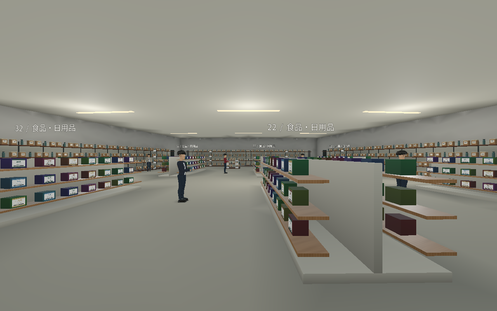

# 0.18：店舗の陳列と売場の密度

ユーザー提供の4枚の参考写真から、壁面の連続陳列、複数列のラック、入口のマネキン・平台・販促表示を重視して更新した。参考写真や実在企業のロゴはゲーム素材として配布していない。

実装済み83店舗を対象とし、**新しい占有範囲を持つ什器559基、B館の既存陳列台21基の置換**を実施。商品・小物のモデル配置を3,207から28,074へ増やした。衣類の積み重ねなどは1組として数える。館の形状、階層数、人物モデルはこの工程の対象外。

## 売場の組み方

- 壁際に連続した棚・ハンガーレールを配置。棚板だけでなく商品を上下に並べる。
- 中央の追加ラックと、入口正面の低いおすすめ展示を配置。入口から複数の陳列が重なる構成にする。
- 衣料品店はジャケット・パンツ・畳み衣類・靴箱と、顔のない展示用マネキンを組み合わせる。マネキンはNPCではなく、スキャン人数や本物の抽選に含めない。
- B館の大きな不透明な木の陳列ブロック21基を、内部の商品が見える開放棚へ置換。同じ占有範囲を使い、奥の陳列を増やす。
- コスメ・眼鏡・宝飾・書籍・玩具・旅行用品などは業種ごとの商品を使用。大型家電店に冷蔵庫・洗濯機・テレビ、家具店にソファ展示、食品街に商品パックを追加。
- 既存の店舗看板、フードコートのメニューと価格、トイレと開閉扉を維持。

## 変更前後の実画面

同じカメラ、標準画質、300人・同じシードで撮影。HUDと道具を隠し、NPCの時計を固定した内装確認用。目標イメージや参考写真の加工ではない。

### A館1階・服飾

変更前：

変更後：

### A館2階・服飾

変更前：

変更後：

### B館・ファッション

変更前：

変更後：

### コスメ

変更前：

変更後：

### C館とスーパー

[C館・変更前](screenshots/mall18-before-home-c.png)、[スーパー・変更前](screenshots/mall18-before-market.png)。撮影スクリプトは `tools/capture_retail_density.gd`。

## 動線・NPC・スキャンとの整合

`RetailDensity.fixtures()` の同じ矩形から実際の衝突と経路の占有範囲を作る。既存の棚、レジ、NPCの位置を避けて新しい什器を配置。入口と、中央展示の左右から奥へ行く通路を残す。平台の衝突は天板までにし、マネキンの身体は別の細い衝突にする。平台の上の空間を見えない箱で塞がず、スキャンの光線が空間を通り、マネキンには当たることも検査する。

店舗内は1m間隔の経路点を補い、既存の2m間隔の点と同じ経路グラフへ接続。細い迂回路を粗い点配置が見落とし、棚の間に経路点が孤立する問題を解消した。建物外・主回廊は従来の配置を利用する。完成したグラフを配布データへ保存し、移動中に再生成しない。

v0.17.1の267人すべてについて位置・役割・ID順を保存した比較データと一致。歩行者33人と合わせた300人、本物を一度だけ抽選する処理、初期スキャナーのみでの最終確認も維持する。猫の立っている人への判定点は腹部から上半身へ合わせ、カウンター越しの店員にも届くよう調整した。

## データ量と描画

同じ商品を置くたびに形状を複製するとデータ量が増えるため、追加商品24,828個は**188グループのMultiMesh**でモデルを共有する。変化のない静的陳列で、商品ごとのAIや更新処理は追加しない。従来の小物メッシュと同様に、軽量28m・標準40m・高画質55mで距離カリングする。

湾曲したA館、回転したC館、遠いB館のどこでも正しい位置で表示されるよう、各インスタンスの変換から描画境界を求める。固定のA館用境界を使い回さない。配布前に実描画環境で26,032個の静的インスタンスの変換を再読込検査した。この数は既存の樹木・書籍等1,204個を含む。

| 保存データ | v0.17.1 | v0.18 |
| --- | ---: | ---: |
| 商品・小物モデル配置 | 3,207 | 28,074 |
| 小物用の通常メッシュ | 68 | 83 |
| 静的区画 | 438 | 438 |
| 静的三角形 | 1,185,743 | 1,305,035 |
| 小物用の通常メッシュ三角形 | 1,020,728 | 1,022,962 |
| 経路点 | 18,013 | 32,759 |

インスタンスで描画する商品の三角形は、表の通常メッシュ三角形に含めていない。形状を共有しても可視商品の描画負荷が消えるわけではない。距離と視錐台によるカリングを使い、小物の影は投影しない。

壁・床・什器・通常メッシュには、24方向・半径2.4mの局所遮蔽を再計算した。新しい共有商品の一つひとつへこの遮蔽を焼き込む方式ではなく、GIや鏡面反射の完成を意味しない。商品の種類・形状・素材と照明は今後も作り込む。

## 検証と起動

**19組・696項目、失敗0。** [検証結果と実行条件](retail-density-verification.json)。新規の売場検査では、559基すべての物理的な高さと通行不可範囲、全267人への猫の経路、100通りの宝箱配置の到達性、全18移動地点、モデル共有と描画境界を検証。実際のプレイヤーを操作する検査では、入口を通り中央展示の横を歩いて奥へ進むことも確認する。

実描画と比較画像はLinux/Xorg/Mesa llvmpipe。Windows実行、RTX 4060 LaptopでのFPS、5,000人での性能は未測定。Windows版はクロスビルド。

新しいZIP全体を旧版とは別のフォルダーに展開し、Godot 4.6.3 Standardで `project.godot` を開いてF5で起動する。Blender・Pythonはプレイに不要。ソースZIPにはこの比較画像を収録し、過去版の比較画像はGitHubリンクにして容量を抑える。
