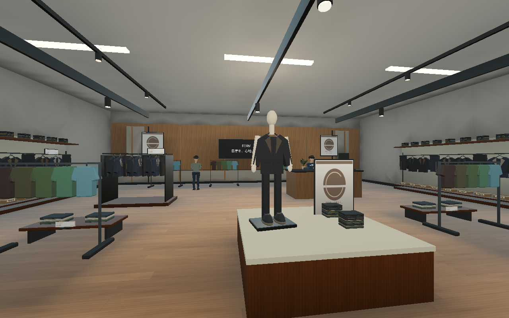
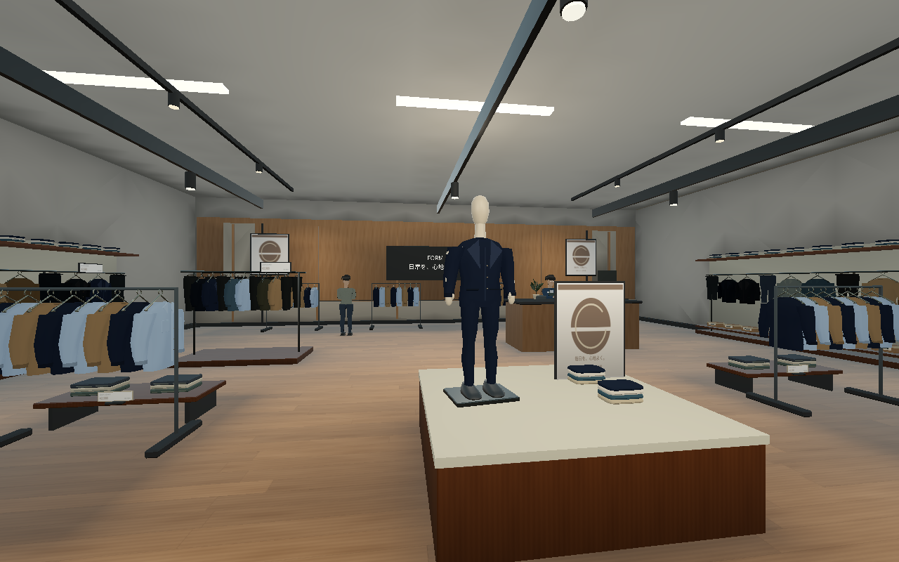
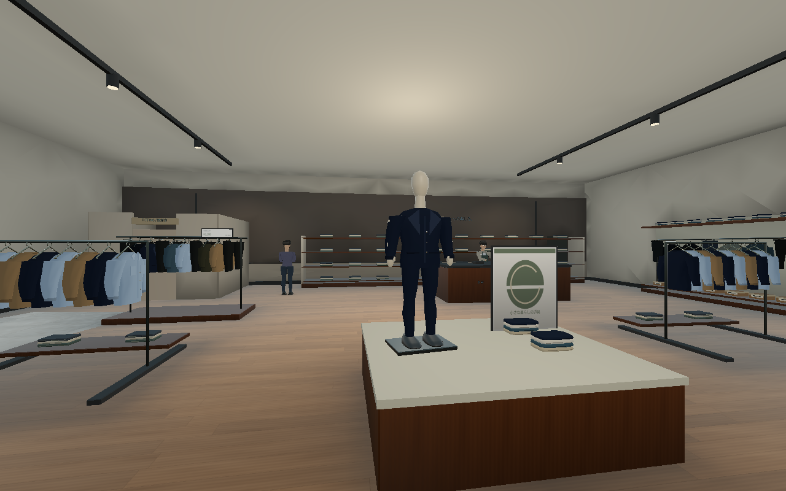
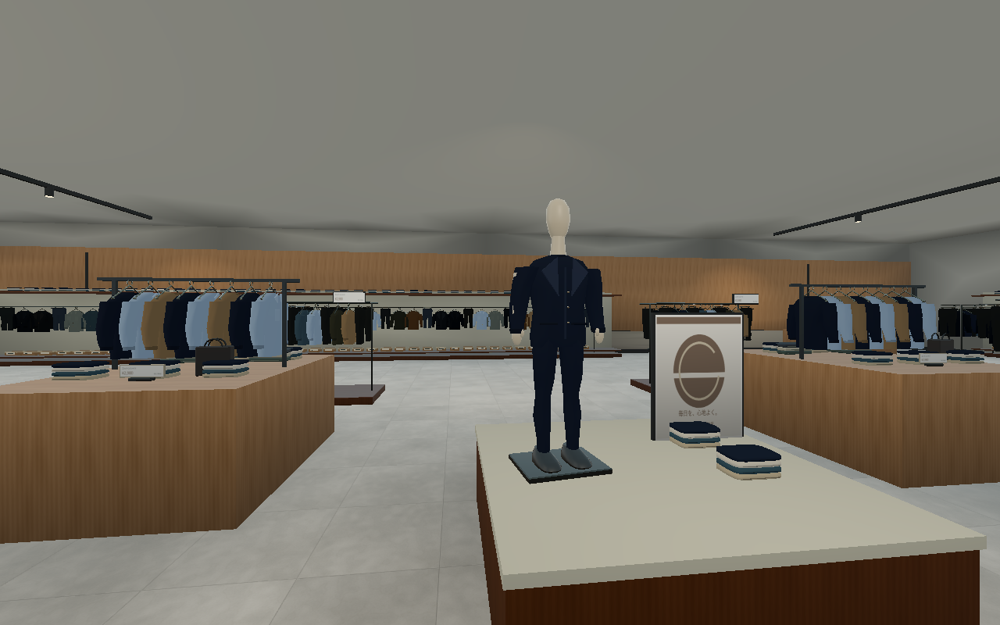
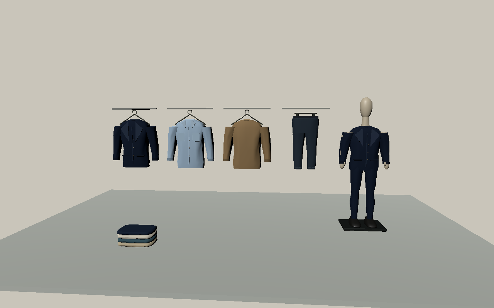

# 0.19：衣料品の形状・素材と売場照明

前工程の[陳列密度の更新](RETAIL_DENSITY.md)に続き、服と展示用マネキンの形状・素材を更新した。新しく棚を増やす工程ではなく、既存の売場の部品を作り込む工程。

**建物の外形・通路の骨格・フロア数はこの版では変更していない。** レイクタウンの参考図に基づく構造改修は未実装。[次の構造改修の範囲](MALL_STRUCTURE_NEXT.md)を参照。

## 変更内容

- ジャケット・シャツ・ニット・パンツ・畳み衣類・展示用マネキンの6種類を、体積のある形へ変更。胴、袖、膝、ふくらはぎに太さの変化を付け、襟・袖口・ポケット・ボタン・ハンガーも作る。
- A館・C館の箱を組み合わせた服と、上階の板状の服を置換。B館の既存展示には支柱を設け、衣類の裾が台へ埋まらない高さへレールを上げた。ジャケット・淡いシャツ・ニットを組み合わせる。
- 畳み衣類は角を丸め、層ごとの厚みと折り返しを持たせる。布にはオリジナルの織り目と微細な凹凸、マネキンには別のプラスチック材質を使用。布の法線マップには接線を生成し、ミップマップと異方性フィルターを使う。
- ラックを丸い金属パイプへ、台の一部を面取りした形へ変更。
- 衣料品店10店舗へ壁面用20灯・入口展示用10灯を追加。短い照射範囲と距離フェードを使い、追加のリアルタイム影は投影しない。

**NPC本体の顔・髪・体型は今回変更していない。** 展示用マネキンは顔のない静的な店内備品で、NPCや本物の抽選に含めない。

## ゲーム内の比較

変更前は0.18の保存画像。変更後は同じカメラ、標準画質、300人・シード912、固定したNPCの時計で撮影した。HUDと道具を隠した内装確認用の実描画。部品確認用の専用シーンとは区別する。

### A館1階・衣料品店

変更前：

変更後：

### A館2階・衣料品店

変更前：

変更後：

### B館・衣料品店

変更前：

変更後：

[C館・変更前](screenshots/mall19-before-home-c.png) / [変更後](screenshots/mall19-after-home-c.png)、[スーパー・変更前](screenshots/mall19-before-market.png) / [変更後](screenshots/mall19-after-market.png)。畳み衣類の共通モデルは衣料品店以外の展示にも反映する。

## 部品の確認用シーン

この画像は `tools/preview_apparel.gd` の専用シーン。通常のゲーム画面ではなく、形状と材質を確認するためのもの。ゲーム内比較は前節の画像。`tools/preview_retail_finish.gd` では、マップ全体を生成する前に店舗1区画を確認できる。

## 既存システムと描画設計

新しい服も共有モデルを使い、商品ごとのAI・アニメーション・毎フレーム更新を追加しない。軽量28m・標準40m・高画質55mの小物描画距離を継続。追加照明は範囲6〜7m、最大24〜28mで距離フェードし、実時間の影用マップを増やさない。

559基の追加什器とB館の置換21基の占有範囲、32,759点の経路、18地点の移動先を維持。267人の定位置・役割・ID順も維持し、歩行者33人と合わせた300人の構成を変更していない。本物の抽選、初期スキャナーだけでの最終確認、猫、宝箱、スキルの購入条件も継続。

| 保存データ | v0.18 | v0.19 |
| --- | ---: | ---: |
| 商品・小物モデル配置 | 28,074 | 28,252 |
| 小物用の通常メッシュ | 83 | 83 |
| 静的区画 | 438 | 438 |
| 通常メッシュの静的三角形 | 1,305,035 | 1,315,631 |
| 通常の小物メッシュ三角形 | 1,022,962 | 1,014,202 |
| 静的インスタンスのグループ | 218 | 238 |
| 静的インスタンス | 26,032 | 26,240 |

通常メッシュの三角形数は、インスタンスで描画する商品の全三角形を含まない。立体化により可視の衣類の頂点処理と材質処理は増える。モデル共有と距離カリングで対処しており、RTX実機のFPSが向上したという測定結果ではない。

新しい保存マップで24方向・半径2.4mの局所遮蔽を再計算。法線・材質・モデル共有の状態は実描画環境で再読込検査する。GI、衣類の物理シミュレーション、写真と同等の質感が完成した意味ではなく、照明・商品種類・店舗固有の造作は継続して作り込む。

## 検証と起動

**20組・704項目、失敗0。** [検証項目と実行条件](retail-finish-verification.json)。衣類の体積と寸法、法線・三角形の向き・接線、材質の分離、ミップマップ、モデル共有、保存後の境界、照明数・範囲・影を検査。既存ゲーム・猫・宝箱・各館の移動・扉操作も確認する。

Mesaで描画しながら画質を連続切替する別試験では、終了時に2件のGLテクスチャ解放診断を観測した。通常の6画面の比較撮影では再現していない。未解決の診断として検証JSONへ記録。売場の17項目は実描画コンテキストで描画ループを止め、形状・物理・経路を検査している。

実描画はLinux/Xorg/Mesa llvmpipe。Windows実行・RTX 4060 LaptopのFPS・5,000人の性能は未測定。Windows版はクロスビルド。

旧版とは別フォルダーへZIP全体を展開し、Godot 4.6.3 Standardで `project.godot` を開いてF5で起動。プレイにBlenderやPythonは不要。ソースZIPに今回の比較画像を同梱し、過去版の画像はGitHubへリンクする。
