# 0.12 → 0.13の店舗とスキャナー更新

68店舗へ新しい商品・小物モデル2,775点と、ポスター136枚・商品札201枚を配置。既存の箱状商品も一部置換したため、この数字は旧版からの純増数ではない。カップ、器、ボトル、鞄、靴、衣類の折り畳み、ヘッドホン、照明などを業種に応じて配置する。元の陳列台・棚・カウンターと奥壁を使い、入口と中央の動線を空ける。

| 対象 | 変更前：0.12 | 変更後：0.13 |
| --- | --- | --- |
| 服飾 | 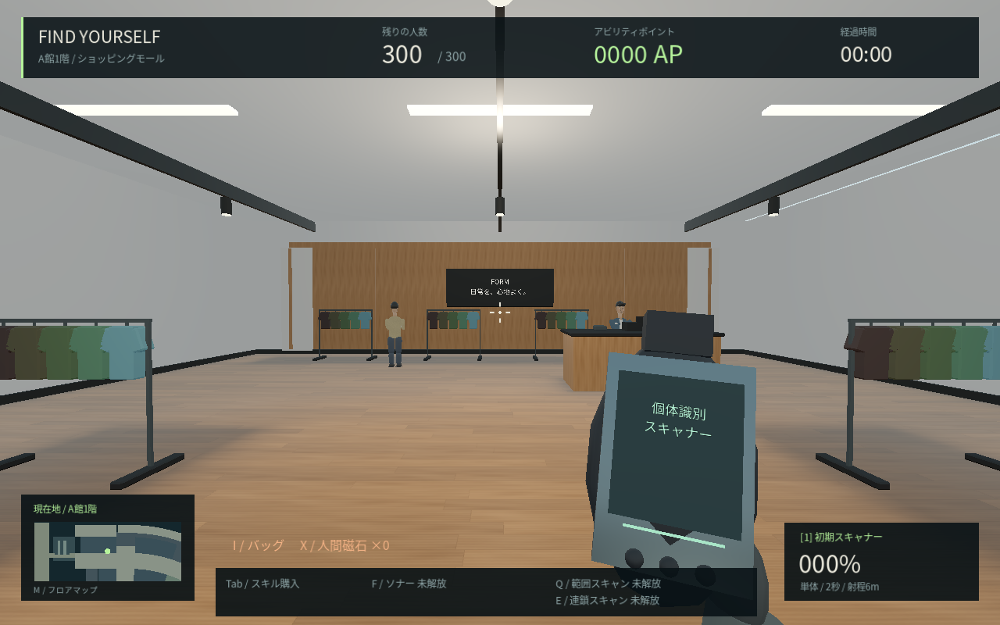 | 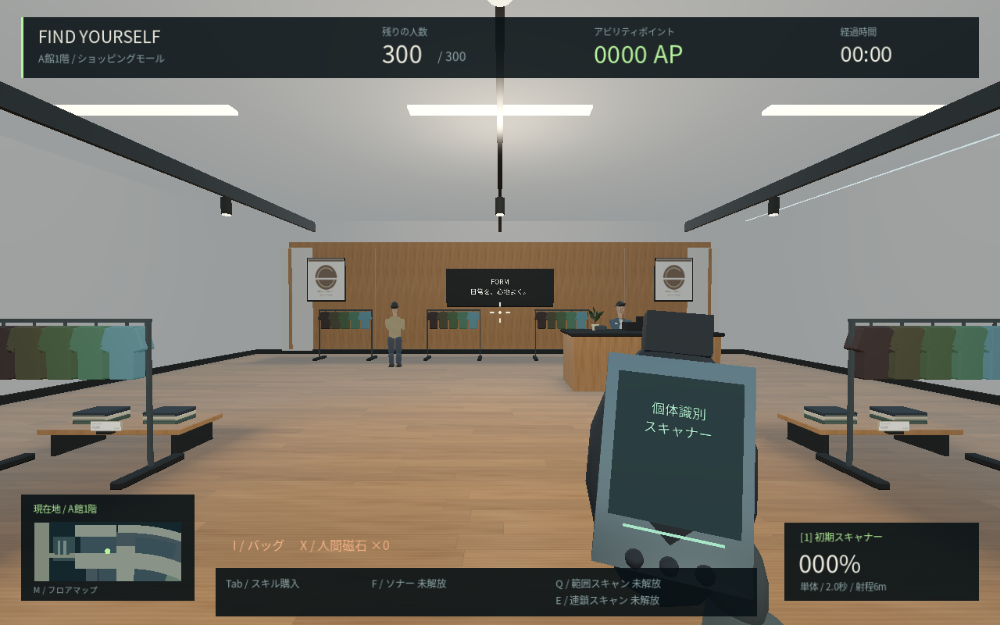 |
| 生活雑貨 | 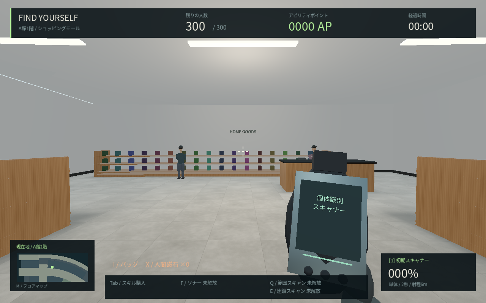 | 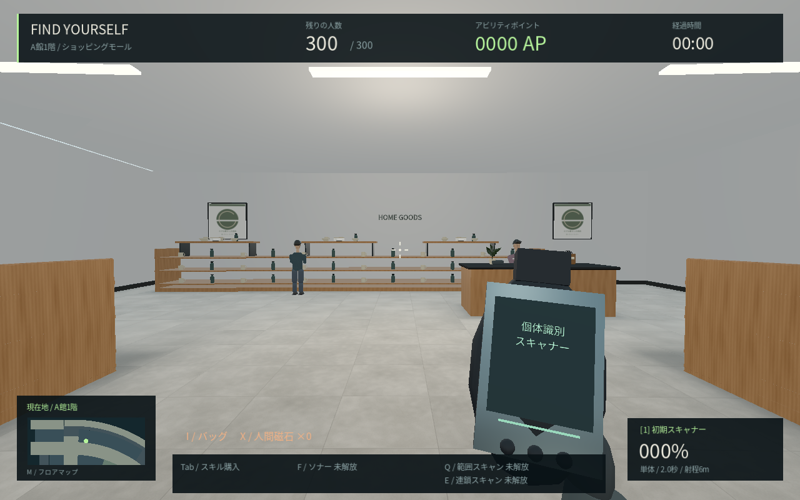 |
| 器と商品札の近接 | 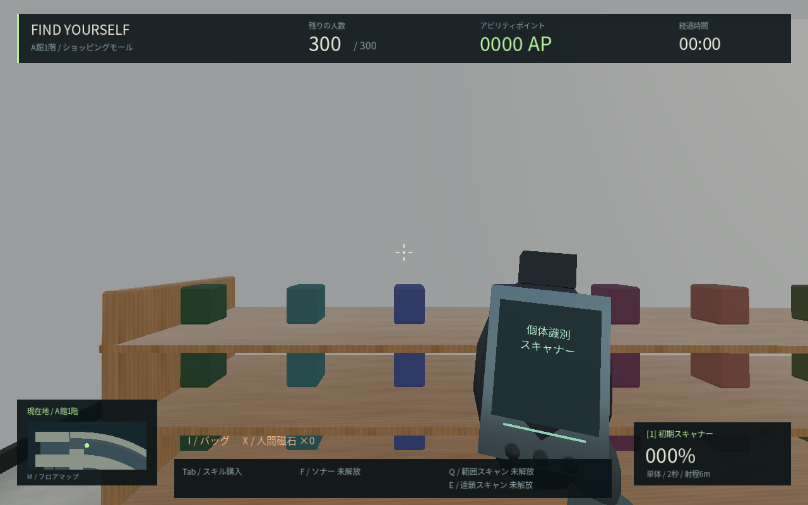 | 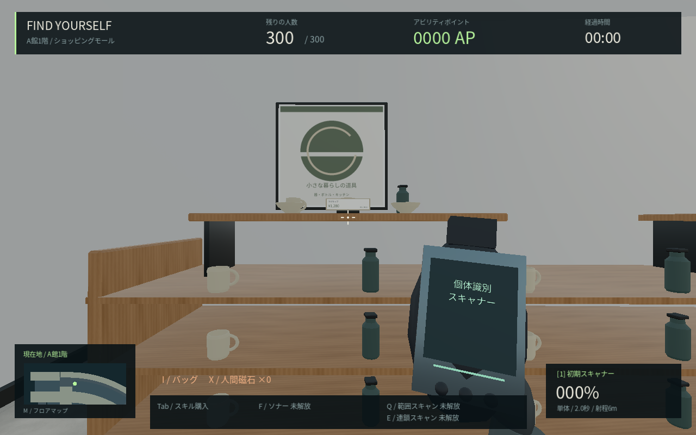 |
| 家電・デジタル | 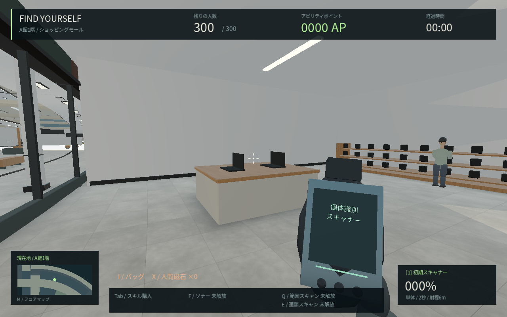 | 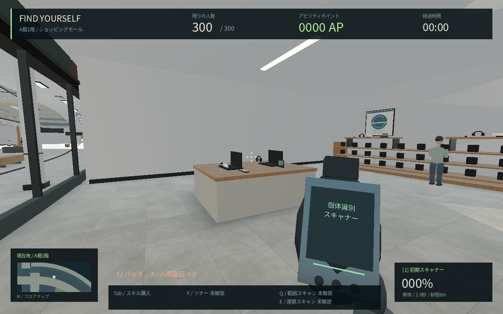 |
| 喫茶 | 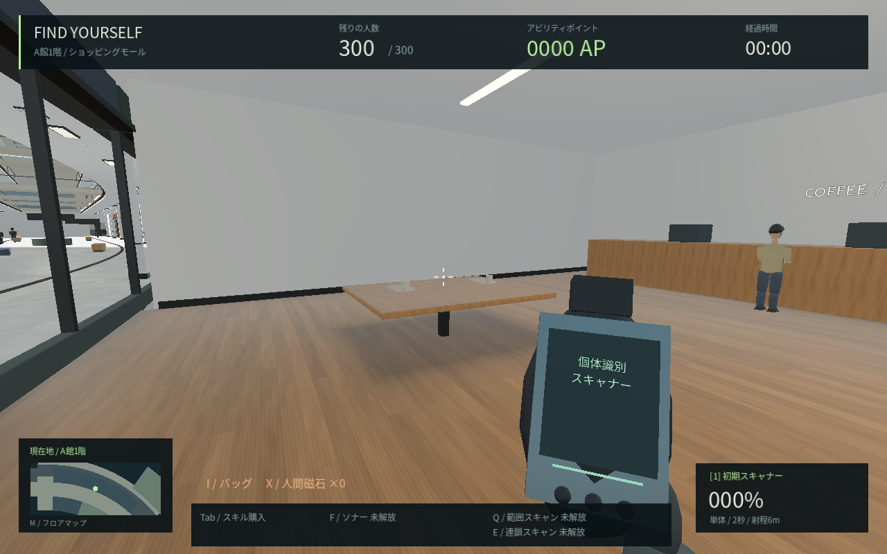 | 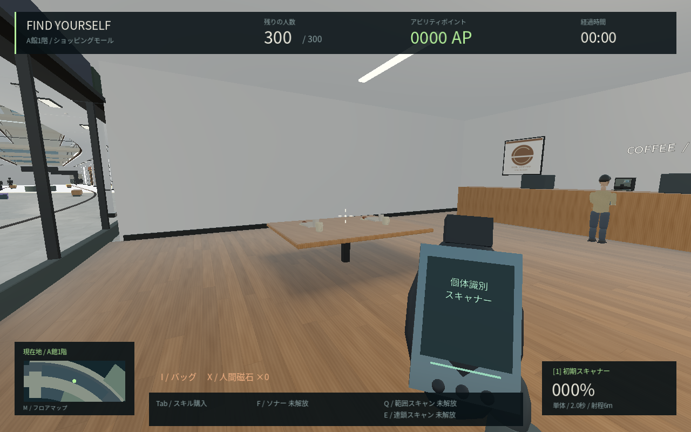 |
| B館の服飾 | 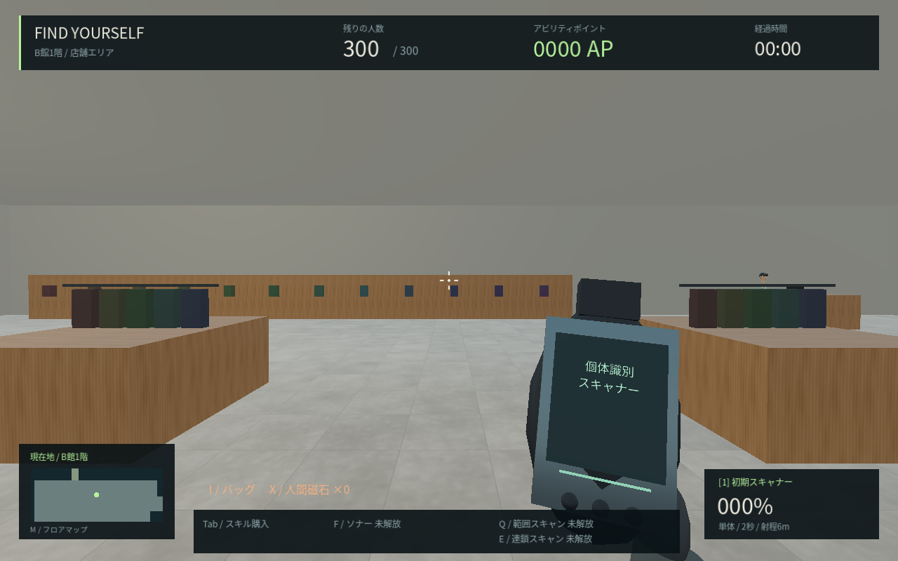 | 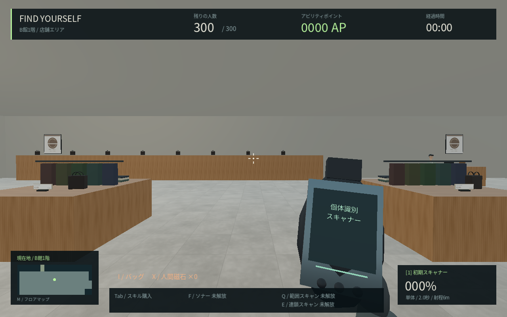 |
| C館の靴売場 | 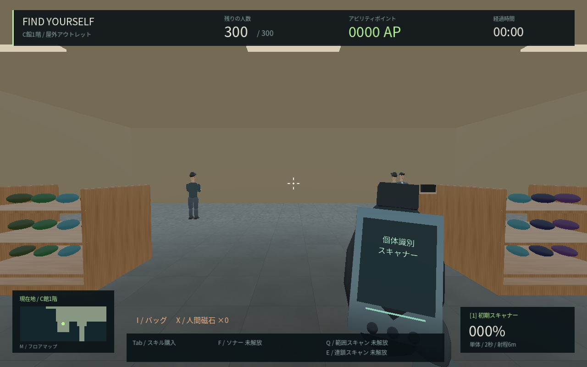 | 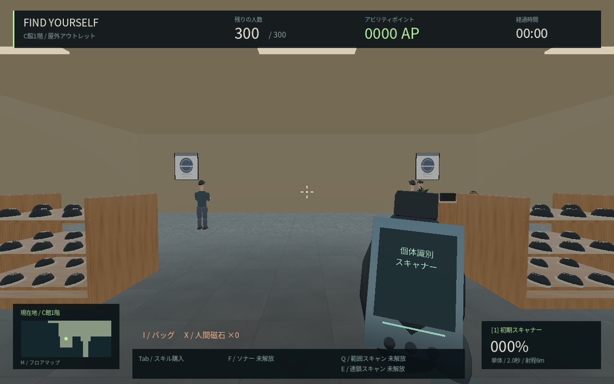 |

比較はGodot 4.6.3 Compatibility、Linux+Mesa llvmpipe、1280×800、300人、標準画質。同じカメラ・向き・描画時刻を使う。0.12はコミット251e8c0の保存ソース、0.13はLinux release export。画像の色・明るさは後補正していない。背景のNPC初期配置の完全一致は保証しない。撮影中は人物とプレイヤーの物理更新を停止する。撮影用引数は`-- --capture-stores`、旧版の比較は`tools/capture_stores.gd -- --before`。

小物は1店舗最大4材質にまとめ、標準40m・軽量28m・高画質55mで描画する。通常の建物の区画統合から分け、距離設定を保持する。形状・ポスター・値札はこのプロジェクトで作成し、写真や実在ブランドのモデルを使っていない。店舗の個別設計・全身モデル・照明・高品質反射などは制作途中で、写実品質の完成を示す画像ではない。

## 初期スキャナー高速化

Tabの「01 / 装備・スキャン銃」から購入。2→1.5→1→0.6秒、60/120/180 AP、銃の購入は不要。連続した単体スキャンと6mの射程、対象変更・ボタン解放・メニューによる取消、本物の最終判定は初期スキャナーだけ、というルールは維持。

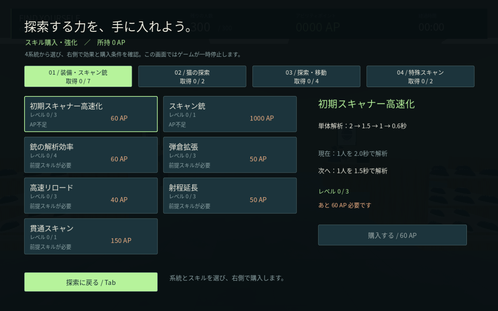

## 猫と照準

経路終点の数cm手前で止まり、判定範囲へ届かない条件を修正。プレイヤー自身によるレイの遮断も除外し、奥の壁・家具は再判定する。近い階とその場で届く固定客を優先し、HUDに相手の番号と解析の残り秒数を表示する。猫・銃・特殊アイテムは本物の通知のみで、クリアには初期スキャナーが必要。猫の接近後の時間は20→12→6秒の既存段階を維持する。

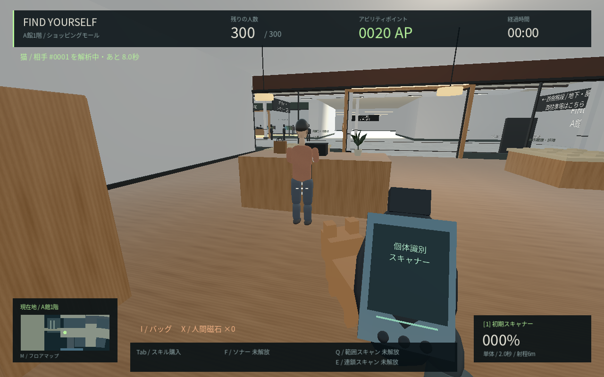

NPCの照準用カプセル半径を32→44cmへ拡張。壁より手前へ判定だけが飛び出す場合も、実際の身体への遮蔽を再確認し、壁越しのスキャンを防ぐ。

移動の一時的な重さについては経路計算の集中を分散する。Escには直近180フレームのFPSと最大フレーム時間を表示する。公開している[性能記録](PERFORMANCE.md)はクラウドのソフトウェア描画・CPU計測であり、Windows実機のFPSや断続的な重さの完全解消の保証ではない。
