# A館の拡張と上階の動線 — 開発版0.23

0.22でB館のエスカレーターを増やした後も、店舗前を吹き抜けの境界と手すりが横切る問題が残っていた。0.22の通常ゲームを使った歩行診断では、光・時の広場から最寄り店舗へ向かう4経路（各2/3階）で通行が止まった。旧テストは乗降口までを検査し、その先の店舗への歩行を検査していなかった。この版では乗降後の歩行も回帰検証へ含める。

## 建築と入口

- A館は同じ曲線平面の南北方向を約20%拡張。主通路の実空間の奥行きは16→19.2m、旧4m回廊は4.8m。A/B間は連続的に寸法を変える。描画・衝突・NPC・宝箱・案内図は共通の変換と逆変換を使う。
- A館の旧2本を更新し、中央吹き抜けと木もれびの広場に各4本、計8本。1↔2階と2↔3階の各上り/下りを持つ。中央の背面踊り場を延長し、東側回廊へ抜ける床と開口を作る。
- B館の主回廊は6.5→10m、背面回廊は10→14m、分岐の連絡路は8→12m、渡り廊下は5→8m。店舗前の約8mの帯と店内の床を先に保護し、残る部分から吹き抜けを切り抜く。出入口に吹き抜けの手すりを生成しない。
- B館の3広場・上下対12本を維持し、踊り場の奥行きを3→6mへ。狭い側面通路にだけ依存せず、広場側から回廊へ接続する。
- A/B館の専門店に、ガラスの2本の目印、入口の縦枠・床の切り替え・「入口 / OPEN」表示を追加。ガラスを両面表示し、薄すぎた着色を調整する。壁上端には床下まで重なる部材を入れ、見た目と衝突の両方で隙間を閉じる。

101店舗、1000人/300人、10/15フロア、20の訪問済み移動地点を維持。C館の平面と人物のモデルは今回変更していない。全館の仕上げ完了、15フロアや5,000人の完成という意味ではない。

## デバッグ開始

タイトルの **「デバッグ：スキャン系スキルを全解放」** をONにして開始する。初期スキャナー高速化・銃・銃の強化・連鎖・範囲・ソナーを最大段階で使える。通常開始は従来の購入順とAPを維持する。HUDにデバッグ開始であることを表示し、タイトルへ戻ってOFFにすれば通常の新規プレイへ戻せる。

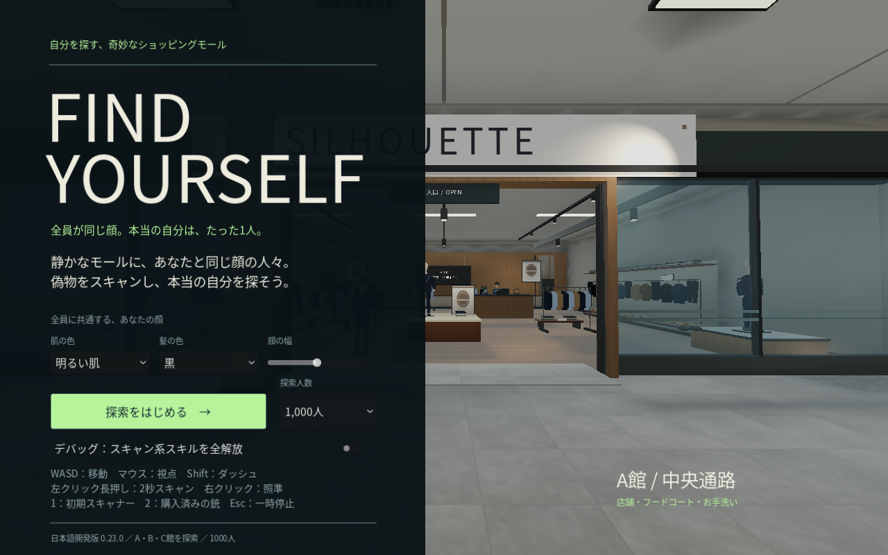

本物の抽選、APの所持数、NPC人数は変更しない。強化済みの特殊スキャンでも本物は位置通知のみで、初期スキャナーでの最終確認が必要。使える操作は既存のキー割当と同じ。

## 通常ゲームの比較画面

同じ論理座標・1000人・標準画質で撮影。HUD/手持ち道具を隠して人物の動きを停止し、屋根・材質・建築を撮影専用に置換していない。A館では寸法拡張に合わせてカメラ座標も共通変換を使う。Linux/Mesa llvmpipeであり、WindowsやRTX 4060 LaptopのFPS測定ではない。

|場所|0.22|0.23|
|---|---|---|
|A館・中央吹き抜け|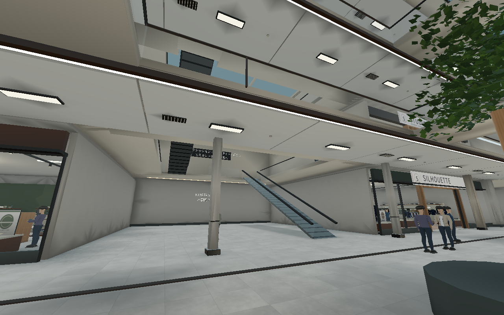|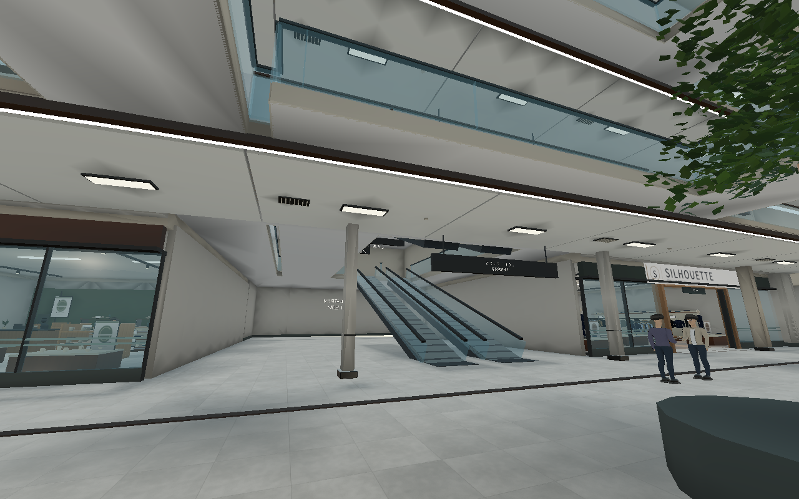|
|A館・木もれびの広場|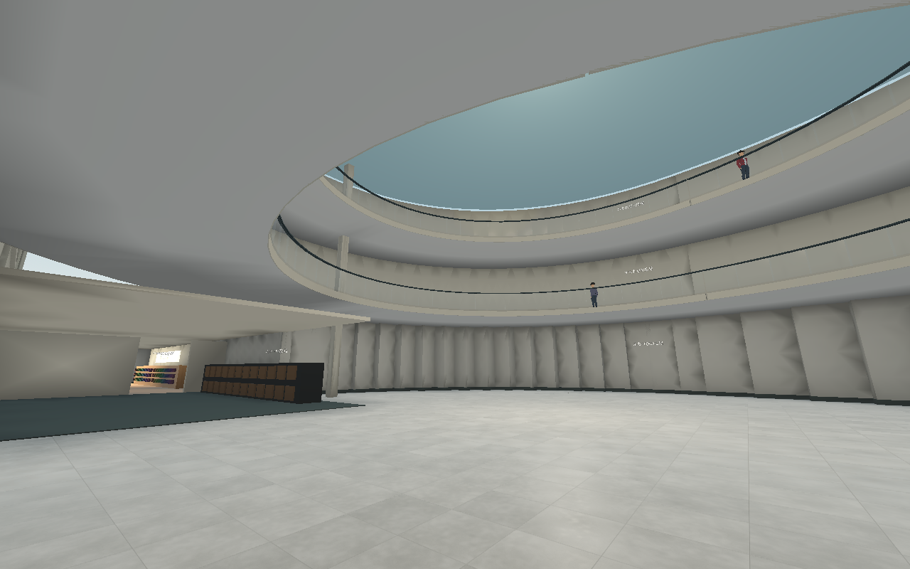|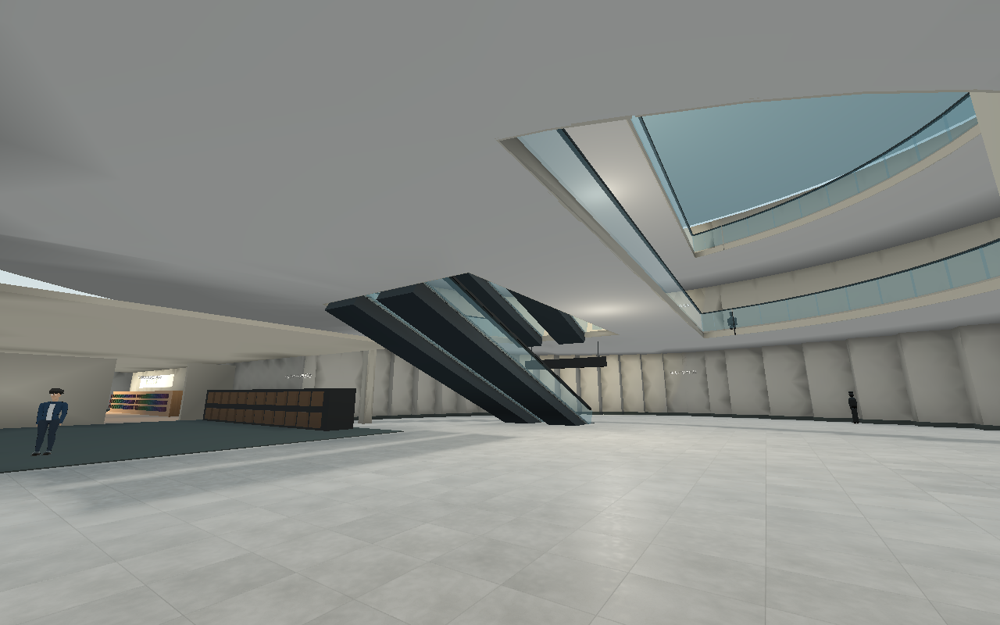|
|B館・2階の乗降口|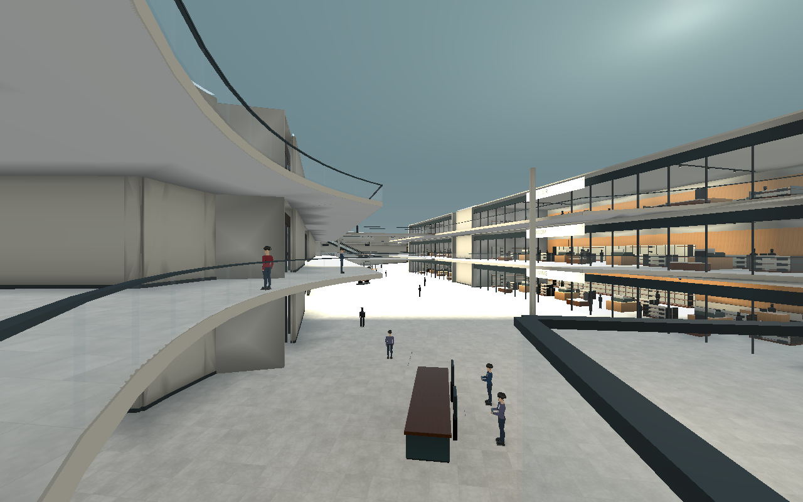|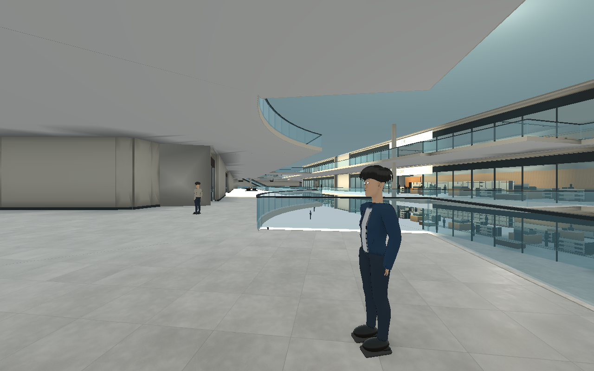|
|B館・3階の乗降口|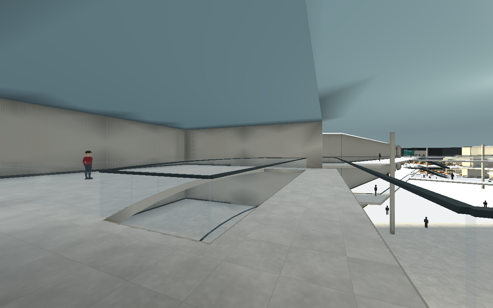|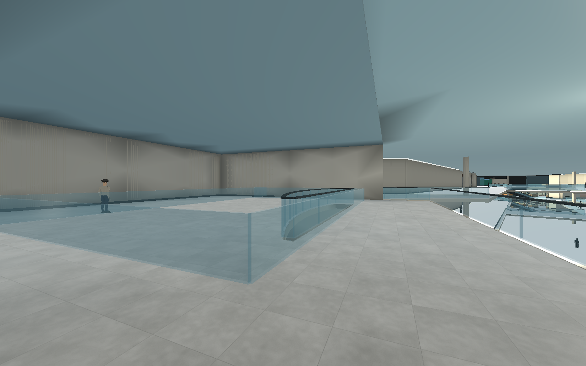|
|A館・店舗入口|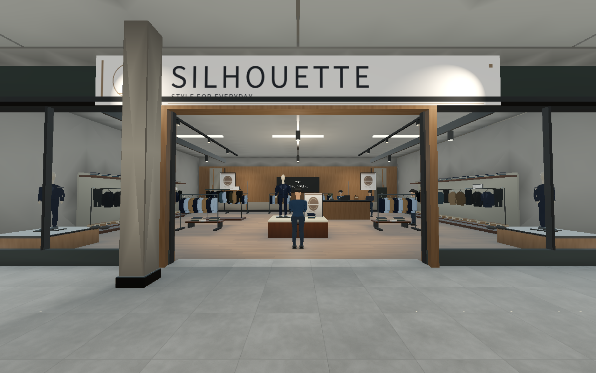|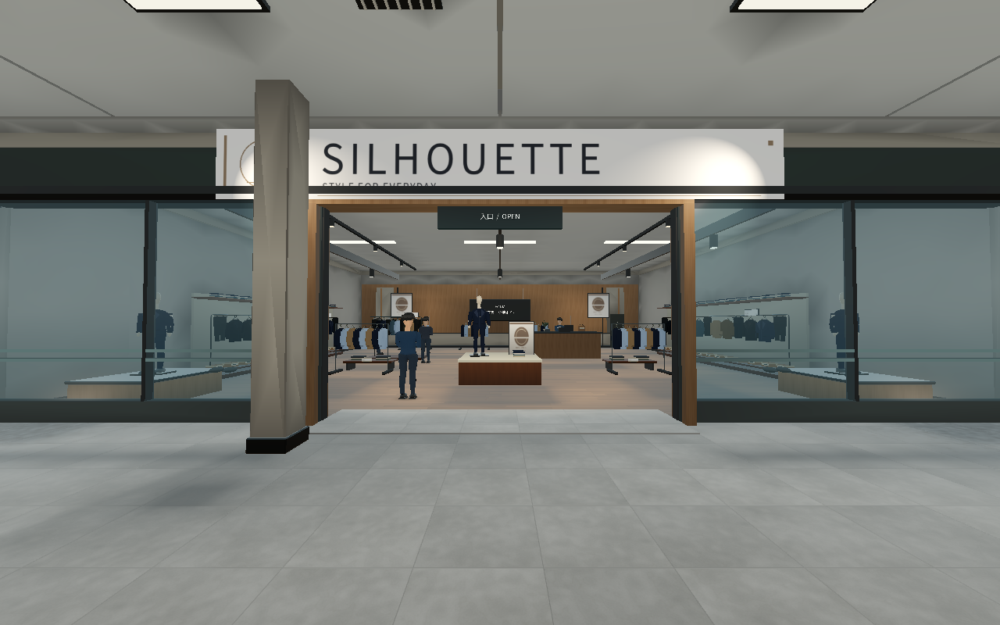|

床・開口・店舗・昇降口を共通定義から描いた平面図（ゲーム画面ではない）：

## 検証の範囲

`test_upper_access.gd` では全20本の実歩行、上りの到着地点から店舗前回廊への実歩行、B館上階の店舗入口と物理床、壁上端の封止、デバッグ開始/通常開始の切替、本物の最終確認を検査する。既存のNPC・猫・宝箱・訪問済み移動の検査も再実行し、実行結果を `upper-access-verification.json` に記録する。Windows実行と実機FPS、全店の内装品質、地下・屋上・他館を含む隅々の目視監査は別途必要。

`test_floor_integrity.gd` は、公開床の全ナビゲーションサンプルと水平接続の中点を物理レイで検査する。論理上は通れるのに実際の床がない接続を、目視だけに頼らず検出する。壁の全表面を自動監査する検査ではない。

A館の拡張後に2m間隔の経路点から猫の2.2m射程へ届かない席では、最後の最大0.9mだけ公開床・障害物・視線を確認して進む。射程やスキャン時間を延長せず、通常の猫スキャンを維持する。

物理レイが三角形の共有辺を厳密に通り数値誤差で外れる場合は、東西南北2.5cmの4点すべてで同じ高さの床があることを要求する。片側だけに床がある穴の縁を合格にはしない。

曲線上の通路スラブと店舗スラブは別々の分割幅を持つため、境界の弦が一致しない場合がある。各専門店の前面全幅に1.5m奥行きの連続した下地スラブを置き、両方の床へ重ねる。天端は主床から1.2cm下とし、描画の重なりを避けながら物理的な隙間も塞ぐ。

最終検証は29スイート・1,238項目。床の一括監査は47,275公開サンプルと294,575水平接続中点を対象にし、どちらも欠落0。全20本の実乗降と乗降後の回廊への歩行を含む。Linuxの実行ファイルで1000人の起動確認も行い、配布ZIPを新しい場所へ展開して再検証する。詳細な結果・条件は `upper-access-verification.json` と配布先の `VERIFICATION.json` に記録する。
