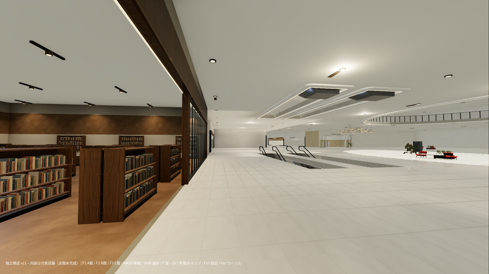
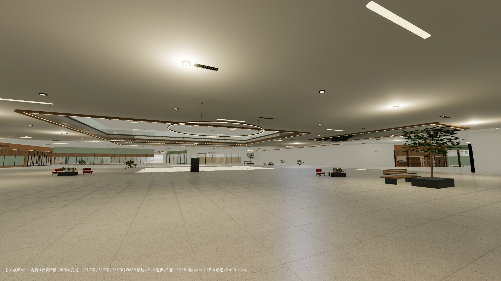
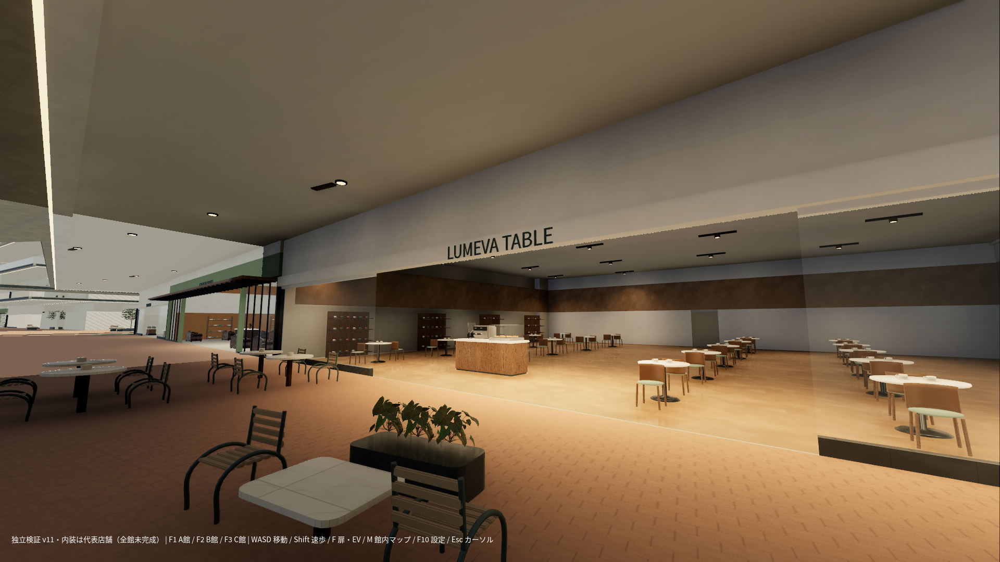

# FIND YOURSELF v11｜独立施設検証版

EVのシャフト・乗降口、ESの上昇時の高さ変動、店舗境界の残余と代表売場を修正しました。ゲーム本体への統合は行っていません。全15層・480店舗ID・主要な館間接続を維持しています。

全館内装・FF16級のグラフィック完成版として扱いません。未完成箇所も実画像と資料に残しています。

## ダウンロード

- [Godotプロジェクト一式・単一ZIP](../../downloads/FIND_YOURSELF-v11-Godot.zip?raw=true)
- [同一視点の実画面比較PDF](../../downloads/FIND_YOURSELF-v11-Visual-Review.pdf?raw=true)
- [図面・原寸PNG・台帳・検査記録・入力資料ZIP](../../downloads/FIND_YOURSELF-v11-Review.zip?raw=true)
- [SHA256](../../downloads/FIND_YOURSELF-v11-SHA256SUMS.txt?raw=true)

Godot ZIPだけを新しいフォルダへすべて展開し、Godot 4.6.3 Standardで `project.godot` をインポートしてF5で起動します。比較資料ZIPのコピー、Dataの追加ダウンロード、ファイル結合は不要です。Windows EXEは作成していません。

WASD移動、マウス視点、Shift速歩、Fで扉・EV、Mで館内マップ、F10設定。F1=A館、F2=B館、F3=C館の検証用地点です。初期1080p・144FPS上限・VSync ONを維持しています。

## 主な修正

- EVは連続シャフト壁、各階の引き分け扉と衝突、敷居、扉の再開放を実装。F呼出と、乗車後の行先選択を分離しました。
- ES斜面で通常階段用の補助が22cm持ち上げを反復する原因を修正。物理補間、機械外装、梳き板支持板を追加しました。
- A1F-003の細長い入口を広い既存売場面へ移動し、首部分をA1F-005へ配分。155の境界残余を隣接店舗へ組み込み、正式アクセス11領域を保護しました。
- 143店舗の壁・正面を再生成。代表8店舗は業種別陳列へ置換。A館中央は食品核店舗と確認し、入口側の売場を制作しました。
- 手すり金物を実際のガラス面から生成。C館の通常版・別案に共通する面だけに適用し、この仕上げ処理では衝突配列を変更していません。

## 確認と限界

15層480店の区画・共用床・売場・裏方の分割検査で残存不合格0。945指定経路、約700mのA→B→C連続移動、EV119、乗降口安全296、屋上104、手すり18、F/M操作などを自動検査しました。C館別案の348指定経路にはIDフィルター上で選ばれる他館のPUBLIC経路も含みます。

個別経路の検査では従業員扉を開いた条件を使用しています。人間が全店舗を実操作した検査ではありません。指定経路の合格を建築品質・実建築の構造安全の承認とは扱いません。

単一ZIPだけをキャッシュのないフォルダへ展開し、840ファイル照合、67外部画像参照、7地形データの展開ハッシュ、初回インポート、通常版とC館別案の起動を確認しています。

描画測定はLinux／llvmpipeのソフトウェアVulkan、CPU描画2スレッド、1080p、NPC 0人、各視点8フレームのみです。A=0.101、B=0.136、C=0.107FPS。この環境では60FPSに到達していません。Windows／RTX 4060のGPUは未測定で、60・144FPS達成を主張しません。

## 未完成・承認待ち

C館支持フレームとES移設は未施工案、RF-SUPPORT-16は未承認です。C館の設計手すり線と現3D床境界に差分があります。B1-008の陳列密度、食品核店舗全体の物流、天井の設備ピット、看板の納まり、C館別案の空の黒い表示も未完了です。全480店の詳細内装や人間による実歩行は未検証です。

詳細は [変更内容と残課題](変更内容と残課題.md)、[性能測定](性能測定.md)、比較ZIP内の設計・検査データを参照してください。

## 実Godot画面（代表部のみ）

A館1F：既存書店と広場。全館内装は未完成です。

B館1F：時の広場。広場の開放感を維持し、店舗境界・設備を修正しています。

C館1F：カフェ。C館の構造変更案は通常版に確定していません。

