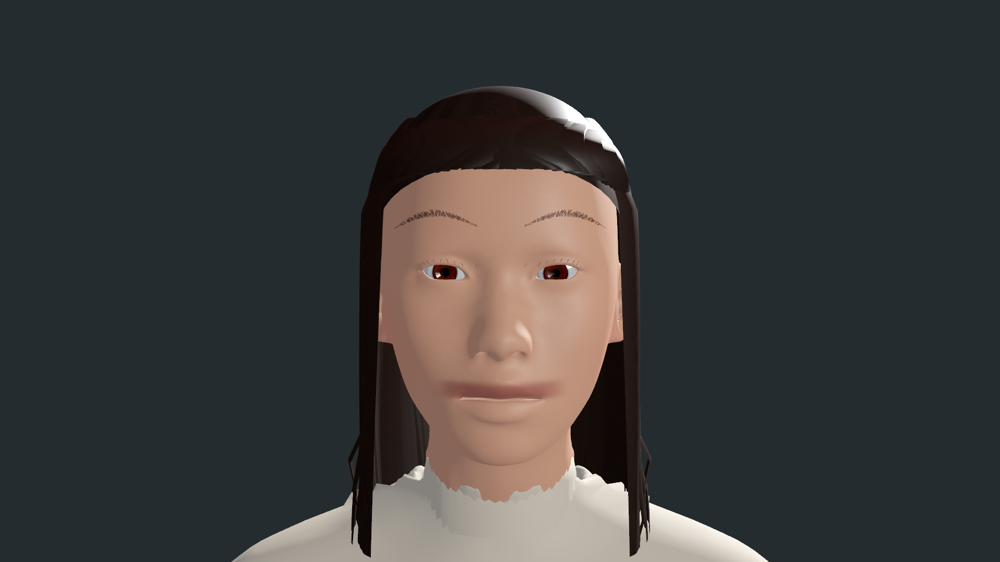
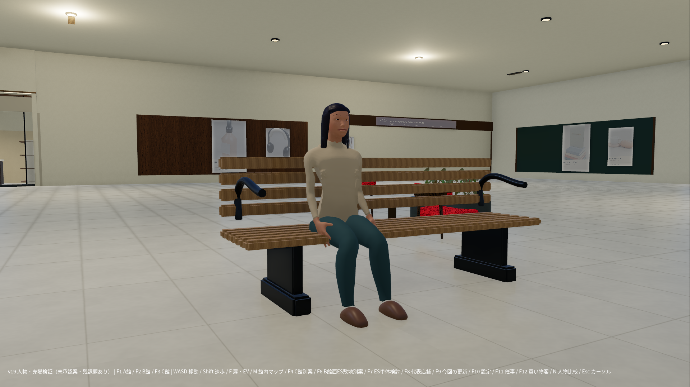

# FIND YOURSELF v19 独立検証版

女性基準モデル1人、43人の活動、代表9店舗と既存11休憩ユニットを部分改修しました。**人物の肌・髪・衣服、全館の景観は未完成です。FF16級や商用品質の達成とは判定していません。** ゲーム本体には統合していません。

- [Godotプロジェクト（完全・非分割ZIP）](../../downloads/FIND_YOURSELF-v19-Godot.zip)
- [画像・比較・検査・制作原本（Review ZIP）](../../downloads/FIND_YOURSELF-v19-Review.zip)
- [SHA256](../../downloads/SHA256SUMS-v19.txt)

Review ZIPを展開して `index.html` を開くと、55枚のGodot実画面と19視点のv18比較を確認できます。画像の違いが見えない視点は「維持・未改善」と明記しています。

Godot4.6.3でproject.godotを開き、インポート後F5。F9の末尾に人物と靴店。Nでv19の43人／元の43人／女性1人、F12で人物ON/OFF。人物専用確認はCharacter_Review_v19.tscnを開いて「現在のシーンを実行」。

## 女性基準モデル：制作途中

## 検証範囲

新規フォルダへの展開、1540ファイルSHA照合、初回インポート、通常・F4・F6・人物確認シーン起動をLinuxのGodot4.6.3で確認。通常945経路、ES163、EV119、店内45経路、43人90秒活動を自動検査。人間による操作検証とWindows GPU測定は未実施です。144FPSは設定上限のみです。

- [検査集計](data/check-summary.json)
- [15層の改修範囲](data/floor-scope.csv)
- [未完成・未承認事項](data/unfinished-and-unapproved.json)
- [素材・取得元・ライセンス](licenses/v19-PROVENANCE.json)
